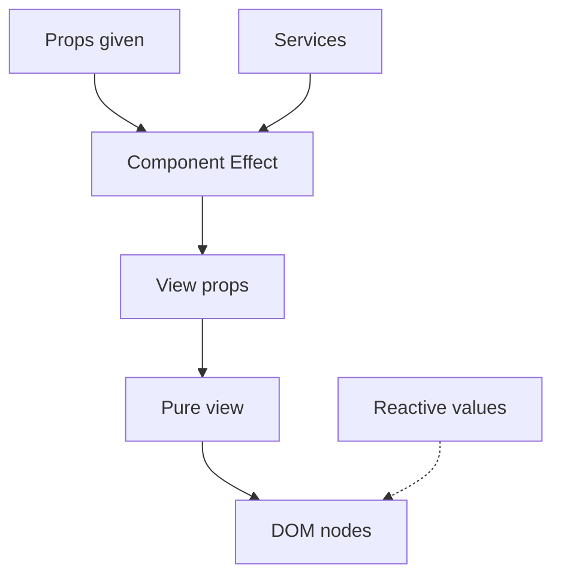
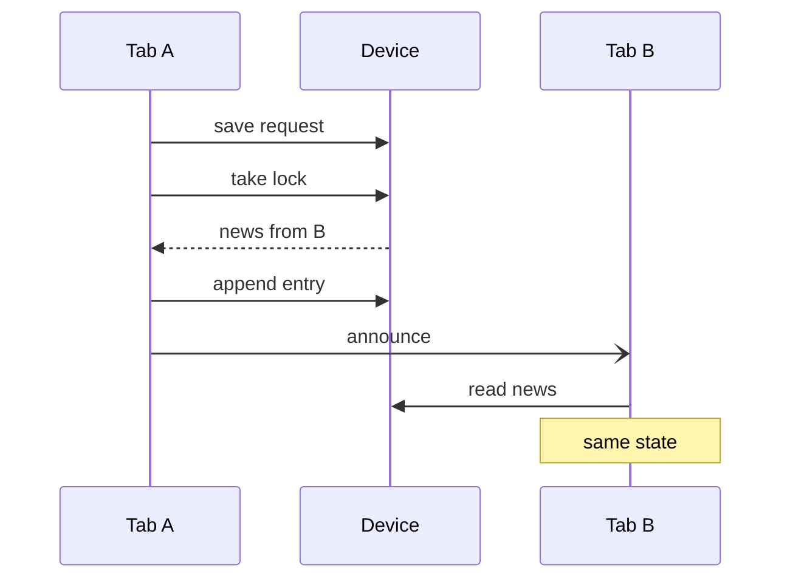
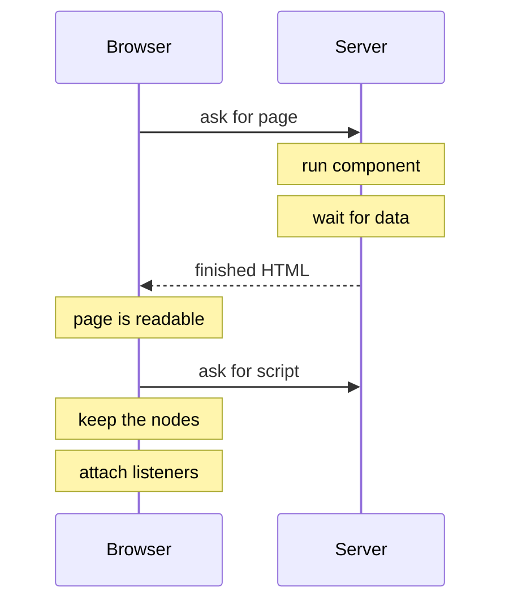

# Spar, for agents

This file is everything an agent needs to write a Spar app. It is put together by
`bun run llms` from this guide, the principles, the API reference, the recipes and the source of
the showcase app, so the examples are code that is built and tested, not sketches. When this file
and the code disagree, the code is right and this file is stale: run `bun run llms`.

## What Spar is

Spar is a UI framework for people who are all in on Effect. It is not general purpose and does
not try to be. A Spar app is an Effect program front to back: components are Effects, state lives
in Schema-described stores, the backend is an Effect RPC group, and one trace follows a click
from the page through the backend and back. The framework sees every state change and every
backend call, logs each one, and shows them in devtools that people use in the page and agents
use over MCP or from a shell.

If a thing can be done two ways, Spar picks one and refuses the other, at compile time or at
build time. Do not look for the escape hatch. There is not meant to be one.

## The shape of an app

```
src/
  api.ts            the RPC contract shared with the backend: groups, payloads, errors
  routes.ts         Router.route(path, Schema) values
  SomeStore.ts      Store.Tag: state Schema, actions, selectors
  Some.ts           components: an Effect that makes the props of a view
  SomeView.tsx      views: View.make(name, props Schema, draw). JSX lives only here
  main.ts           App.mount with the layers
  server/           what runs on the server, or stands in for it
server/             the backend's handlers
```

A component is always two things: a view (`.tsx`, pure, draws props) and an Effect (`.ts`, makes
those props from stores, UI state, routes and services). `View.connect(effect)(view)` joins them.
The view never runs an Effect and the Effect never writes markup.

## The one way to do each thing

| You want to                               | Do this                                                                                | Not this                                               |
| ----------------------------------------- | -------------------------------------------------------------------------------------- | ------------------------------------------------------ |
| Draw something                            | `View.make(name, { prop: Schema }, (props) => <jsx />)` in a `.tsx` file               | A plain function returning JSX                         |
| Give a view its props                     | `View.connect(() => Effect)` or `View.taking(outerProps, (outer) => Effect)`           | Passing services into a view                           |
| Hold state only the screen cares about    | `UiState.make(name, Schema, initial)` in the component's Effect                        | `Ref`, `SubscriptionRef`, `let`, a module variable     |
| Hold data the app cares about             | A `Store.Tag` with actions and selectors                                               | UI state seeded from a store, a service with a Ref     |
| Put a store where one component uses it   | `SomeStore.with(Component)`, then mount the result                                     | Wiring a layer at the root for a store one screen owns |
| Share a store across the app              | `SomeStore.layer()` in the layers given to `App.mount`                                 | A global                                               |
| Change app state                          | `store.commands.<action>(payload)`                                                     | Writing to state anywhere else                         |
| Change UI state                           | `UiState.set` or `UiState.update` in a handler                                         | Writing UI state from a command, a stream or a service |
| Read state in a view                      | A `Props.Reactive(Schema)` prop fed from `store.select.<name>` or the UI state itself  | Reading a store inside a view                          |
| Show a list                               | `Reactive.mapBy(key, RowView, props)` in the Effect, passed as a `Props.Element`       | `.map` inside JSX                                      |
| Show one thing or another                 | `Reactive.when` in the Effect, or `View.branch`                                        | A ternary inside JSX                                   |
| Mount a child that needs services         | `yield* View.child(Child, props)` in the Effect, passed as a `Props.Element`           | Writing a connected component as a JSX tag             |
| Call your backend                         | `Backend.rpc(Group, url)` and call the client                                          | `fetch`, axios, tRPC, a hand-rolled client             |
| Call someone else's HTTP API              | An Effect `HttpClient` call, or an HttpApi client, with `Backend.layer` provided       | `fetch`, `FetchHttpClient.layer`                       |
| Send something that must not be lost      | `Store.outbox(action, send)`: saved on the device, retried with an idempotency key     | Calling the server from a handler and hoping           |
| Do something after an action              | `Store.after(action, effect)`                                                          | An Effect inside a reducer                             |
| Handle a failure a component can have     | `View.recover(ErrorSchema, FallbackView)`                                              | `catchAll` that hides it; leaving it (compile error)   |
| Show something while a component loads    | `View.pending(LoadingView)`                                                            | A loading flag in UI state                             |
| Navigate                                  | `Router.route(path, Schema)`, `router.link(route, params)`, `router.go(route, params)` | `location.href`, string paths                          |
| Build a form                              | `Form.make(Schema, initial)`, `form.field(name)`, `form.submit` or `form.submitThen`   | UI state for each input plus hand validation           |
| Listen to the window or document          | `Events.onWindow`, `Events.onDocument` in the Effect                                   | `addEventListener`                                     |
| Focus or measure an element               | `Handle.make`, passed as a `Props.Handle`                                              | `document.querySelector`                               |
| Open a dialog, menu, popover or tooltip   | The ones in `@spar/ui`, or `View.portal` with `Overlay`                                | A positioned div                                       |
| Note something that happened, for the log | `Timeline.note(kind, name, detail)`                                                    | `console.log`                                          |
| Test a store                              | Provide its layer and call commands in `it.effect`                                     | Mounting a page to test a reducer                      |
| Test a component                          | `spar/testing`: `Testing.mount`, then find and click by role                           | Reaching into nodes by class name                      |

## What is refused, and why

Compile errors (the proofs are the files in `apps/demo/forbidden`, each of which must fail to
compile):

- A component from a plain function, a view without a Schema for its props, UI state, a store, a
  selector or route params without a Schema. Everything declared has a Schema so the devtools and
  agents can read it as data.
- A component whose Effect needs a service nobody provided, or can fail with an error nobody
  recovers, mounted anyway. Needs and failures are settled at mount.
- A backend error from the shared contract that the component does not handle.
- UI state made in a service, written from a command, a stream or a service listener, or seeded
  from a store. UI state belongs to one component and changes only in its handlers.
- A connected component written as a JSX tag, a service passed into a view, a modal outside a
  portal, `View.pending` placed before `View.recover`, a route mounted with the wrong page.

Build errors (the Vite plugin stops the build and names the file, line and rule):

- `views-need-a-schema`: JSX outside `View.make`.
- `jsx-only-in-views`: JSX inside an expression or a call, such as `.map` or a ternary in a hole.
- `no-effect-run-in-views`: `Effect.run*` in a view file.
- `state-only-through-spar`: `Ref.make`, `SubscriptionRef.make`, `SynchronizedRef.make`,
  `MutableRef.make`, `TxRef.make`, `let`, `var`. State the framework did not make is state the
  log cannot show and the devtools cannot rewind.
- `backend-only-through-spar`: `fetch`, `XMLHttpRequest`, `WebSocket`, `EventSource`,
  `sendBeacon`, `FetchHttpClient.layer`, and imports of axios, ky, got, superagent,
  graphql-request, openapi-fetch, `@trpc/client`, `@apollo/client`, socket.io-client. A call the
  framework did not make is a call missing from the trace.

The two `-through-spar` rules look at app source. They skip `node_modules`, tests, config files,
`scripts/` and any `server/` folder (server code is not page state).

House rules the linter holds everywhere: no loops, no mutation, no comments, no casts, `type`
not `interface`, no nested ifs.

## UI state and app state

UI state is what one component remembers about its own screen: a menu is open, what was typed,
which tab is showing. It is made with `UiState.make` in that component's Effect, lives in one tree
by component path, and goes away when the component unmounts. Nothing else can write it.

App state is what the app knows: the agents, the notes, the cart. It lives in a store. A store is
a Schema for the state, named actions with pure reducers, and named selectors. It changes only
through `store.commands.<action>(payload)`, and every command is an entry in the store's log.

A store does not have to be declared at the root. `SomeStore.with(Component)` makes one unit of a
store and the component that uses it. Mount that unit twice and there are two stores, each with
its own state, each registered in the same root registry the devtools read. So it is still model,
view, update: one registry, one log, every change an action. It only does not look like it,
because the store and its view sit in the same file.

## The backend

Declare the contract once, in a file both sides import:

```ts
export class Agents extends RpcGroup.make(
  Rpc.make("Start", {
    payload: { name: Schema.String, idempotencyKey: Schema.String },
    error: ServerUnreachable,
  }),
) {}
```

On the page, `Backend.rpc(Agents, url)` gives a typed client. Its calls are spans in the trace of
whatever caused them, the trace context travels to the backend in the request, and the backend's
spans join the same trace. Provide `Backend.layer` once, where the app is mounted.

## Devtools

`sparDevtools({ backends })` from `spar/devtools/vite` adds the tools on the dev server only. In
the page they give the inspector, the one log with rewind, step and fork, the trace waterfall
across page and backend, and the stores with their outbox. No collector has to run to see a
trace.

An agent gets the same over MCP (`bun run --filter @spar/devtools-mcp start`, then connect to
`http://127.0.0.1:4188/mcp`) or from a shell
(`bun run --filter @spar/devtools-mcp cli call <tool> '<json>'`). A useful loop when debugging:

1. `get_timeline` to see what happened, in order.
2. `step` with `by: -1` to walk back; each answer has the moment and the spans it caused.
3. `diff_states` to see what an action changed in a store.
4. `fork`, then `run_action` or `set_ui_state` to try something else from that point.
5. `switch_branch` with `branch: 0` to return to what really happened.

## Working in this repo

- `bun run showcase` starts the showcase app, its backend and the devtools.
- `bun run check` is everything that must pass: format, lint, types, tests with 100% coverage,
  the forbidden-code proofs, the production build check.
- `bun run bench` reruns the benchmarks and rewrites `docs/benchmarks.md` and
  `docs/benchmarks.html`.
- Browser suites are moon tasks: `bun run moon run sidebar:features sidebar:walkthrough
  sidebar:devtools sidebar:traced demo:browser stories:play ssr:browser --concurrency 1`.
- Only run tools through package scripts or moon tasks.


# Principles

Each principle says what it is and what it rules out. Rules are enforced by types or by Spar's own
JSX build step, never by a lint rule, and each has a file under `apps/demo/forbidden` that must fail
to compile.

How one component is put together: its Effect runs once with the props it was given and the
services it asks for, and hands plain props to a pure view. After that, only reactive values
touch the page.



### 1. Set up once, bind at the leaf

A view function runs one time and builds real DOM nodes. A reactive value placed in the markup is
bound to exactly one text node or attribute, and only that node is written when the value changes.
There is no virtual DOM and nothing re-renders. A store command updates the screen before it
returns.

Rules out: stale closures, dependency arrays, memoization, and every bug that comes from a
component function running again.

### 2. A component is a pure view plus one Effect that makes its props

`View.connect(() => Effect<Props, E, R>)(View)`, with the view last, or
`View.taking(fields, (outerProps) => Effect<Props, E, R>)(View)` when the parent gives it props. The
view is made with `View.make(name, fields, draw)`: a function from props to an element that cannot
reach a service. Both kinds of props are declared with a Schema for each one, and the build rejects a
view written as a plain function. The Effect is ordinary Effect code. It
runs once when the component mounts, in the component's own scope, and everything it started is
cancelled when the component unmounts. Every component keeps its pure view as `.view`, so a test or
a story can render it with sample props. `connect` rejects props the view does not take.

Rules out: hook ordering rules, effects that run again, leaked subscriptions and timers, views that
fetch, and services smuggled into a view.

### 3. Errors and layers are part of a component's type and are settled at mount

`Component<Props, E, R>` carries what can fail and what it needs, the same way an Effect does.
`App.mount` only accepts a component with no errors left and a layer that provides everything it
needs.

Rules out: a load failure nobody handles and a missing provider. Both are compile errors.

### 4. Children with needs are placed by the Effect, not by JSX

TypeScript gives every JSX expression the same type, so a connected component used as a tag would
silently lose its errors and layers. A connected component is therefore not a function and cannot be
a tag. The parent's Effect mounts it with `View.child`, `Reactive.mapBy`, `Reactive.when` or
`Router.outlet` and hands the view a finished element. Only pure views are JSX tags.

Rules out: requirements and errors that disappear somewhere in the middle of the tree.

### 5. Composition is plain functions

`recover`, `pending`, `crash`, `mapProps`, `branch` and `portal` each take a component and return a
component, combined with `pipe` or `flow`. `recover` removes the error it handles from the type.
`pending` only accepts a component with no errors left, because a placeholder would hide a failure
that arrives later. `portal` supplies the overlay layer that `Overlay.modal` needs, so modal
behaviour outside a portal does not compile.

Rules out: class components, a context API, lifecycle hooks and wrapper hierarchies.

### 6. UI state and app state are different types

`UiState.make(name, schema, initial)` only works inside a component's Effect. It can be read anywhere it is
passed, but it can only be changed by a `UiState.set` or `UiState.update` value, and the only thing
that runs those is a DOM event handler (including `Events.onDocument` and `Events.onWindow`, which
also only work inside a component). Its Schema describes the value for the devtools and for
restoring it; the state itself is a live handle, not data, so it cannot be a command payload. Form input
is UI state inside `Form`. App state lives in stores and nowhere else.

Rules out: local state kept in sync with a store, UI state created in a service, UI state sent to
the server or saved.

### 7. App state changes only through named commands, and every one is logged

A store is a Schema for its state, an initial state, pure actions `(state, payload) => state` with a
Schema for each payload, and named selectors with a Schema for what each gives. None of the three
can be declared without its Schema. Commands return an Effect. The state is always computed from the
encoded payload that went into the log, so replaying the log gives the same state. Every store can
show any earlier state (`travelTo`), which is what the devtools use.

Rules out: state changed from anywhere, actions that cannot be saved or replayed, and a log that
drifts from the state.

### 8. Nothing the user did is lost

A durable store writes each action to the device before the state changes and comes back after a
reload. Anything leaving the device goes through the outbox: saved first, sent in order with one
idempotency key, retried, held while offline, sent by one tab at a time, and set aside with its
reason if it can never be sent.

Rules out: effects inside reducers, a sent item that is lost on reload, a retry the server sees as a
second send, and two tabs sending the same thing.

### 9. Lists, conditionals and pages are functions over reactive values

`Reactive.mapBy(key, Component, toProps)` keeps one mounted row per key and moves, adds and removes
rows as the list changes. `Reactive.when(Component, props)` mounts a component while a condition
holds. `Router.outlet` mounts the page for the current URL. None takes a function that returns JSX,
and JSX cannot appear inside an expression in other JSX.

Rules out: unkeyed lists, rows rebuilt on every change, inline ternaries and maps in markup, render
props, and a route whose page does not take that route's params.

### 10. A part that breaks does not take the page with it

`View.crash(Fallback)` shows a fallback for a part whose Effect dies. An event handler, a reactive
binding or a background load that dies is reported to `App.CrashReporter` and the rest keeps
working.

Rules out: a blank page, and failures nobody hears about.

### 11. The compiler and the build enforce the rules

Every rule above is a type error, or a failure of the JSX build step for the two things types cannot
see (JSX inside an expression, and `Effect.run` in a view file). A rule that neither can check is
left out instead of being written down as a convention.

Rules out: rules that hold only while everyone remembers them.

### 12. One way to do each thing

The surface is these modules: View, Reactive, UiState, Store, Outbox, Events, Handle, Form, Router,
Overlay, Devtools, App, and `spar/testing`. Timers are Effect's schedules and websockets are
`effect/socket`; Spar adds no wrapper for what Effect already ships.

Rules out: two styles of the same app in one codebase.

### 13. Everything declared has a Schema

Nothing that is data can be declared with a TypeScript type alone. Each of these takes a Schema, and
the plain form does not compile or does not build:

- a view's props (`View.make(name, fields, draw)`; a function that just returns JSX is rejected by
  the build), and a component's outer props (`View.taking(fields, props)`);
- UI state (`UiState.make(name, schema, initial)`);
- a store's state, each command's payload and each selector's output;
- a route's params, whenever its path has any, and the Schema must name every one of them;
- an error a component recovers from (`View.recover(ErrorSchema, ErrorView)`).

What is not data has a Schema of its own kind, checked by what it is: reactive values and UI state
carry the Schema of their value, and actions, handlers, callbacks, elements, handles, links, form
fields and placements each have one. Reactive values themselves are plumbing between these points
and take no Schema of their own: wherever one is shown, kept or passed it crosses one of the
declarations above. DOM events are not data either; a handler prop names the event it takes.

The Schemas are what the devtools read: a component's props and UI state can be shown as plain
values, restored, and sent to an agent, without any of it being written twice.

Rules out: props, state and params that exist only as types, which nothing at run time can read,
check, show or restore.

### 14. One application, front to back

A click and everything it causes are one trace: the event, the command, what the outbox sends
(now or after a restart), the components that mount because of it, the call to the backend and the
backend's own work. The backend is reached through a shared Effect RPC contract, so its failures
are part of the calling component's type and an unhandled one is a compile error. The same
component runs on a server and in the browser; the layers it is given decide where its data comes
from, and the render and the takeover are one trace too.

Rules out: a front end and a back end that only meet in a network tab, failures that surface as
an unknown error, and directives that say where code runs.

### 15. What the app is doing can always be read

In development the tools are there without being asked for, and a production build has none of
their code. A person picks a component on the page and reads its data where it lives; an agent
asks the same over MCP. Both see one log of everything that happened, can show the app as it was
at any moment, and can open any moment as one trace across the page and the backend.

Rules out: debugging by guessing what state a component is in, and devtools that only work with a
browser extension or only for people.

### 16. State is declared where it is used and registered in one place

UI state and stores are made only through Spar: `UiState.make` in a component's Effect, and a
`Store.Tag` placed app-wide with `.layer` or beside a view with `.with`. Wherever one is declared,
making it registers it in the one registry the devtools read, and every change to it is an entry
in the one log. So a component can own app state, be reused, and compose with others without the
app root knowing about it, and it is still model, view, update underneath. The build refuses
state held any other way.

### 17. One way to the backend

Every backend call goes through `Backend`. Effect RPC is the way to talk to a backend you own;
HttpApi and JSON clients plug into the same client; everything that would go around it is refused
by the build. A call the framework cannot see is a call missing from the trace.

### 18. The past can be walked and branched

Any moment in the log can be shown again, stepped through with the trace each step caused, and
forked: the program carries on from there while the original is kept. People do it in the tools
and agents do it over MCP or from a shell.

### Where this differs from the first brief

- `recover` takes one tag at a time. Looking up a handler by tag in a record cannot be typed without
  a cast.
- There is no `selectKeys`. Key selectors are ordinary selectors.
- A reducer names its state type: `Store.action(Schema, (state: State, payload) => ...)`.
- Two things types cannot catch were dropped: seeding UI state from a one-off read of a store, and
  an aliased `Effect.run` in a view file.
- Refs are `Handle` values, not an enhancer, because the component's Effect has to hold the handle
  to act on it.
- A span per component is automatic (named after the view), so there is no `withSpan`.
- Two internal modules are allowed to mutate, each behind a pure-looking interface: `internal/dom.ts`
  (all DOM writes) and `internal/cell.ts` (the value cell under reactive values, added after the
  benchmark showed a stream and a fiber per binding cost 10 seconds for 10,000 rows). The reactive
  values in `internal/reactive.ts` are small classes for the same reason: one object per value
  instead of an object, two effects and three closures, which with one list of things to stop per
  row took 10,000 rows from 61 MB to 19 MB. The lint rule lets a constructor set its own fields
  and nothing else.


# API reference

Everything is imported from `spar` unless a line says otherwise. Each section names a file in this
repo where the API is used and type-checked.

### View

| Function                               | What it does                                                                                                               |
| -------------------------------------- | -------------------------------------------------------------------------------------------------------------------------- |
| `View.make(name, fields, draw)`        | Makes a view: `fields` gives a Schema for each prop, `draw` turns the props into JSX.                                      |
| `View.connect(props)(View)`            | Makes a component: `props` is `() => Effect<Props, E, R>`, run once on mount.                                              |
| `View.taking(fields, props)(View)`     | The same for a component its parent gives props to: `fields` is their Schema, `props` is `(outer) => Effect<Props, E, R>`. |
| `View.child(component, props)`         | Mounts a child from a parent's Effect and gives back its element.                                                          |
| `View.recover(ErrorSchema, ErrorView)` | Handles one tagged error with a view and removes it from the type.                                                         |
| `View.pending(PlaceholderView)`        | Shows a placeholder until the component's Effect finishes. Needs errors handled first.                                     |
| `View.crash(FallbackView)`             | Shows a fallback if the component's Effect dies, and reports it.                                                           |
| `View.mapProps(f)`                     | Changes the props a component takes.                                                                                       |
| `View.branch(test, Other)`             | Mounts `Other` instead when `test(props)` holds.                                                                           |
| `View.portal`                          | Mounts the component in a layer above the app.                                                                             |

```ts
export const AgentPage = pipe(
  View.taking({ id: Schema.String }, agentProps)(AgentPageView),
  View.recover(AgentNotFound, AgentMissingView),
  View.pending(AgentLoadingView),
)
```

(`apps/sidebar/src/AgentPage.ts`)

### Props

A view's props are declared as a record of Schemas. Plain data uses `Schema` as it is; what is
not data has a Schema of its own kind:

| Schema                                                           | A prop that is                                       |
| ---------------------------------------------------------------- | ---------------------------------------------------- |
| `Props.Reactive(schema)`                                         | a reactive value of that type                        |
| `Props.State(schema)`                                            | UI state the view may also set                       |
| `Props.Action`                                                   | something to run from a handler                      |
| `Props.Handler("keydown")`, `Props.Handler("input", "textarea")` | a handler for that event, on that element when named |
| `Props.Callback(schema)`                                         | a function from a value to an action                 |
| `Props.Element`, `Props.Handle`                                  | an element to place, a handle to an element          |
| `Form.Field(schema)`, `Router.Link`, `Overlay.Placement`         | a form field, a link, where an overlay sits          |

`Props.kind(guard, show)` makes one for a type of your own. `Props.allShown(fields, props)` gives a
view's props as plain values, which is what the inspector and the MCP tools read.

### Reactive

A `Reactive<A>` is a value that changes: `get` reads it and `changes` is a stream that starts with
the current value.

| Function                                                                                      | What it does                                                          |
| --------------------------------------------------------------------------------------------- | --------------------------------------------------------------------- |
| `Reactive.map(reactive, f)`                                                                   | A derived value.                                                      |
| `Reactive.zip(a, b)`                                                                          | Both values as a pair (an Effect, scoped to the component).           |
| `Reactive.mapBy(key, Component, toProps)`                                                     | A keyed list. `toProps(item, key)` gets each row's own reactive item. |
| `Reactive.when(Component, props)`                                                             | Mounts a component while a boolean is true.                           |
| `Reactive.fromStream(initial, stream)`                                                        | Any stream as a reactive value, owned by the scope.                   |
| `Reactive.fromSubscriptionRef(ref)`, `Reactive.succeed(value)`, `Reactive.make(get, changes)` | Other ways to make one.                                               |

```ts
const rows =
  yield *
  pipe(
    Reactive.map(props.section, (section) => section.rows),
    Reactive.mapBy(
      (agent: Agent) => agent.id,
      AgentRow,
      (agent, id) => ({ agent, id, editing: props.editing }),
    ),
  )
```

(`apps/sidebar/src/Sidebar.ts`)

### UiState

`UiState.make(name, schema, initial)` in a component's Effect; `UiState.set(state, value)` and
`UiState.update(state, f)` as event handlers. A `UiState` is also a `Reactive`.

Every piece is kept in one tree, under its component's place: the names of the views from the root
down, with a row's key in brackets (`Board / Note[a]`), and a number when two share a place
(`Panel#2`). It is there while the component is mounted and gone when it leaves.
`UiState.snapshot` reads the whole tree as plain JSON (each value encoded by its Schema),
`UiState.changes` is the stream of what was added, set and removed, `UiState.put(path, name, value)`
sets one piece from outside (refused when the value does not fit the Schema), and
`UiState.restore(snapshot)` puts a whole snapshot back, keeping values for components that are not
on screen until they mount. Give an app its own tree with
`Layer.succeed(UiState.Tree, UiState.makeTree())`; a server render always has its own.

```tsx
<button onClick={UiState.update(open, (shown) => !shown)}>Options</button>
```

### Store

| Function                                                              | What it does                                                                                                           |
| --------------------------------------------------------------------- | ---------------------------------------------------------------------------------------------------------------------- |
| `Store.Tag<Self>()(key, { state, initialState, actions, selectors })` | Defines a store as a service class.                                                                                    |
| `Store.selector(Schema, select)`                                      | One named reading of the state, with a Schema for what it gives. A plain function is a compile error.                  |
| `Store.action(Schema, reduce)`                                        | One action: a payload Schema and a pure reducer.                                                                       |
| `Self.layer(reactions?)`                                              | The store in memory, for the whole app: provide it where the app is mounted.                                           |
| `Self.with(component, reactions?)`                                    | The store beside one component: mounting the result makes the store, and each place it is mounted has its own.         |
| `Self.layerDurable({ compactAfter? }, reactions?)`                    | The store kept on the device (needs a `KeyValueStore`). Fails with `Store.Unreadable` if saved data no longer decodes. |
| `Store.after(action, effect)`                                         | Runs an Effect after an action.                                                                                        |
| `Store.outbox(action, send)`                                          | Sends the action's payload through the outbox.                                                                         |
| `Store.replay(definition, entries)`                                   | Rebuilds state from a log.                                                                                             |

A store service has `state`, `log`, `select.<name>`, `commands.<name>(payload)`, `viewing` and
`travelTo(seq | null)`.

(`apps/sidebar/src/BoardStore.ts`)

#### A store beside its view

```ts
export class NotesStore extends Store.Tag<NotesStore>()("sidebar/Notes", { ... }) {}

const NotesPanel = View.taking({ id: Schema.String, title: Schema.String }, ...)(NotesView)

export const Notes = NotesStore.with(NotesPanel)
```

`Notes` is one unit: mount it anywhere with `View.child(Notes, props)` and nothing is wired at the
app root. The store is made when the unit mounts and closed when it unmounts. Its key is the
store's key and the place it is mounted (`sidebar/Notes @ ShellView / NotesView`), a second one
beside it is numbered (`... NotesView#2`), and it registers with the devtools like every other
store, so its actions are in the one log and it rewinds and forks with the rest. Underneath it is
the same model, view, update as an app-wide store: one definition, pure reducers, every change an
action. (`apps/sidebar/src/Notes.ts`)

The build refuses any other way to hold state in app code (rule `state-only-through-spar`):
`Ref.make`, `SubscriptionRef.make` and their relatives, `let` and `var`. Code under a `server/`
folder is not page state and is left alone.

#### Several tabs



Provide `Tabs.layerBrowser` in a browser and a durable store is one store across every open tab.
A command takes a cross-tab lock, first applies whatever other tabs have recorded since, then
records its own entry, so two tabs never write the same slot and a reducer always sees the latest
state. Idle tabs hear about new entries and follow. A tab that fell behind a fold of old entries
starts again from the saved state. Each command is written to the device before the lock is taken, so
one made just before a reload or a close is carried out by the next tab to open (and reported as
`Store.Abandoned` if that version no longer has the action). Without the layer a store behaves as if
it were the only tab.

### Outbox

`Outbox.Outbox.layer` (or `layerWith({ maxAttempts, attemptTimeout })`) needs a `KeyValueStore`.
Provide `Outbox.layerBrowser` in a browser: it follows the connection, lets one tab send, and tells
other tabs when something was added. The service has `pending`, `dead`, `retry(key)` and
`discard(key)`.

### Events

| Function                                                             | What it does                                                             |
| -------------------------------------------------------------------- | ------------------------------------------------------------------------ |
| `Events.onDocument(type, handler)`, `Events.onWindow(type, handler)` | A typed handler outside one element, in a component's scope.             |
| `Events.fromDocument(type)`, `Events.fromWindow(type)`               | The same events as streams.                                              |
| `Events.prevent(handler)`, `Events.stop(handler)`                    | A handler that prevents the default or stops propagation, synchronously. |
| `Events.online`, `Events.visible`, `Events.mediaQuery(query)`        | Reactive values for the connection, tab visibility and a media query.    |

Event props are `on` plus the DOM event name capitalised: `onClick`, `onKeydown`, `onPointerdown`.

### Handle

`Handle.make` in a component's Effect, `ref={handle}` on an element, then `Handle.focus(handle)`,
`Handle.scrollIntoView(handle)` or `Handle.measure(handle)`.

### Form

```ts
const form = yield * Form.make(Named, { name: "" })

return {
  field: form.field("name"),
  busy: form.submitting,
  onSubmit: form.submit(({ name }) => store.commands.spaceAdded({ name })),
}
```

`Form.text(field)` and `Form.checkbox(field)` are the props to spread on an input. A field's problem
shows once the field has been left or a submit was tried. Fail the submit Effect with
`new Form.Rejected({ message, fields })` to put a server's messages on their fields.
`form.submitThen(onValid, onDone)` also runs an action (closing a dialog, clearing the form) once
the submit has worked, and not when the input was invalid or the server refused it.

(`apps/sidebar/src/Sidebar.ts`, `packages/spar/test/form.test.ts`)

### Router

```ts
export const home = Router.route("/")
export const agentRoute = Router.route("/agents/:id", Schema.Struct({ id: Schema.String }))

page: yield *
  Router.outlet({
    routes: [Router.on(home, EmptyPageView), Router.on(agentRoute, AgentPage)],
    otherwise: MissingPageView,
  })
```

`Router.route(path, Schema)` decodes path and query params with a Schema. A path with `:params` cannot be declared without one, and the Schema must have every param the path names. A path ending in `/*` is a
layout that stays mounted while inner pages change. The service has `location`, `go(route, params)`,
`replace`, `back` and `link(route, params)`. `Router.focusOnChange(handle)` moves focus after a
navigation. `Router.live(route, Page)` keeps the page mounted while only the query changes and
gives it `params` as a reactive value, where `Router.on` mounts a fresh page for every change. In
a browser, a new page starts at the top and going back or forward puts the page where it was
scrolled to, waiting for late content for up to two seconds. `Router.focusOnChange(handle)` moves
focus to the page on every navigation; after a link it lets the browser bring the page into view,
and after back or forward it leaves the scroll position alone. Layers: `Router.Router.layerBrowser` and `Router.Router.layerMemory(url)`.

(`apps/sidebar/src/Shell.ts`, `packages/spar/test/router.test.ts`)

### Overlay

Inside a component wrapped in `View.portal`: `Overlay.modal({ onDismiss, initialFocus? })` makes
everything beneath inert, locks scrolling, keeps Tab inside, dismisses on Escape and returns focus;
`Overlay.dismissable({ onDismiss, anchor? })` is for menus; `Overlay.position(anchor)` gives styles
that place the layer by its anchor: below it or above, whichever has more room, from the left edge
or the right, never past the edge of the window, and no taller than the room there is.

### On a server



`Server.render(Component, { layer })` runs the same component on a server and gives its HTML
and the state it drew from: each store's state encoded by its Schema, the UI state tree, and the
trace of the render. `Server.renderToString` gives only the HTML. Loading parts (`View.pending`)
are waited for, so the page arrives complete; overlays are left out; `Events` values take their
resting values (online, visible, no media query matching) and window listeners are not attached.

There are no directives. The component is the same in both places, and the layers it is given
decide where its data comes from. On the server a store starts from data loaded there,
`Self.layerFrom(load)`, and a service reads the database directly. In the browser the same store
is `Self.layer()`, which starts from the state the server sent, and the same service asks over
the network.

`Server.renderToStream(Component, { layer, open, close, end })` sends the document in parts:
`open` at once, before anything is drawn, then the page, `close`, the state as a
`<script type="application/json" id="spar-state">`, and `end`. `Server.stateScript(state)` is that
script on its own.

In the browser, `App.hydrate(Component, { target, layer })` takes the page over instead of
building it again: it keeps the server's nodes, attaches listeners and bindings to them, and
repairs whatever does not match what the component would have drawn. It reads the state script,
so stores and UI state start where the server left them, and its span `App.hydrate` is a child of
the server's `Server.render`: the render and the takeover are one trace. While it takes over,
loading parts are waited for as on the server, so nothing flickers back to a placeholder.
`App.mount` and `App.hydrate` both take `shown`, an effect run once the first picture is up.

(`apps/ssr`: `server/layers.ts` and `src/client.ts` are the two sets of layers.)

### One application, front to back

Every DOM handler runs in a span named `on <event>`, the root of a trace. What it causes stays in
that trace: the store command (`<store>/<action>`), what the outbox saves and later sends, even
after a restart (`Outbox.persist`, `Outbox.deliver`), navigation (`Router.go`), each component
that mounts because of it (a span with the view's name), and each call to the backend. Calls go
through Effect RPC, which carries the trace to the server, so the backend's spans are children of
the page's.

The contract is shared: an `RpcGroup` whose payloads, results and failures are Schemas. A failure
named in the contract is in the calling component's error type, so a component that calls the
backend and does not `View.recover` it cannot be mounted.

`spar/devtools/spans` is a span buffer for either side: `Spans.layer()` wraps whatever tracer is
installed and keeps the newest spans; `SpanBuffer.ofTrace(id)` and `recent()` give them as plain
data. `spar/devtools/span-routes` has `route` (`GET /spans/:traceId`) and `recentRoute`
(`GET /spans`) for an Effect HTTP server.

(`apps/sidebar`: `src/api.ts` is the contract, `server/handlers.ts` and `scripts/backend.ts` the
backend; `bun run backend` serves the app with it, and `bun run traced` follows one trace through
both in a real browser.)

### Backend

Every call to a backend goes through one client, so each is a span in the trace and an entry in
the log.

| Function                    | What it does                                                                                                  |
| --------------------------- | ------------------------------------------------------------------------------------------------------------- |
| `Backend.layer`             | The `HttpClient` of the app. Each request is noted in the log as a `call` with the trace it belongs to.       |
| `Backend.layerFrom(client)` | The same over another `HttpClient` layer (a test double, a client with a base address).                       |
| `Backend.rpc(group, url)`   | A client for an Effect RPC group over that `HttpClient`. This is the blessed way to talk to your own backend. |
| `Backend.layerTelemetry`    | A client for telemetry exporters. It is deliberately not logged, or each export would log itself.             |
| `Backend.beacon(url, body)` | `navigator.sendBeacon`, for what must still be sent as the page goes away.                                    |

How the other ways fit:

- **Effect RPC** is the one to use for a backend you own: the contract, its errors and the trace
  context are shared, and an error the component does not handle is a compile error.
- **Effect HttpApi** clients and **hand-written JSON calls** take `HttpClient.HttpClient` from
  context. Provide `Backend.layer` and they are logged and traced like RPC.
- **Generated OpenAPI clients** fit when they are built on an Effect `HttpClient`. Ones that call
  `fetch` themselves are refused.
- **tRPC, axios, ky, got, superagent, graphql-request, openapi-fetch, Apollo, socket.io-client**,
  and plain `fetch`, `XMLHttpRequest`, `WebSocket`, `EventSource`, `sendBeacon` and
  `FetchHttpClient.layer` are refused by the build (rule `backend-only-through-spar`). Port a tRPC
  router to an RPC group.

(`apps/sidebar/src/server/Server.ts`, `apps/sidebar/src/main.ts`)

### Timeline

`Timeline.note(kind, name, detail)` reports something that happened to whoever is recording; with
nobody recording it does nothing. Store commands, `UiState.set` and `update`, and route changes
report themselves; use it for data arriving from a server. Each note carries the trace and span it
happened in.

### Devtools

The devtools are not part of an app. In development the Vite plugin adds them:

```ts
import { sparDevtools } from "spar/devtools/vite"

export default defineConfig({
  plugins: [sparJsx, sparDevtools({ backends: ["http://127.0.0.1:4182"] })],
})
```

It only acts on the dev server. A production build carries no devtools code at all
(`apps/sidebar` checks its own build for that as part of `check`). `backends` are the servers
that expose `GET /spans/:traceId`; leave it out when there is none.

What the tools show, docked at the corner of the page:

- **Inspector.** Pick a component on the page: it is outlined as you move over it, and picking it
  shows its place in the tree, the props its view receives as plain values (reactive ones as they
  are now, and the store selector each comes from), its UI state, the services its Effect uses,
  the failures it recovers from, and a list of what changed in it after each action.
- **Everything that happened.** One log of store commands, UI state changes, route changes and
  data arriving and backend calls, in order, each with its trace id. Jump to any moment, step
  earlier and later, or go back to now; the whole app, stores and UI state together, shows that
  moment, and stepping opens the trace of the moment stepped to.
- **Fork.** "Fork from here" carries the running program on from the moment being shown, in a new
  branch, and keeps the original. The Branches list switches between them. A fork lives in the
  page: a durable store's saved log is not rewritten, so a reload returns to what was saved.
- **Trace.** Any moment opens as a waterfall of its spans: the page's and the backends' on one
  time line, nested by parent, with how long each took and the failed ones marked.
- **Stores.** Each store's actions and state, with Back, Forward, Live and Go to; export a log as
  JSON text, or paste one and load it to see where it leads without touching the live state. When
  the app has an outbox: how many items are waiting, and what could not be sent, each with Retry
  and Discard.

An app can also include the stores panel on purpose: provide `Devtools.layer` (from
`spar/devtools`) to its store layers and mount `Devtools.Panel`.

#### For agents

`bun run --cwd packages/devtools-mcp start` runs a small server on 127.0.0.1:4188 (set
`SPAR_DEVTOOLS_PORT` to change it). An app that provides
`DevtoolsLink.layer({ url })` from `@spar/devtools-mcp/client` beside `Devtools.layer` reports to
it over Effect RPC; the demo does when opened with `?devtools=http://127.0.0.1:4188`. An agent
connects to `http://127.0.0.1:4188/mcp` (MCP over HTTP) and can ask what the app is doing right
now:

| Tool                                     | What it gives                                                                                |
| ---------------------------------------- | -------------------------------------------------------------------------------------------- |
| `list_stores`, `get_state`, `get_log`    | The stores, a store's state, its recorded actions                                            |
| `travel_to`, `run_action`, `load_log`    | Step one store through its log, carry out an action, replay another log                      |
| `get_ui_state`, `set_ui_state`           | Every piece of UI state by component path; set one (refused when it does not fit its Schema) |
| `get_timeline`, `rewind`                 | The one log with trace ids; show the whole app as it was after a moment                      |
| `list_components`, `get_component`       | The mounted components; one component's props, UI state, services and recovered failures     |
| `get_trace`                              | The spans the page recorded for a trace                                                      |
| `step`                                   | One moment earlier or later; gives the moment and every span of its trace                    |
| `fork`, `list_branches`, `switch_branch` | Fork the program at the moment shown, list the branches, make another one the running one    |
| `count_moments`                          | How many times each thing happened, most frequent first                                      |
| `diff_states`                            | What changed in a store between two of its actions, by path                                  |

The same tools answer from a shell: `bun run --filter @spar/devtools-mcp cli tools` lists them and
`bun run --filter @spar/devtools-mcp cli call <tool> '<json>'` asks one (add `--url` when the
server is not on 127.0.0.1:4188).

Each failure comes back as a plain sentence. With several pages linked, the tools speak for the
one that reported last.

### App

`App.mount(component, { target, layer })` never returns; interrupting it unmounts everything.
`App.CrashReporter` is the reference to replace to receive crashes.

### spar/testing

`import * as Testing from "spar/testing"`: `render(view, props)`, `mount(component)`,
`find(role, name?)`, `findText(text)`, `gone(role, name?)`, `eventually(assertion)`,
`click(role, name?)`, `fill(role, name, value)`, `press(key)`.

### @spar/ui

`Button`, `SubmitButton`, `TextField`, `Select`, `Checkbox`, `Switch`, `Tabs`, `Menu`,
`Dialog(frame, View.child(Content, props))` (mounted with `{ onClose }`) and `Toast` (`Toast.Toasts` service, `Toast.Viewport`). Import
`@spar/ui/styles.css` once. One page per component in `apps/stories`.

- `Popover` (`label`, `text`, `content`): a button that opens a panel beside it. The panel takes
  focus, closes on Escape or a press elsewhere, and gives focus back.
- `Tooltip.make(text)`: gives `trigger`, props to spread on the button it describes, and `bubble`,
  an element to put next to it. Shown on hover and on focus, put away on leave, blur or Escape.
- `Listbox` (`label`, `name`, `choices`, `value`, `onChange`): a select drawn by the kit, for when
  the native control will not do. Arrow keys, Home, End, typing a first letter, Enter or Space to
  choose, and a hidden input so it posts with a form. `Select` stays the native control.

`Events.cancel(event)` is an action that stops what the browser would do with an event, for a
handler that only sometimes takes a key over.


# Getting started

Spar apps are Bun and Effect v4 projects. Every example below is taken from code in this repo that
is type-checked and tested in CI; the file is named under each one.

### Set up a project

In `tsconfig.json`, point JSX at Spar:

```json
{ "compilerOptions": { "jsx": "react-jsx", "jsxImportSource": "spar" } }
```

In `vite.config.ts`, add the build check and the same JSX setting:

```ts
import { sparJsx } from "spar/transform/vite"
import { defineConfig } from "vite"

export default defineConfig({
  plugins: [sparJsx],
  oxc: { jsx: { runtime: "automatic", importSource: "spar" } },
})
```

(`apps/stories/vite.config.ts`. For `Bun.build` use `spar/transform/bun`, as `apps/demo/scripts/build.ts` does.)

### A store

App state lives in stores. A store is a Schema for its state, an initial state, pure actions
with a Schema for each payload, and named selectors with a Schema for what each gives.

```ts
import { Schema } from "effect"
import { Store } from "spar"

const State = Schema.Struct({ count: Schema.Finite })

type State = typeof State.Type

const initialState: State = { count: 0 }

export class CounterStore extends Store.Tag<CounterStore>()("demo/counter/CounterStore", {
  state: State,
  initialState,
  actions: {
    incremented: Store.action(Schema.Struct({ by: Schema.Finite }), (state: State, { by }) => ({
      count: state.count + by,
    })),
    reset: Store.action(Schema.Void, (): State => initialState),
  },
  selectors: {
    count: Store.selector(Schema.Finite, (state: State) => state.count),
    doubled: Store.selector(Schema.Finite, (state: State) => state.count * 2),
  },
}) {}
```

(`apps/demo/src/counter/CounterStore.ts`)

### A view

A view is made with `View.make`: a name, a Schema for each prop, and a function from those props to
JSX, in a `.tsx` file. It cannot reach a service. Reactive values go straight into the markup; each
one updates the single text node or attribute it sits in. A plain function that returns JSX is
rejected by the build, because its props would have no Schema.

```tsx
import { Schema } from "effect"
import { Props, View } from "spar"

export const CounterView = View.make(
  "CounterView",
  {
    count: Props.Reactive(Schema.Finite),
    doubled: Props.Reactive(Schema.Finite),
    onIncrement: Props.Action,
    onReset: Props.Action,
  },
  ({ count, doubled, onIncrement, onReset }) => (
    <section aria-label="Counter">
      <h2>Counter</h2>
      <p>
        Count <output aria-label="Count">{count}</output>, doubled{" "}
        <output aria-label="Doubled">{doubled}</output>
      </p>
      <button onClick={onIncrement}>Add one</button>
      <button onClick={onReset}>Reset</button>
    </section>
  ),
)
```

`Props` has the Schemas for what is not plain data: `Props.Reactive(schema)`, `Props.State(schema)`,
`Props.Action`, `Props.Handler("keydown")`, `Props.Callback(schema)`, `Props.Element` and
`Props.Handle`, next to `Form.Field(schema)`, `Router.Link` and `Overlay.Placement`.

(`apps/demo/src/counter/CounterView.tsx`)

### A component

`View.connect` joins an Effect that makes the props to the view that shows them. The Effect runs
once, when the component mounts. A component that takes props from its parent names them with a
Schema too: `View.taking({ id: Schema.String }, ({ id }) => ...)(View)`.

```ts
import { Effect } from "effect"
import { View } from "spar"
import { CounterStore } from "./CounterStore.ts"
import { CounterView } from "./CounterView.tsx"

export const Counter = View.connect(
  Effect.fnUntraced(function* () {
    const store = yield* CounterStore

    return {
      count: store.select.count,
      doubled: store.select.doubled,
      onIncrement: store.commands.incremented({ by: 1 }),
      onReset: store.commands.reset(),
    }
  }),
)(CounterView)
```

(`apps/demo/src/counter/Counter.ts`)

`Counter` has the type `Component<unknown, never, CounterStore>`: it takes no props, cannot fail,
and needs the counter store.

### Mount it

```ts
import { Effect, Layer } from "effect"
import { SecureRandom } from "effect/crypto"
import { App } from "spar"

const program = Effect.gen(function* () {
  const target = yield* Effect.fromNullishOr(document.getElementById("root"))

  return yield* App.mount(Counter, {
    target,
    layer: Layer.provide(CounterStore.layer(), SecureRandom.layerWebCrypto),
  })
})

Effect.runFork(program)
```

Leave the layer out and it does not compile. `App.mount` only accepts a component with no errors
left and a layer that provides everything the tree needs.

### Test it

```ts
import { expect, it } from "@effect/vitest"
import { Effect, Layer } from "effect"
import { SecureRandom } from "effect/crypto"
import * as Testing from "spar/testing"

it.live("the counter counts", () =>
  Effect.gen(function* () {
    yield* Testing.mount(Counter)
    yield* Testing.click("button", "Add one")

    const count = yield* Testing.find("status", "Count")

    yield* Testing.eventually(() => expect(count.textContent).toBe("1"))
  }).pipe(Effect.provide(Layer.provide(CounterStore.layer(), SecureRandom.layerWebCrypto))),
)
```

Pure views are rendered with plain props: `Testing.render(CounterView, { ... })`.

### Where to go next

- [Principles](principles.md) for the rules and what each one rules out.
- [API](api.md) for lists, conditionals, UI state, forms, routing, overlays and the outbox.
- `apps/sidebar` for a whole app.


# Recipes

### A timer

Timers are Effect schedules. Turn the stream into a reactive value in the component's Effect; it
stops when the component unmounts.

```ts
const ticks =
  yield *
  Reactive.fromStream(
    0,
    Stream.fromSchedule(Schedule.spaced("1 second")).pipe(Stream.map((count) => count + 1)),
  )
```

(`packages/spar/test/events.test.ts`)

### A websocket

Use `effect/socket`. Decode each message with a Schema, then either show it
(`Reactive.fromStream`) or turn it into store commands
(`Effect.forkScoped(Stream.runForEach(messages, store.commands.received))`). Reconnect with
`Stream.retry` and a schedule. Spar adds nothing here.

### Close something on Escape or an outside press

```ts
yield * Events.onDocument("pointerdown", UiState.set(open, false))
yield *
  Events.onDocument("keydown", (event) => (event.key === "Escape" ? UiState.set(open, false) : []))
```

and stop presses inside from reaching the document: `<span onPointerdown={Events.stop([])}>`.
For a layer above the page use `View.portal` with `Overlay.dismissable`.

(`apps/demo/src/mail/Thread.ts`)

### A dialog with a form

Wrap the form component with the kit's `Dialog` and mount it while some UI state says so. The form
is mounted fresh each time the dialog opens.

```ts
yield *
  pipe(
    Reactive.map(editing, (now) => now._tag === "AddingProject"),
    Reactive.when(
      Dialog({ id: "project", title: "New project" }, View.child(ProjectForm, shared)),
      { onClose },
    ),
  )
```

(`apps/sidebar/src/Sidebar.ts`)

### Work that must reach the server

Declare it beside the store. The item is saved before the state changes, sent with one idempotency
key, and retried until it lands.

```ts
export const BoardStoreLive = BoardStore.layerDurable({}, [
  Store.outbox(
    BoardStore.actions.started,
    Effect.fnUntraced(function* ({ name }, idempotencyKey) {
      const server = yield* Server

      yield* server.start(name, idempotencyKey)
    }),
  ),
])
```

Show `outbox.pending` and `outbox.dead` so the person can see what has not been sent.

(`apps/sidebar/src/BoardStore.ts`)

### Tracing

Every component mount is a span named after its view and every store command is a span named
`<store key>/<action>`. Provide Effect's OTLP layer at the entry point:

```ts
const telemetry = Otlp.layerJson({
  baseUrl: `${location.origin}/otlp`,
  resource: { serviceName: "spar-sidebar" },
}).pipe(Layer.provide(FetchHttpClient.layer))

Effect.runFork(Effect.provide(program, telemetry))
```

Post to your own origin and forward from the server, so the browser needs no cross-origin access to
the collector. `apps/demo/scripts/site.ts` forwards `/otlp` to `OTLP_ENDPOINT` when it is set and
drops traces otherwise.

### Testing a component with fixture layers

Mount the real component and provide test layers for its services.

```ts
it.live("a failed load is shown by the view that recovers its error", () =>
  Effect.gen(function* () {
    const probe = yield* Probe

    yield* mount(LoaderPage)
    yield* Deferred.fail(probe.loaded, new LoadFailed({ message: "The report is missing." }))

    expect((yield* find("alert")).textContent).toBe("The report is missing.")
  }).pipe(Effect.provide(layer)),
)
```

(`packages/spar/test/render.test.ts`)

### A long action

A handler's actions start in event order and may overlap if they wait on something. Keep handlers
short: a store command, a UI state change, a navigation. Put slow work in a store reaction, the
outbox, or a form's submit (which ignores a second submit while the first is running).


# Coming from React

| React                                             | Spar                                                                     |
| ------------------------------------------------- | ------------------------------------------------------------------------ |
| A component function that runs on every render    | A view that runs once, plus one Effect that runs once on mount           |
| `useState`                                        | `UiState.make` for screen state, a store for app state                   |
| `useEffect` with a dependency array and a cleanup | Effect code in the component's scope; cleanup is the scope closing       |
| `useMemo`, `useCallback`, `memo`                  | Not needed: nothing re-runs                                              |
| `useContext`                                      | Services in the Effect's requirements, provided as layers at `App.mount` |
| `{cond && <X />}`, `cond ? <A /> : <B />`         | `Reactive.when(X, props)` in the Effect                                  |
| `{items.map((item) => <Row key={item.id} />)}`    | `Reactive.mapBy((item) => item.id, Row, toProps)` in the Effect          |
| `useRef` and `ref`                                | `Handle.make` and `ref={handle}`                                         |
| Error boundaries                                  | `View.recover` for expected errors (typed), `View.crash` for defects     |
| Suspense                                          | `View.pending(Placeholder)`                                              |
| Portals                                           | `View.portal`                                                            |
| React Router                                      | `Router.route`, `Router.outlet`, `router.link`                           |
| Redux and middleware                              | `Store.Tag`, `Store.after`, `Store.outbox`                               |
| Testing Library                                   | `spar/testing` (it uses the same queries by role)                        |

### Things that will feel different

- **JSX holds no logic.** A view cannot map, branch or fetch. The build step rejects JSX inside an
  expression. Lists, conditionals and children that need services are built in the component's
  Effect and handed to the view as elements.
- **Props are not reactive by themselves.** A changing value is a `Reactive<A>` and you pass that.
  A plain prop is fixed for the life of the component.
- **A connected component is not a tag.** `<Counter />` does not compile if `Counter` needs a
  service; mount it with `View.child(Counter, props)` in the parent's Effect. This is what keeps
  errors and services in the types.
- **Handlers are values.** `onClick={store.commands.reset()}` is an Effect, not a callback. A
  function is only needed when the handler reads the event.
- **Event names follow the DOM.** `onKeydown`, not `onKeyDown`.


# Coming from Foldkit

Both are built on Effect and both keep app state changes explicit and replayable. The differences:

| Foldkit                                              | Spar                                                                                     |
| ---------------------------------------------------- | ---------------------------------------------------------------------------------------- |
| One Model for the whole app, described by a Schema   | Stores for app state, `UiState` for a component's own state (open menus, what was typed) |
| Messages and one `update`                            | Store actions with a reducer each; commands are `store.commands.<name>(payload)`         |
| Commands returned from `update`                      | `Store.after(action, effect)` and `Store.outbox(action, send)` beside the store          |
| `view(model, h)` re-runs and a virtual DOM is diffed | A view runs once; reactive values update single nodes                                    |
| `h.div([...], [...])`                                | JSX                                                                                      |
| Subscriptions as a function of the Model             | Streams in the component's Effect, released on unmount                                   |
| Submodels and OutMessages                            | Components and props; a child's handlers are Effects the parent passes in                |
| Routes from parser combinators                       | `Router.route(path, Schema)` values and `Router.outlet`                                  |
| `foldkit/story` and `foldkit/scene`                  | Stores tested as services; components tested with `spar/testing` by role                 |
| Crash view                                           | `View.crash` per part, plus `App.CrashReporter`                                          |
| DevTools overlay and MCP server                      | Devtools from the Vite plugin, an MCP server and a CLI (`docs/devtools-compared.md`)     |
| Server rendering and hydration                       | `Server.render` and `App.hydrate`, the same components chosen by layers                  |

### Porting a screen

`apps/sidebar` is a port of a real Foldkit screen. What moved where:

- Model fields that were only about the screen (`menu`, `tagging`, `naming`, the filter text) became
  `UiState` or form state inside the component that owns them. They are no longer saved or replayed.
- Model fields that are real data (agents, projects, which sections are collapsed) became a durable
  store.
- Each Message that changed data became a store action. Messages that only changed screen state
  became `UiState.set` in a handler.
- The pure functions that turned data into sections moved over unchanged in spirit
  (`src/domain.ts`) and are tested the same way.
- `update` tests became store tests; scene tests became `spar/testing` or browser scenarios.

What you give up: one Model value holding everything. The one log, time travel over stores and
screen state together, forking and server rendering are all there.
What you get: rows that update without re-running a view, local state without ceremony, and errors
and services checked at the mount.


# What is not done

Two things need a person or a device. The rest of the list is small and is written down so nobody
has to find it.

1. **A screen reader.** axe audits every story and every step of the proof app, and the proof
   app's walkthrough compares what the browser hands to assistive technology (roles, names and
   states, in reading order) with the copies in `apps/sidebar/spoken`, in all three engines. It
   also checks that a dialog takes focus when it opens and gives it back when it closes, and that a
   toast sits in a live region. None of that hears what VoiceOver, NVDA or TalkBack says or when.
   Unblocked by: a person listening through the stories and the proof app.
2. **Real phones and tablets.** Every browser test runs in desktop builds of Chromium, Firefox and
   WebKit at phone, tablet and desktop sizes. Only a physical device can show:
   - dragging a row or a section with a finger (the tests fire drag events directly; a touch drag
     starts with a long press), though the move buttons and the row menu do the same job;
   - whether the on-screen keyboard covers a dialog's field or its error message;
   - menus, tooltips and dialogs against a real phone viewport (the collapsing address bar, the
     notch and home bar insets, pinch zoom);
   - tooltips, which open on hover or focus, on a screen with no hover;
   - Mobile Safari itself, since the WebKit tested is the desktop Linux build;
   - speed and memory on phone hardware;
   - going offline for real (airplane mode, a tab put in the background and brought back);
   - VoiceOver or TalkBack driven by touch.

   Unblocked by: a device, or a device farm, to run the same suites on.

Built since, and smaller than they sound, but not done:

- **Toasts and generated ids in `@spar/ui` keep their state in a `Ref`.** The package is outside
  the build rule, so a toast appearing is not an entry in the log. They should move to a store.
- **A socket made with `effect/socket` is not seen by `Backend`.** The build refuses
  `new WebSocket` in app code, but a stream of socket messages is not logged as calls. Turn each
  message into a store command and it is in the log from there.
- **A fork lives in the page.** A durable store's saved log is not rewritten by a fork, so a reload
  returns to what was saved. A store that was made beside a view stays listed in the devtools
  after its view unmounts.
- **For agents:** an action's payload Schema is not reported, several actions cannot be sent in
  one call, and with several tabs open the tools speak for the one that reported last
  (`docs/devtools-compared.md`).
- **The showcase is `apps/sidebar`, and server rendering is shown by `apps/ssr`.** No single app
  uses every feature.

The joined trace has been looked up in Tempo: run with `OTLP_ENDPOINT` set, one form submit in the
proof app came back from Tempo as one trace with spans from the page and from the backend under one
root, both send attempts included. `sidebar:traced` prints the trace id to look up.

To record the accessibility trees again after a deliberate change to the proof app's markup, run
the walkthrough with `SPOKEN=write` and read the diff.


# Worked examples from the showcase

Every file below is in the repo as shown and is built, linted and tested by `bun run check`.

## apps/sidebar/src/api.ts

The contract the page and the backend share: one RPC group, its payloads and its errors.

```ts
import { Schema } from "effect"
import { Rpc, RpcGroup } from "effect/rpc"

export class ServerUnreachable extends Schema.TaggedError<
  ServerUnreachable,
  { readonly brand: unique symbol }
>()("ServerUnreachable", {}) {
  override get message() {
    return "The server did not answer. Your change is saved here and will be sent again."
  }
}

export class NoRecord extends Schema.TaggedError<NoRecord, { readonly brand: unique symbol }>()(
  "NoRecord",
  { agent: Schema.String },
) {
  override get message() {
    return `The server has no record of ${this.agent} yet.`
  }
}

export const Started = Schema.Struct({ name: Schema.String, key: Schema.String })

export type Started = typeof Started.Type

export class Agents extends RpcGroup.make(
  Rpc.make("Describe", {
    payload: { name: Schema.String },
    success: Started,
    error: NoRecord,
  }),
  Rpc.make("Start", {
    payload: { name: Schema.String, idempotencyKey: Schema.String },
    error: ServerUnreachable,
  }),
  Rpc.make("Started", { success: Schema.Array(Schema.String) }),
) {}
```

## apps/sidebar/server/handlers.ts

The backend's handlers for that contract.

```ts
import { Effect, Ref } from "effect"
import { Agents, NoRecord, ServerUnreachable } from "../src/api.ts"
import type { Started } from "../src/api.ts"

export const AgentsLive = Agents.toLayer(
  Effect.gen(function* () {
    const seen = yield* Ref.make<ReadonlyArray<Started>>([])
    const attempts = yield* Ref.make(0)

    const start = Effect.fn("Agents.start")(function* (name: string, idempotencyKey: string) {
      const attempt = yield* Ref.updateAndGet(attempts, (count) => count + 1)

      yield* Effect.annotateCurrentSpan({ "agent.name": name, "idempotency.key": idempotencyKey })
      yield* Effect.sleep("50 millis")

      if (attempt % 2 === 1) return yield* new ServerUnreachable()

      yield* Ref.update(seen, (all) => [
        ...all.filter((known) => known.key !== idempotencyKey),
        { name, key: idempotencyKey },
      ])
    })

    const describe = Effect.fn("Agents.describe")(function* (name: string) {
      const all = yield* Ref.get(seen)

      return yield* Effect.mapError(
        Effect.fromNullishOr(all.findLast((known) => known.name === name)),
        () => new NoRecord({ agent: name }),
      )
    })

    return {
      Start: ({ name, idempotencyKey }) => start(name, idempotencyKey),
      Describe: ({ name }) => describe(name),
      Started: () => Effect.map(Ref.get(seen), (all) => all.map((known) => known.key)),
    }
  }),
)
```

## apps/sidebar/src/server/Server.ts

The page's side of the backend: a service whose remote layer is a `Backend.rpc` client, and an in-memory stand-in used when there is no backend.

```ts
import { Context, Effect, Layer, Ref } from "effect"
import type { HttpClient } from "effect/http"
import { Backend } from "spar"
import { Agents, NoRecord, ServerUnreachable } from "../api.ts"
import type { Started } from "../api.ts"

export { NoRecord, ServerUnreachable }

export class Server extends Context.Service<
  Server,
  {
    readonly start: (name: string, idempotencyKey: string) => Effect.Effect<void, ServerUnreachable>
    readonly started: Effect.Effect<ReadonlyArray<string>>
    readonly describe: (name: string) => Effect.Effect<Started, NoRecord | ServerUnreachable>
  }
>()("sidebar/Server") {
  static readonly layer = Layer.effect(
    Server,
    Effect.gen(function* () {
      const seen = yield* Ref.make<ReadonlyArray<Started>>([])
      const attempts = yield* Ref.make(0)

      const describe = Effect.fn("Server.describe")(function* (name: string) {
        const all = yield* Ref.get(seen)

        return yield* Effect.mapError(
          Effect.fromNullishOr(all.findLast((known) => known.name === name)),
          () => new NoRecord({ agent: name }),
        )
      })

      const start = Effect.fn("Server.start")(function* (name: string, idempotencyKey: string) {
        const attempt = yield* Ref.updateAndGet(attempts, (count) => count + 1)

        yield* Effect.annotateCurrentSpan({ "agent.name": name, "idempotency.key": idempotencyKey })
        yield* Effect.sleep("150 millis")

        if (attempt % 2 === 1) return yield* new ServerUnreachable()

        yield* Ref.update(seen, (all) => [
          ...all.filter((known) => known.key !== idempotencyKey),
          { name, key: idempotencyKey },
        ])
      })

      return Server.of({
        start,
        started: Effect.map(Ref.get(seen), (all) => all.map((known) => known.key)),
        describe,
      })
    }),
  )

  static readonly layerRemote = (url: string): Layer.Layer<Server, never, HttpClient.HttpClient> =>
    Layer.effect(
      Server,
      Effect.gen(function* () {
        const agents = yield* Backend.rpc(Agents, url)

        return Server.of({
          start: (name, idempotencyKey) =>
            Effect.catchTag(agents.Start({ name, idempotencyKey }), "RpcClientError", () =>
              Effect.fail(new ServerUnreachable()),
            ),
          started: Effect.orElseSucceed(agents.Started(), () => []),
          describe: (name) =>
            Effect.catchTag(agents.Describe({ name }), "RpcClientError", () =>
              Effect.fail(new ServerUnreachable()),
            ),
        })
      }),
    )
}
```

## apps/sidebar/src/routes.ts

Routes are values with a Schema for their params.

```ts
import { Schema } from "effect"
import { Router } from "spar"

export const home = Router.route("/")

export const agentRoute = Router.route("/agents/:id", Schema.Struct({ id: Schema.String }))
```

## apps/sidebar/src/BoardStore.ts

An app-wide store: state Schema, actions, selectors, and an outbox for what must reach the server.

```ts
import { Effect, Schema } from "effect"
import { Store } from "spar"
import {
  Agent,
  AgentId,
  Board,
  Space,
  SpaceId,
  agentNudged,
  agentPlaced,
  agentPlacedBefore,
  spaceNudged,
  spacePlacedBefore,
  toggled,
} from "./domain.ts"
import { Server } from "./server/Server.ts"

const agent = (id: string, name: string, given: Partial<Agent>): Agent => ({
  id: AgentId.make(id),
  name,
  status: "idle",
  pinned: false,
  spaceId: null,
  tags: [],
  ...given,
})

const hangar = SpaceId.make("space-1")

const homelab = SpaceId.make("space-2")

const initialState: Board = {
  agents: [
    agent("agent-1", "Release notes", { status: "blocked", spaceId: hangar, tags: ["docs"] }),
    agent("agent-2", "Flaky test hunt", { status: "working", spaceId: hangar }),
    agent("agent-3", "Backup check", { status: "done", spaceId: homelab, tags: ["ops"] }),
    agent("agent-5", "Inbox triage", { status: "working", pinned: true }),
    agent("agent-4", "Trip planning", { status: "idle" }),
  ],
  spaces: [
    { id: hangar, name: "Hangar" },
    { id: homelab, name: "Homelab" },
  ],
  collapsed: [],
  nextNumber: 6,
}

const withAgent = (board: Board, id: AgentId, change: (agent: Agent) => Agent): Board => ({
  ...board,
  agents: board.agents.map((found) => (found.id === id ? change(found) : found)),
})

export class BoardStore extends Store.Tag<BoardStore>()("sidebar/BoardStore", {
  state: Board,
  initialState,
  actions: {
    started: Store.action(Schema.Struct({ name: Schema.String }), (board: Board, { name }) => ({
      ...board,
      agents: [agent(`agent-${board.nextNumber}`, name, { status: "working" }), ...board.agents],
      nextNumber: board.nextNumber + 1,
    })),
    pinToggled: Store.action(Schema.Struct({ id: AgentId }), (board: Board, { id }) =>
      withAgent(board, id, (found) => ({ ...found, pinned: !found.pinned })),
    ),
    moved: Store.action(
      Schema.Struct({ id: AgentId, spaceId: Schema.NullOr(SpaceId) }),
      (board: Board, { id, spaceId }) => withAgent(board, id, (found) => ({ ...found, spaceId })),
    ),
    tagged: Store.action(
      Schema.Struct({ id: AgentId, tags: Schema.Array(Schema.String) }),
      (board: Board, { id, tags }) => withAgent(board, id, (found) => ({ ...found, tags })),
    ),
    spaceAdded: Store.action(Schema.Struct({ name: Schema.String }), (board: Board, { name }) => ({
      ...board,
      spaces: [...board.spaces, { id: SpaceId.make(`space-${board.nextNumber}`), name }],
      nextNumber: board.nextNumber + 1,
    })),
    agentDropped: Store.action(
      Schema.Struct({ id: AgentId, section: Schema.String, before: Schema.NullOr(AgentId) }),
      (board: Board, { id, section, before }) =>
        before === null
          ? agentPlaced(board, id, section, board.agents.length)
          : agentPlacedBefore(board, id, before),
    ),
    agentNudged: Store.action(
      Schema.Struct({ id: AgentId, by: Schema.Int }),
      (board: Board, { id, by }) => agentNudged(board, id, by),
    ),
    spaceDropped: Store.action(
      Schema.Struct({ id: SpaceId, before: Schema.String }),
      (board: Board, { id, before }) => spacePlacedBefore(board, id, before),
    ),
    spaceNudged: Store.action(
      Schema.Struct({ id: SpaceId, by: Schema.Int }),
      (board: Board, { id, by }) => spaceNudged(board, id, by),
    ),
    sectionToggled: Store.action(
      Schema.Struct({ key: Schema.String }),
      (board: Board, { key }) => ({
        ...board,
        collapsed: toggled(board.collapsed, key),
      }),
    ),
  },
  selectors: {
    board: Store.selector(Board, (board: Board) => board),
    spaces: Store.selector(Schema.Array(Space), (board: Board) => board.spaces),
    agents: Store.selector(Schema.Array(Agent), (board: Board) => board.agents),
  },
}) {}

export const BoardStoreLive = BoardStore.layerDurable({}, [
  Store.outbox(
    BoardStore.actions.started,
    Effect.fnUntraced(function* ({ name }, idempotencyKey) {
      const server = yield* Server

      yield* server.start(name, idempotencyKey)
    }),
  ),
])
```

## apps/sidebar/src/Notes.ts

A store declared beside the component that uses it, shipped as one unit with `NotesStore.with`. It is mounted twice in the app and each place has its own notes.

```ts
import { Effect, Schema, pipe } from "effect"
import { Form, Reactive, Store, View } from "spar"
import { NoteLineView, NotesView } from "./NotesView.tsx"

const Note = Schema.Struct({ id: Schema.Int, text: Schema.String })

type Note = typeof Note.Type

const State = Schema.Struct({ notes: Schema.Array(Note) })

type State = typeof State.Type

const counted = (state: State): string =>
  state.notes.length === 1 ? "1 note" : `${state.notes.length} notes`

export class NotesStore extends Store.Tag<NotesStore>()("sidebar/Notes", {
  state: State,
  initialState: { notes: [] },
  actions: {
    added: Store.action(Schema.String, (state: State, text) => ({
      notes: [...state.notes, { id: state.notes.length + 1, text }],
    })),
  },
  selectors: {
    notes: Store.selector(Schema.Array(Note), (state: State) => state.notes),
    count: Store.selector(Schema.String, counted),
  },
}) {}

const Draft = Schema.Struct({
  text: Schema.String.check(Schema.makeFilter((text) => text.trim().length > 0 || "Write a note")),
})

const NotesPanel = View.taking(
  { id: Schema.String, title: Schema.String },
  Effect.fnUntraced(function* ({ id, title }) {
    const store = yield* NotesStore
    const form = yield* Form.make(Draft, { text: "" })

    return {
      id,
      title,
      count: store.select.count,
      notes: yield* pipe(
        store.select.notes,
        Reactive.mapBy(
          (note: Note) => String(note.id),
          NoteLineView,
          (note) => ({ text: Reactive.map(note, (now) => now.text) }),
        ),
      ),
      field: form.field("text"),
      busy: form.submitting,
      onSubmit: form.submitThen(({ text }) => store.commands.added(text.trim()), form.reset),
    }
  }),
)(NotesView)

export const Notes = NotesStore.with(NotesPanel)
```

## apps/sidebar/src/NotesView.tsx

The view of that unit: a Schema for each prop, JSX and nothing else.

```tsx
import { Schema } from "effect"
import { Events, Form, Props, View } from "spar"
import { SubmitButton, TextField } from "@spar/ui"

export const NoteLineView = View.make(
  "NoteLineView",
  { text: Props.Reactive(Schema.String) },
  ({ text }) => <li>{text}</li>,
)

export const NotesView = View.make(
  "NotesView",
  {
    id: Schema.String,
    title: Schema.String,
    count: Props.Reactive(Schema.String),
    notes: Props.Element,
    field: Form.Field(Schema.String),
    busy: Props.Reactive(Schema.Boolean),
    onSubmit: Props.Action,
  },
  (props) => (
    <section class="notes" aria-label={props.title}>
      <h2>{props.title}</h2>
      <p>
        <output aria-label={`${props.title} count`}>{props.count}</output>
      </p>
      <ul>{props.notes}</ul>
      <form aria-label={`Add to ${props.title}`} onSubmit={Events.prevent(props.onSubmit)}>
        <TextField
          id={props.id}
          label="Note"
          hint={`Kept in ${props.title}`}
          type="text"
          field={props.field}
        />
        <SubmitButton label="Add note" busy={props.busy} />
      </form>
    </section>
  ),
)
```

## apps/sidebar/src/AgentPage.ts

A page: route params in, a failure recovered, a loading view, a child that calls the backend, and the notes unit mounted as a child.

```ts
import { Effect, Option, Schema, pipe } from "effect"
import { Reactive, Router, View } from "spar"
import { BoardStore } from "./BoardStore.ts"
import type { Agent, Board } from "./domain.ts"
import { Notes } from "./Notes.ts"
import { home } from "./routes.ts"
import { NoRecord, Server, ServerUnreachable } from "./server/Server.ts"
import {
  AgentLoadingView,
  AgentMissingView,
  AgentPageView,
  ServerRecordLoadingView,
  ServerRecordProblemView,
  ServerRecordView,
} from "./SidebarView.tsx"

class AgentNotFound extends Schema.TaggedError<AgentNotFound, { readonly brand: unique symbol }>()(
  "AgentNotFound",
  { id: Schema.String },
) {
  override get message() {
    return `There is no agent called ${this.id}. It may have been removed.`
  }
}

const ServerRecord = pipe(
  View.taking(
    { name: Schema.String },
    Effect.fnUntraced(function* ({ name }) {
      const server = yield* Server
      const record = yield* server.describe(name)

      return { key: record.key }
    }),
  )(ServerRecordView),
  View.recover(NoRecord, ServerRecordProblemView),
  View.recover(ServerUnreachable, ServerRecordProblemView),
  View.pending(ServerRecordLoadingView),
)

const projectOf = (board: Board, agent: Agent): string =>
  Option.match(Option.fromNullishOr(board.spaces.find((space) => space.id === agent.spaceId)), {
    onNone: () => "No project",
    onSome: (space) => space.name,
  })

export const AgentPage = pipe(
  View.taking(
    { id: Schema.String },
    Effect.fnUntraced(function* ({ id }) {
      const store = yield* BoardStore
      const router = yield* Router.Router
      const board = yield* store.select.board.get
      const found = board.agents.find((agent) => agent.id === id)

      yield* Effect.annotateCurrentSpan("agent.id", id)
      yield* Effect.sleep("120 millis")

      if (found === undefined) return yield* new AgentNotFound({ id })

      const agent = Reactive.map(store.select.board, (now) =>
        Option.getOrElse(
          Option.fromNullishOr(now.agents.find((other) => other.id === found.id)),
          () => found,
        ),
      )

      return {
        record: yield* View.child(ServerRecord, { name: found.name }),
        notes: yield* View.child(Notes, { id: "agent-note", title: "Notes on this agent" }),
        name: Reactive.map(agent, (now) => now.name),
        status: Reactive.map(agent, (now) => now.status),
        tags: Reactive.map(agent, (now) => (now.tags.length === 0 ? "None" : now.tags.join(", "))),
        project: Reactive.map(store.select.board, (now) =>
          projectOf(
            now,
            Option.getOrElse(
              Option.fromNullishOr(now.agents.find((other) => other.id === found.id)),
              () => found,
            ),
          ),
        ),
        pinLabel: Reactive.map(agent, (now) => (now.pinned ? "Unpin" : "Pin to the top")),
        idle: Reactive.succeed(false),
        onPin: store.commands.pinToggled({ id: found.id }),
        home: router.link(home, {}),
      }
    }),
  )(AgentPageView),
  View.recover(AgentNotFound, AgentMissingView),
  View.pending(AgentLoadingView),
)
```

## apps/sidebar/src/Shell.ts

The shell: the router's outlet and the second place the notes unit is mounted.

```ts
import { Effect } from "effect"
import { Handle, Router, View } from "spar"
import { Toast } from "@spar/ui"
import { AgentPage } from "./AgentPage.ts"
import { Notes } from "./Notes.ts"
import { agentRoute, home } from "./routes.ts"
import { Sidebar } from "./Sidebar.ts"
import { EmptyPageView, MissingPageView, ShellView } from "./SidebarView.tsx"

export const Shell = View.connect(
  Effect.fnUntraced(function* () {
    const main = yield* Handle.make

    yield* Router.focusOnChange(main)

    return {
      main,
      sidebar: yield* View.child(Sidebar, {}),
      scratch: yield* View.child(Notes, { id: "scratch-note", title: "Scratchpad" }),
      page: yield* Router.outlet({
        routes: [Router.on(home, EmptyPageView), Router.on(agentRoute, AgentPage)],
        otherwise: MissingPageView,
      }),
      toasts: yield* View.child(Toast.Viewport, {}),
    }
  }),
)(ShellView)
```

## apps/sidebar/src/main.ts

The entry point: the layers, `Backend.layer`, telemetry, and `App.mount`.

```ts
import "@spar/ui/styles.css"
import "./app.css"
import { Effect, Layer, Option } from "effect"
import { SecureRandom } from "effect/crypto"
import { Otlp } from "effect/observability"
import { KeyValueStore } from "effect/persistence"
import { App, Backend, Outbox, Router, Tabs } from "spar"
import { Toast } from "@spar/ui"
import { BoardStoreLive } from "./BoardStore.ts"
import { Server } from "./server/Server.ts"
import { Shell } from "./Shell.ts"

const telemetry = Otlp.layerJson({
  baseUrl: `${location.origin}/otlp`,
  resource: { serviceName: "spar-sidebar" },
  tracerExportInterval: "1 second",
}).pipe(Layer.provide(Backend.layerTelemetry))

const server = Option.match(
  Option.fromNullishOr(
    document.querySelector('meta[name="sidebar-backend"]')?.getAttribute("content"),
  ),
  {
    onNone: () => Server.layer,
    onSome: (path) =>
      Layer.provide(Server.layerRemote(new URL(path, location.origin).href), Backend.layer),
  },
)

const layer = BoardStoreLive.pipe(
  Layer.provideMerge(
    Layer.mergeAll(server, Outbox.Outbox.layer, Router.Router.layerBrowser, Toast.Toasts.layer),
  ),
  Layer.provide(Outbox.layerBrowser),
  Layer.provide(Tabs.layerBrowser),
  Layer.provide(SecureRandom.layerWebCrypto),
  Layer.provide(KeyValueStore.layerStorage(() => localStorage)),
)

const program = Effect.gen(function* () {
  const target = yield* Effect.fromNullishOr(document.getElementById("root"))

  return yield* App.mount(Shell, { target, layer })
})

Effect.runFork(Effect.provide(program, telemetry))
```

## apps/sidebar/vite.config.ts

The build: the Spar check and the devtools plugin pointed at the backend.

```ts
import { sparDevtools } from "spar/devtools/vite"
import { sparJsx } from "spar/transform/vite"
import { defineConfig } from "vite"

const backend = process.env["SIDEBAR_BACKEND"]

const backends = backend === undefined ? [] : [backend]

const servedByBackend = {
  name: "sidebar-backend",
  apply: "serve",
  transformIndexHtml: () =>
    backends.map(() => ({
      tag: "meta",
      attrs: { name: "sidebar-backend", content: "/rpc" },
      injectTo: "head",
    })),
} as const

export default defineConfig({
  plugins: [sparJsx, sparDevtools({ backends }), servedByBackend],
  oxc: { jsx: { runtime: "automatic", importSource: "spar" } },
  server: {
    host: "127.0.0.1",
    port: 4181,
    proxy: Object.fromEntries(backends.map((target) => ["/rpc", target])),
  },
})
```

## apps/sidebar/test/trace.test.ts

A test that one click is one trace through the page and the backend.

```ts
import { describe, expect, it } from "@effect/vitest"
import { fireEvent, screen } from "@testing-library/dom"
import { Context, Effect, Layer, Schedule, Schema } from "effect"
import { SecureRandom } from "effect/crypto"
import { FetchHttpClient } from "effect/http"
import { KeyValueStore } from "effect/persistence"
import { App, Outbox, Router } from "spar"
import * as Spans from "spar/devtools/spans"
import * as Testing from "spar/testing"
import { Toast } from "@spar/ui"
import { BoardStoreLive } from "../src/BoardStore.ts"
import { Server } from "../src/server/Server.ts"
import { Shell } from "../src/Shell.ts"

const addressOf = (input: URL | RequestInfo): string => {
  if (typeof input === "string") return input

  return input instanceof URL ? input.href : input.url
}

const outOfThePage: typeof globalThis.fetch = Object.assign(
  (input: URL | RequestInfo, init?: RequestInit) =>
    Bun.fetch(addressOf(input), {
      method: init?.method ?? "GET",
      headers: Object.fromEntries(new Headers(init?.headers ?? {}).entries()),
      body: init?.body ?? null,
    }),
  { preconnect: Bun.fetch.preconnect },
)

const freePort = Effect.sync(() => {
  const probe = Bun.serve({ port: 0, hostname: "127.0.0.1", fetch: () => new Response(null) })
  const port = probe.port

  void probe.stop(true)

  return port
})

const spansOf = (origin: string, traceId: string) =>
  Effect.promise(() =>
    outOfThePage(`${origin}/spans/${traceId}`).then((answer) => answer.json()),
  ).pipe(
    Effect.flatMap(Schema.decodeUnknownEffect(Schema.Array(Spans.Recorded))),
    Effect.orElseSucceed((): ReadonlyArray<Spans.Recorded> => []),
  )

const backend = Effect.gen(function* () {
  const port = yield* freePort
  const origin = `http://127.0.0.1:${port}`

  yield* Effect.acquireRelease(
    Effect.sync(() =>
      Bun.spawn(["bun", "scripts/backend.ts"], {
        env: { ...Bun.env, PORT: String(port) },
        stdout: "ignore",
        stderr: "inherit",
      }),
    ),
    (running) => Effect.sync(() => running.kill()),
  )
  yield* Effect.retry(
    Effect.tryPromise(() => outOfThePage(`${origin}/spans/none`)),
    Schedule.spaced("50 millis"),
  )

  return origin
})

const app = (origin: string) =>
  BoardStoreLive.pipe(
    Layer.provideMerge(
      Layer.mergeAll(
        Layer.provide(Server.layerRemote(`${origin}/rpc`), FetchHttpClient.layer),
        Layer.succeed(FetchHttpClient.Fetch, outOfThePage),
        Outbox.Outbox.layer,
        Router.Router.layerMemory("/"),
        Toast.Toasts.layer,
      ),
    ),
    Layer.provide(SecureRandom.layerWebCrypto),
    Layer.provide(KeyValueStore.layerMemory),
  )

const opened = (agent: string) =>
  Effect.sync(() => fireEvent.click(screen.getByText(agent).closest("a") ?? document.body))

const named = (spans: ReadonlyArray<Spans.Recorded>, name: string) =>
  spans.filter((span) => span.name === name)

describe("one trace from a click to the server and back", () => {
  it.live("starting an agent is one connected trace across the browser and the backend", () =>
    Effect.gen(function* () {
      const origin = yield* backend
      const browser = yield* Layer.build(Spans.layer())
      const target = yield* Effect.acquireRelease(
        Effect.sync(() => document.body.appendChild(document.createElement("div"))),
        (node) => Effect.sync(() => node.remove()),
      )

      yield* Effect.forkScoped(App.mount(Shell, { target, layer: app(origin) }), {
        startImmediately: true,
      }).pipe(Effect.provide(browser))
      yield* Testing.click("button", "Start an agent")

      const dialog = yield* Testing.find("dialog")

      yield* Effect.sync(() => {
        fireEvent.input(screen.getByRole("textbox", { name: "What should it work on?" }), {
          target: { value: "Trace me" },
        })
        fireEvent.submit(dialog.querySelector("form") ?? dialog)
      })

      const inBrowser = Context.get(browser, Spans.SpanBuffer)
      const submit = yield* Effect.repeat(
        Effect.sync(() => named(inBrowser.recent(), "on submit")),
        { until: (found) => found.length > 0, schedule: Schedule.spaced("10 millis") },
      )
      const traceId = submit[0]?.traceId ?? ""
      const onServer = yield* Effect.repeat(spansOf(origin, traceId), {
        until: (spans) => named(spans, "Agents.start").length >= 2,
        schedule: Schedule.spaced("50 millis"),
      })
      const mine = inBrowser.ofTrace(traceId)
      const browserIds = new Set(mine.map((span) => span.spanId))
      const serverIds = new Set(onServer.map((span) => span.spanId))
      const arriving = onServer.filter((span) => !serverIds.has(span.parentSpanId ?? ""))

      expect(named(mine, "sidebar/BoardStore/started")).toHaveLength(1)
      expect(named(mine, "Outbox.deliver")).toHaveLength(1)
      expect(named(onServer, "Agents.start").map((span) => span.attributes["agent.name"])).toEqual([
        "Trace me",
        "Trace me",
      ])
      expect(named(onServer, "Agents.start").map((span) => span.failed)).toEqual([true, false])
      expect(arriving.length).toBeGreaterThanOrEqual(2)
      expect(arriving.every((span) => browserIds.has(span.parentSpanId ?? ""))).toBe(true)
      expect(onServer.every((span) => span.traceId === traceId)).toBe(true)

      yield* opened("Inbox triage")
      yield* Testing.eventually(() =>
        expect(screen.getByLabelText("Server record").textContent).toBe(
          "The server has no record of Inbox triage yet.",
        ),
      )
      yield* opened("Trace me")
      yield* Testing.eventually(() =>
        expect(screen.getByLabelText("Server record").textContent).toMatch(
          /^The server started this agent as [0-9a-f-]{36}\.$/,
        ),
      )

      const page = named(inBrowser.recent(), "ServerRecordView").at(-1)
      const click = named(inBrowser.recent(), "on click").at(-1)
      const asked = yield* spansOf(origin, click?.traceId ?? "")

      expect(page?.traceId).toBe(click?.traceId)

      expect(named(asked, "Agents.describe").map((span) => span.failed)).toEqual([false])
    }),
  )
})
```

## packages/spar/test/unit.test.ts

Tests of a store beside its view: no layer at the root, one state for each place.

```ts
import { describe, expect, it } from "@effect/vitest"
import { Effect, Ref, Schema } from "effect"
import { Store, UiState, View } from "spar"
import * as Testing from "spar/testing"
import { PairView, TallyView } from "./units.tsx"

class TallyStore extends Store.Tag<TallyStore>()("test/Tally", {
  state: Schema.Finite,
  initialState: 0,
  actions: {
    added: Store.action(Schema.Finite, (count: number, by) => count + by),
  },
  selectors: {
    count: Store.selector(Schema.Finite, (count: number) => count),
  },
}) {}

const Tally = TallyStore.with(
  View.taking(
    { label: Schema.String },
    Effect.fnUntraced(function* ({ label }) {
      const store = yield* TallyStore

      return { label, count: store.select.count, onAdd: store.commands.added(1) }
    }),
  )(TallyView),
)

const Lone = TallyStore.with(
  View.connect(
    Effect.fnUntraced(function* () {
      const store = yield* TallyStore

      return { label: "plums", count: store.select.count, onAdd: store.commands.added(1) }
    }),
  )(TallyView),
)

const Pair = View.connect(
  Effect.fnUntraced(function* () {
    return {
      first: yield* View.child(Tally, { label: "apples" }),
      second: yield* View.child(Tally, { label: "pears" }),
    }
  }),
)(PairView)

const registering = (seen: Ref.Ref<ReadonlyArray<string>>) => ({
  keepStates: 0,
  register: (store: Store.Inspected) => Ref.update(seen, (keys) => [...keys, store.key]),
})

describe("a store declared beside its view", () => {
  it.live("needs no layer at the root, and each place it is used has its own state", () =>
    Effect.gen(function* () {
      const seen = yield* Ref.make<ReadonlyArray<string>>([])
      const tree = UiState.makeTree()

      yield* Testing.mount(Pair).pipe(
        Effect.provideService(Store.Inspector, registering(seen)),
        Effect.provideService(UiState.Tree, tree),
      )
      yield* Testing.click("button", "Add to pears")
      yield* Testing.click("button", "Add to pears")
      yield* Testing.click("button", "Add to apples")

      expect((yield* Testing.find("status", "pears count")).textContent).toBe("2")
      expect((yield* Testing.find("status", "apples count")).textContent).toBe("1")
      expect(yield* Ref.get(seen)).toEqual([
        "test/Tally @ Pair / Tally",
        "test/Tally @ Pair / Tally#2",
      ])
    }),
  )

  it.live("gives its place back when it is unmounted", () =>
    Effect.gen(function* () {
      const tree = UiState.makeTree()

      yield* Effect.scoped(Testing.mount(Pair).pipe(Effect.provideService(UiState.Tree, tree)))

      expect([...tree.taken]).toEqual([])
    }),
  )

  it.live("is named by its own view when it is the whole page", () =>
    Effect.gen(function* () {
      const seen = yield* Ref.make<ReadonlyArray<string>>([])

      yield* Testing.mount(Lone).pipe(Effect.provideService(Store.Inspector, registering(seen)))
      yield* Testing.click("button", "Add to plums")

      expect((yield* Testing.find("status", "plums count")).textContent).toBe("1")
      expect(yield* Ref.get(seen)).toEqual(["test/Tally @ Tally"])
    }),
  )
})
```
