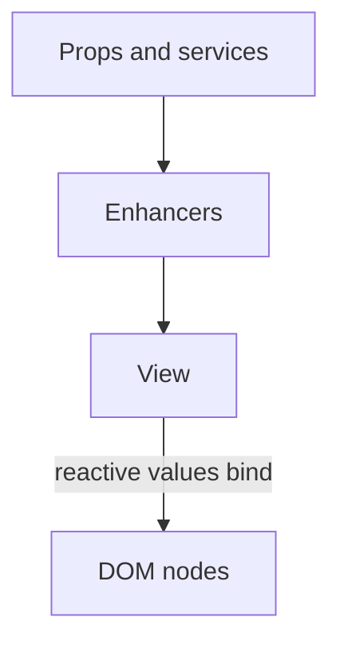
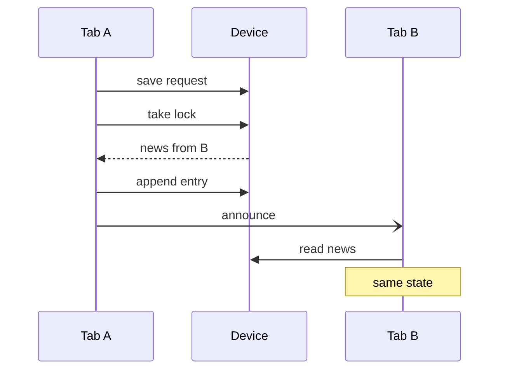
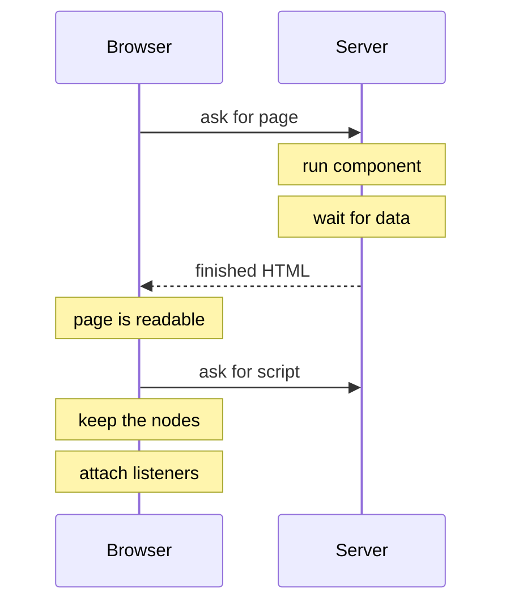

# Spar, for agents

This file is everything an agent needs to write a Spar app. It is put together by
`bun run llms` from this guide, the principles, the API reference, the recipes and the source of
the showcase app, so the examples are code that is built and tested, not sketches. When this file
and the code disagree, the code is right and this file is stale: run `bun run llms`.

## What Spar is

Spar is a UI framework for people who are all in on Effect. It is not general purpose and does
not try to be. A Spar app is an Effect program front to back: components are Effects, state lives
in Schema-described stores, the backend is an Effect RPC group, and one trace follows a click
from the page through the backend and back. The framework sees every state change and every
backend call, logs each one, and shows them in devtools that people use in the page and agents
use over MCP or from a shell.

If a thing can be done two ways, Spar picks one and refuses the other, at compile time or at
build time. Do not look for the escape hatch. There is not meant to be one.

## Read this first

"Routes, data and no waterfalls", the part right after this guide, is the one way to load data:
declare a query, ask for it in the component that needs it, pass values down as reactive props.
Never fetch in a component's Effect and never wait there.

Three rules that break the build most often:

1. Never write a bare `(props) => ...` as an enhancer inside `compose`. Wrap it:
   `withEffectProps((props) => Effect.gen(...))` when it runs an Effect,
   `withHandlers((props) => ({ ... }))` when it returns plain values. A bare one makes `props`
   `unknown` in every enhancer after it (`TS18046`), and the errors that follow (`TS2339`, an
   `Effect<unknown, unknown, unknown>` that is not a `Handler`) all go away with the wrap.
2. A UI write (`UiState.set`, `UiState.update`) is not an Effect, so `Effect.all`, `Effect.andThen`,
   `Effect.tap` and `Effect.forEach` do not take it (`TS2739: Type 'UiWrite' is missing the
   following properties from type 'Effect'`). Yield it inside `Effect.gen`, or give a handler a
   list of actions: `onReset: [UiState.set(props.name, ""), UiState.set(props.open, false)]`.
3. A handler (an event prop, a `withKey` action) takes an `Effect<void>` with no error and no
   requirement, a UI write, or a list of them. A store command (`store.commands.added(payload)`)
   already fits: a refusal shows in the store, not as an error.
   Something that fails or needs a service gets handled first: `Effect.catch`, or provide it.

## The shape of an app

```
src/
  api.ts            the RPC contract shared with the backend: groups, payloads, errors
  routes.ts         Router.route(path, Schema) values
  SomeStore.ts      Store.Tag: state Schema, actions, selectors
  Some.tsx          components: compose(...enhancers)((props) => <jsx />)
  main.ts           App.mount with the layers
  server/           what runs on the server, or stands in for it
server/             the backend's handlers
```

A component is one expression: `compose(...enhancers)((props) => <jsx />)`. The enhancers add
props (a store's values and commands, UI state, a query, a key press); the view comes last,
inline, and its props are inferred from them. The view never runs an Effect; an enhancer never
writes markup. Child components are written in JSX inside the view. Your own behaviour, written
inside `compose`, is `withEffectProps((props) => effect)` for props made by an Effect or
`withHandlers((props) => values)` for plain values. Written as a named function, give its
parameter a type: `const withDraft = (props: { readonly id: string }) => Effect.succeed({ ... })`.
A group of enhancers is `compose(...)` without a view. `compose` takes up to 10 enhancers; group
some with `compose(...)` beyond that.

If TypeScript says `'props' is of type 'unknown'` or that a property you added does not exist,
an untyped inline function among the enhancers is the cause (the build says so too, with
`SPAR_ENHANCER_UNTYPED`): wrap it in `withEffectProps` or `withHandlers`.

Three other errors to avoid:

- `For` and `Show` are imported from `"spar"` like everything else.
- In a `.tsx` file a generic arrow is read as a JSX tag: write `<A,>(item: A) => ...` with the
  comma, or use a `function`.
- `exactOptionalPropertyTypes` is on: never pass `undefined` to an optional prop or attribute.
  Leave it out (`{...(title === undefined ? {} : { title })}`) or give a value (`title ?? ""`).

`For` reads its item type from `each`. When `each` is an inline expression such as
`Reactive.map(props.rows, (all) => all.filter(...))`, TypeScript cannot infer it; compute the list
in an enhancer and pass `props.shown` instead.

## The one way to do each thing

| You want to                               | Do this                                                                                                                                 | Not this                                                                                                       |
| ----------------------------------------- | --------------------------------------------------------------------------------------------------------------------------------------- | -------------------------------------------------------------------------------------------------------------- |
| Make a component                          | `compose(...enhancers)((props) => <jsx />)` in a `.tsx` file                                                                            | A plain function returning JSX                                                                                 |
| Take props from the parent                | `withProps({ name: Schema })` as the first enhancer                                                                                     | Untyped props                                                                                                  |
| Make props with an Effect                 | `withEffectProps(Effect.fnUntraced(function* (props) { ... return { ... } }))`                                                          | `(props) => Effect.gen(...)` written inline among enhancers: every enhancer after it sees `props` as `unknown` |
| Read a store                              | `withStore(Store, (store) => ({ count: store.select.count, onAdd: store.commands.added() }))`                                           | Reading a store inside the view                                                                                |
| Hold state only the screen cares about    | `withUiState(name, Schema, initial)`                                                                                                    | `Ref`, `SubscriptionRef`, `let`, a module variable                                                             |
| Add a behaviour of your own               | A named function with a typed parameter, `(props: { readonly id: string }) => Effect.succeed({ ... })`, or `compose(a, b)` with no view | Copying the same enhancers into every component; an untyped inline function among enhancers                    |
| Use a child component                     | Write it in JSX in the view: `<Dropdown label="Sort" onPick={pick} />`                                                                  | Passing elements down as props                                                                                 |
| Hold data the app cares about             | A `Store.Tag` with actions and selectors                                                                                                | UI state seeded from a store, a service with a Ref                                                             |
| Put a store where one component uses it   | `SomeStore.with(Component)`, then mount the result                                                                                      | Wiring a layer at the root for a store one screen owns                                                         |
| Share a store across the app              | `SomeStore.layer()` in the layers given to `App.mount`                                                                                  | A global                                                                                                       |
| Change app state                          | `store.commands.<action>(payload)`                                                                                                      | Writing to state anywhere else                                                                                 |
| Change UI state                           | `UiState.set` or `UiState.update` in a handler                                                                                          | Writing UI state from a command, a stream or a service                                                         |
| Show a list                               | `<For each={props.items} by={(item) => item.id}>{(item) => <li>...</li>}</For>`                                                         | `.map` inside JSX                                                                                              |
| Show a tree (a component inside itself)   | `const Row: View.Component<Props> = compose(...)(... <Row node={child} /> ...)`, a `Schema.suspend` Schema                              | Flattening the tree by hand; leaving the type off                                                              |
| Show one thing or another                 | `<Show when={props.open}>...</Show>`                                                                                                    | A ternary inside JSX                                                                                           |
| Load data from the server                 | A `Query.Tag`, and `withQuery(name, TheQuery, (props) => input)` where it is needed                                                     | Fetching in a component and passing the result down                                                            |
| Use loaded data in an action              | Read the query store in the action's `Store.after` effect, then `send` the result                                                       | Props or arguments that carry server data                                                                      |
| Stop a command that is wrong right now    | A guard as the third argument of `Store.action`, returning the reason                                                                   | Disabling the button and hoping nothing else sends it                                                          |
| Run a flow with a wait in it              | A state field, an action that starts it, `Store.after` that waits and `send`s the finish                                                | A lock, a queue, a flag in UI state                                                                            |
| Call your backend                         | `Backend.rpc(Group, url)` and call the client                                                                                           | `fetch`, axios, tRPC, a hand-rolled client                                                                     |
| Call someone else's HTTP API              | An Effect `HttpClient` call, or an HttpApi client, with `Backend.layer` provided                                                        | `fetch`, `FetchHttpClient.layer`                                                                               |
| Send something that must not be lost      | `Store.outbox(action, send)`: saved on the device, retried with an idempotency key                                                      | Calling the server from a handler and hoping                                                                   |
| Do something after an action              | `Store.after(action, effect)`                                                                                                           | An Effect inside a reducer                                                                                     |
| Handle a failure a component can have     | `View.recover(ErrorSchema, FallbackView)`                                                                                               | `catchAll` that hides it; leaving it (compile error)                                                           |
| Show something while a component loads    | `View.pending(LoadingView)`                                                                                                             | A loading flag in UI state                                                                                     |
| Navigate                                  | `Router.route(path, Schema)`, `router.link(route, params)`, `router.go(route, params)`                                                  | `location.href`, string paths                                                                                  |
| Build a form                              | `Form.make(Schema, initial)`, `form.field(name)`, `form.submit` or `form.submitThen`                                                    | UI state for each input plus hand validation                                                                   |
| React to a key press                      | `withKey("Escape", (props) => UiState.set(props.open, false))`                                                                          | `addEventListener`                                                                                             |
| Run something while mounted               | `withEffect((props) => effect)`; `Events.onWindow` / `onDocument` inside it                                                             | A module-level listener                                                                                        |
| Focus or measure an element               | `Handle.make`, passed as a `Props.Handle`                                                                                               | `document.querySelector`                                                                                       |
| Open a dialog, menu, popover or tooltip   | The ones in `@spar/ui`, or `View.portal` with `Overlay`                                                                                 | A positioned div                                                                                               |
| Note something that happened, for the log | `Timeline.note(kind, name, detail)`                                                                                                     | `console.log`                                                                                                  |
| Test a store                              | Provide its layer and call commands in `it.effect`                                                                                      | Mounting a page to test a reducer                                                                              |
| Test a component                          | `spar/testing`: `Testing.mount`, then find and click by role                                                                            | Reaching into nodes by class name                                                                              |

## What is refused, and why

Compile errors (the proofs are the files in `apps/demo/forbidden`, each of which must fail to
compile):

- A component from a plain function, a view without a Schema for its props, UI state, a store, a
  selector or route params without a Schema. Everything declared has a Schema so the devtools and
  agents can read it as data.
- A component whose Effect needs a service nobody provided, or can fail with an error nobody
  recovers, mounted anyway. Needs and failures are settled at mount.
- A backend error from the shared contract that the component does not handle.
- A reducer returning an object literal with a literal-typed field needs its return type written
  (`(state: State): State => ...`), or TypeScript widens the literal and the action is rejected.
- UI state made in a service, written from a command, a stream or a service listener, or seeded
  from a store. UI state belongs to one component and changes only in its handlers.
- A connected component written as a JSX tag, a service passed into a view, a modal outside a
  portal, `View.pending` placed before `View.recover`, a route mounted with the wrong page.

Build errors (the Vite plugin stops the build and names the file, line and rule):

- `views-need-a-schema`: JSX outside `View.make`.
- `jsx-only-in-views`: JSX inside an expression or a call, such as `.map` or a ternary in a hole.
- `no-effect-run-in-views`: `Effect.run*` in a view file.
- `state-only-through-spar`: `Ref.make`, `SubscriptionRef.make`, `SynchronizedRef.make`,
  `MutableRef.make`, `TxRef.make`, `let`, `var`. State the framework did not make is state the
  log cannot show and the devtools cannot rewind.
- `backend-only-through-spar`: `fetch`, `XMLHttpRequest`, `WebSocket`, `EventSource`,
  `sendBeacon`, `FetchHttpClient.layer`, and imports of axios, ky, got, superagent,
  graphql-request, openapi-fetch, `@trpc/client`, `@apollo/client`, socket.io-client. A call the
  framework did not make is a call missing from the trace.

The two `-through-spar` rules look at app source. They skip `node_modules`, tests, config files,
`scripts/` and any `server/` folder (server code is not page state).

House rules the linter holds everywhere: no loops, no mutation, no comments, no casts, `type`
not `interface`, no nested ifs.

## UI state and app state

UI state is what one component remembers about its own screen: a menu is open, what was typed,
which tab is showing. It is made with `UiState.make` in that component's Effect, lives in one tree
by component path, and goes away when the component unmounts. Nothing else can write it.

App state is what the app knows: the agents, the notes, the cart. It lives in a store. A store is
a Schema for the state, named actions with pure reducers, and named selectors. It changes only
through `store.commands.<action>(payload)`, and every command is an entry in the store's log.

A store does not have to be declared at the root. `SomeStore.with(Component)` makes one unit of a
store and the component that uses it. Mount that unit twice and there are two stores, each with
its own state, each registered in the same root registry the devtools read. So it is still model,
view, update: one registry, one log, every change an action. It only does not look like it,
because the store and its view sit in the same file.

## Flows, refusals and server data

Read the "State, events that interleave, and server data" part below before writing any store
with async work. The short version:

- A store is plain unless some commands are wrong in some states. Then give it a state field and
  give those actions a guard. A refused command is visible in the log, the trace and
  `store.refused`. Never guard only in the view.
- Async work is always three steps in a store: a command records the intent, a `Store.after`
  effect does the work, and it `send`s a command with the result.
- Server data is a `Query.Tag`. Views never fetch and props never carry server data: an action
  that needs it reads the query store itself.
- There is no way to make a command wait for another to finish, on purpose.
- When only the newest answer matters (a search box, a filter), use `Store.afterLatest` instead of
  `Store.after`, or a Query. With `Store.after` an older answer can land last.
- When a second press must not start the work again (Pay, Save, Send), use `Store.afterLeading`:
  the store refuses the repeat while the first run lasts, and says why.
- To change one row of a long list in a reducer, return `Store.withRow(state.rows, index, row)`:
  the list rewrites that row only.
- A query's `value` is null while a new input loads. To keep the last rows on screen while the
  next page or filter loads, show the handle's `latest`; for "load more", use `TheQuery.pages`.
- A query with no input is asked for with no argument, `yield* TheQuery.ask()`. Giving it an
  input, such as one made from another query's value, does not compile (`SPAR_NEEDLESS_WAIT`).
- A draft the user is typing is never overwritten with a saved or loaded value. Keep both.
- Spar reports two timing mistakes while the app runs (`SPAR_DUPLICATE_CALL`,
  `SPAR_TYPING_REPLACED`). After a
  change, run the app and read the log for `noticed` and `waited` entries; each names its fix.
- A store's layer needs no `SecureRandom` from you. A UI write (`UiState.set`, `update`) can be
  yielded inside `Effect.gen`. Give every reducer its state type: `(state: State, payload) => ...`.
- A form field's problem is shown by `TextField`, `Select` and `Checkbox` with the role `alert`.

## The backend

Declare the contract once, in a file both sides import:

```ts
export class Agents extends RpcGroup.make(
  Rpc.make("Start", {
    payload: { name: Schema.String, idempotencyKey: Schema.String },
    error: ServerUnreachable,
  }),
) {}
```

On the page, `Backend.rpc(Agents, url)` gives a typed client. Its calls are spans in the trace of
whatever caused them, the trace context travels to the backend in the request, and the backend's
spans join the same trace. Provide `Backend.layer` once, where the app is mounted.

## Devtools

`sparDevtools({ backends })` from `spar/devtools/vite` adds the tools on the dev server only. In
the page they give the inspector, the one log with rewind, step and fork, the trace waterfall
across page and backend, and the stores with their outbox. No collector has to run to see a
trace.

An agent gets the same over MCP (`bun run --filter @spar/devtools-mcp start`, then connect to
`http://127.0.0.1:4188/mcp`) or from a shell
(`bun run --filter @spar/devtools-mcp cli call <tool> '<json>'`). A useful loop when debugging:

1. `get_timeline` to see what happened, in order.
2. `step` with `by: -1` to walk back; each answer has the moment and the spans it caused.
3. `diff_states` to see what an action changed in a store.
4. `fork`, then `run_action` or `set_ui_state` to try something else from that point.
5. `switch_branch` with `branch: 0` to return to what really happened.

## Working in this repo

- `bun run showcase` starts the showcase app, its backend and the devtools.
- `bun run check` is everything that must pass: format, lint, types, tests with 100% coverage,
  the forbidden-code proofs, the production build check.
- `bun run bench` reruns the benchmarks and rewrites `docs/benchmarks.md` and
  `docs/benchmarks.html`.
- Browser suites are moon tasks: `bun run moon run sidebar:features sidebar:walkthrough
  sidebar:devtools sidebar:traced demo:browser stories:play ssr:browser --concurrency 1`.
- Only run tools through package scripts or moon tasks.


# Routes, data and no waterfalls

The short version: declare the data a component needs in that component, pass values down as
props the way you always would, and Spar loads everything that can load at once. You do not write
loaders, fragments or lists of dependencies.

### Start here: a prop from a store, a query that uses it

A parent reads a value from a store and passes it to a child. The child declares a query that
uses the prop.

```tsx
class OrdersQuery extends Query.Tag<OrdersQuery>()("shop/Orders", {
  input: Schema.Int,
  success: Schema.Array(Order),
  failure: ServerUnreachable,
  load: (userId) => Effect.flatMap(Effect.service(Server), (server) => server.orders(userId)),
  staleAfter: "30 seconds",
}) {}

const Orders = compose(
  withProps({ userId: Props.Reactive(Schema.Int) }),
  withQuery("orders", OrdersQuery, (props) => props.userId),
)((props) => (
  <p>
    {props.orders.status}: {Reactive.map(props.orders.value, (all) => all?.length ?? 0)} orders
  </p>
))

const Parent = compose(
  withStore(PeopleStore, (people) => ({ selected: people.select.selectedId })),
)((props) => <Orders userId={props.selected} />)
```

That is the whole of it. Provide `OrdersQuery.live` where the app is mounted and it works.

What Spar does with it:

1. `ask` (which `withQuery` calls) returns at once with a handle: `status`, `value`, `error`,
   `loading`, each a reactive value, and `refetch`. No enhancer waits for data.
2. Because nothing waits, the parent goes straight on to draw its children, and they draw theirs.
   Every query in the tree is reached in one pass, and every query with an input starts then,
   together.
3. The query runs in its store, which lives at the root. The component can unmount and the
   answer still arrives and is kept. Two components that ask for the same input share one
   request.
4. When the prop changes, the query for the new value starts. An input that was loaded recently
   enough (`staleAfter`) is shown from the cache with no request.

A query that needs another query's answer takes its input from that answer:

```ts
const report = yield * ReportQuery.ask(reportId)
const author =
  yield *
  AuthorQuery.ask(Reactive.map(report.value, (found) => Option.fromNullishOr(found?.authorId)))
```

While the input is none the author query is `waiting`. The moment the report answers, it starts.
That is the only waterfall Spar allows, it is the one the data really has, and it shows: as the
`waiting` status, and in the trace, where the author's request says "input from Report . value".

The one rule: pass a changing value down as the reactive value it is (`Props.Reactive`), which is
how Spar passes changing values anyway. If you read it out into a plain number first, the child's
query cannot follow it when it changes.

### Routes

A route is a path and a Schema. Fields named in the path are path params; every other field is a
search param. Links and navigation take the decoded params, so a wrong param is a type error.

```ts
export const reportRoute = Router.route(
  "/org/:org/team/:team/member/:member/reports/:report",
  Schema.Struct({
    org: Schema.String,
    team: Schema.String,
    member: Schema.String,
    report: Schema.String,
  }),
)

const link = router.link(reportRoute, { org: "acme", team: "core", member: "ada", report: "q3" })
```

Segments nest with open-ended routes and an outlet in each layout. `Router.live` keeps a layout
mounted while only its params change and gives it the params as a reactive value, which is what a
query wants as its input:

```tsx
const orgRoute = Router.route("/org/:org/*", Org)

const withTeams = () =>
  Effect.map(
    Router.outlet({ routes: [Router.live(teamRoute, TeamSegment)], otherwise: Missing }),
    (inner) => ({ inner }),
  )

const OrgSegment = compose(
  withProps({ params: Props.Reactive(Org) }),
  withQuery("org", OrgQuery, (props) => Reactive.map(props.params, (now) => now.org)),
  withTeams,
)((props) => (
  <section>
    <h2>{Reactive.map(props.org.value, (found) => found?.label ?? "")}</h2>
    {props.inner}
  </section>
))
```

A route inside another is declared under it, so its path is written once. The parent must end
with `/*`, and the Schema must carry every param of the whole path; both are compile errors
otherwise:

```ts
const teamRoute = Router.under(orgRoute, "/team/:team/*", Team)
const memberRoute = Router.under(teamRoute, "/member/:member/*", Member)
```

There is no separate route tree to keep in step: the nesting is the outlets, and the paths follow
from `under`.

A page five segments deep written this way starts all five segments' requests together. The
showcase has one (`apps/sidebar/src/Deep.ts`), and its browser check reads the backend's own
spans and fails if the five do not start together or if the sixth does not wait for the one it
needs (`apps/sidebar/scripts/deep.ts`).

### Preload on intent

A link has `onIntent`. Put it on the anchor and pointing at the link, or focusing it, starts the
target page's queries before the click:

```tsx
<a href={link.href} onClick={link.onClick} onPointerenter={link.onIntent} onFocus={link.onIntent}>
```

Spar rehearses the target: it mounts the app at that address without drawing anything, which
reaches every `ask` on the way, and throws the result away. The queries are real and their answers
stay in their stores, so the click finds the data there. Leave `onIntent` off a link whose page
should not be preloaded. `router.preload(route, params)` does the same from code.

Links you did not write as JSX, such as the ones in trusted markup rendered from markdown, follow
in place when their container has `onClick={router.followLinks}`. A plain click on a link to this
site goes through the router; a link to another site, one with `target` or `download`, a link to
a heading on the same page, and a click with a modifier key are left to the browser.

### Loading a page's code when it is first shown

```ts
Router.live(
  orgRoute,
  View.split(LoadingView, () => import("./DeepPage.ts").then((module) => module.OrgSegment)),
)
```

`View.split` shows the placeholder, a view that takes the same props, until the code has
arrived. Routes, param Schemas and query classes stay in the main bundle because the query layers
are provided at the root; the components and their views are what is split off. Preloading a link
fetches the code too, since the rehearsal mounts the page. On the server and while taking over a
server-drawn page the real component is used, not the placeholder. The showcase's deep page is
loaded this way (`apps/sidebar/src/Shell.ts`).

### Pending and failure, per segment

Each segment shows its own query's `status`, so one slow segment does not blank the others. For
a component whose own Effect can wait or fail, `View.pending(placeholder)` and
`View.recover(failure, view)` wrap that component alone. A query takes `retry`, a schedule,
and stays `loading` until the schedule gives up.

### What makes a waterfall, and how Spar stops it

One thing: a component whose Effect waits. Everything below it mounts late, so their queries
start late.

- The build refuses a wait written straight into an enhancer inside `compose(...)`: `yield*` of
  `Effect.sleep`, `Effect.promise`, `Effect.tryPromise`, `Effect.callback`, `Deferred.await`,
  `Fiber.join` (rule `no-waiting-in-components`). A wait in a handler, in a store's reaction or
  anywhere outside a component is fine.
- The build cannot see a wait behind a call such as `yield* server.describe(name)`, or in an
  enhancer written outside the `compose(...)` call. For that,
  any component that takes a frame or more before its children can mount gets a `waited` entry in
  the log with its name and the milliseconds, and `spar.waited_ms` on its span.

Forbidden, in short: fetching in a component's Effect (ask a query), and passing server data down
through props (the component that needs it asks for it, or a store's action reads the query with
`TheQuery.read(input)`).

### Seeing it

One navigation is one trace, whether it started with a link, `router.go` or the browser's Back
and Forward buttons (those run in a span named `Router.popstate`): the click, the route change, each segment mounting, each query's
request, the calls they make, the backend's spans, and each answer landing. In the devtools trace
panel, lenses show one kind at a time:

| Lens      | What it keeps                                                                          |
| --------- | -------------------------------------------------------------------------------------- |
| Rendering | Components mounting, and each event a component handled (`on click`, with its view)    |
| Data      | Queries: each request, its call, its answer, and what a dependent one's input was from |
| Stores    | Store commands and refusals                                                            |
| Backend   | Spans the backend recorded                                                             |

A request that waited for another query's value draws that wait as a line before its bar, from
when the other was asked for to when this one started. Data that was already there (after a
preload, or going back) is a short `served` span that links to the trace that loaded it.

Hovering a link and then clicking it follows one rule. Hovering starts the target page's
queries in the hover's own trace. When the click asks for the same queries, nothing is asked
again, whether the hover's requests have answered or are still on their way. The click's
trace gets a `served` span for each one, saying "served from what trace … loaded" and linking
to the hover's trace. So each request is recorded once, in the trace that started it, and the
click's trace says where its data came from.

When three or more requests each waited for the one before, or when a request had the same input
as the one it waited for, the trace panel says so above the spans with the code
`SPAR_QUERY_CHAIN`, names the requests in order with how long after the one before each started, and says which one
looks avoidable. A chain of
two with different inputs, such as a report and then its author, is not reported.

An agent gets the same with `get_trace` and a `lens`, or `get_navigation` for the newest
route change, which also carries the chains. From a shell:

```sh
bun run --cwd packages/devtools-mcp cli trace --lens data
```

prints that navigation as an indented waterfall: each span, when it started, how long it took and
what it waited for. `--back 1` is the navigation before; `--id` takes a trace id.

### On the server

`Server.render` draws the page, waits until every query has settled, and draws again until a
pass finds nothing still loading. That covers queries inside a routed page or a list, which only
start once the page is drawn, and dependent ones. The queries' stores travel with the page like
any store's, so in the browser the first `ask` finds its data and makes no request. Data the
server or a link preload loaded is used once by the first `ask` that wants it, whatever the
query's `staleAfter`; asks after that follow `staleAfter`, which is 500 ms unless set (give
`"0 millis"` to ask again every time).

The server boundary is one Effect RPC group and one service with two layers. On the server the
layer reads the database; in the browser it calls the group over `Backend.rpc`. The query's
`load` is the same code on both sides. `apps/ssr` shows it with a routed product page: its
browser test fails unless the page arrives with what its two queries loaded, the browser asks for
none of it again, a link to another product makes exactly two calls in one trace that reaches the
database's spans, and going back loads no new document.

#### Sending a page in pieces

`Server.render` and `renderToStream` wait for every query, so the page arrives complete and
works without JavaScript. `Server.renderInPieces` does not wait:

```ts
Server.renderInPieces(Site, {
  layer: layer(url),
  open,
  close: "</div>",
  script: '<script type="module" async src="/client.js"></script>',
  end: "</body></html>",
})
```

It sends the page as first drawn, with each query showing its own `loading` or `waiting`
state, and the state it had then. The queries go on running on the server, dependent ones too,
and each time their stores change the new state follows as a small script. The browser hands each
piece to the query's store (the store's log shows it as `streamed`), the views update, and the
browser asks the backend for nothing. The whole response is one render in one trace. The server
code chooses per page which of the two to call.

Each data piece is followed by the parts of the page that data changed. The server draws the page
again, compares each component with what it last sent, and sends only the components whose own
markup changed, each as finished HTML in a `<template>` with a one-line script that puts it
between that component's two marks. In a page sent in pieces every component is wrapped in
`<!--spar(-->` and `<!--spar)-->`, and the takeover removes the marks as it reaches them, without
making any node again. A slow supplier on a product page arrives as the product's component
alone, not the page around it. When what changed is outside every component, the whole root
(`#root`, or the `root` option's selector) is sent instead. Each round is a `Server.piece` span
in the trace of the render, with how many parts it sent. The script does nothing once the app has
started taking the page over (the root is marked `data-spar-taken`), so the server's HTML never
lands on a page the app is drawing.
So a slow or blocked bundle still leaves the reader with the finished page, and when the bundle
does arrive, the pieces that came before it are applied before its first draw, so it takes over
the finished page as it is.

What to know: the client script must be `async`, or the browser runs it only after the last
piece. With scripts turned off, the pieces cannot run, so each round that changed the page also
sends the whole page as drawn so far inside `<noscript>`, which such a browser shows; a style
sent with the first draw shows only the newest round and hides the page as first drawn. The page
then fills in round by round, every component in its place. A browser with scripts on reads
`<noscript>` as text and uses the pieces. While pieces are still coming the browser does not ask for data it lacks; the last piece says the
server is done, and whatever is still missing then is asked for by the browser. That covers a
query first asked for by a component that only mounts once data is there (a row of a loaded
list), which the server does not run. If the connection drops part way, the document ends without that last piece; the browser
notices the end and asks for what is missing itself.

From TanStack Start this takes: the same loading code on both sides, the cache sent with the page
and picked up in the browser, a typed server boundary, and a choice per page between a complete
page and one sent in pieces. It does not take: routes from files, or server functions made by a
compiler. What is sent in pieces is data and the finished HTML of each component it changed, drawn
by the same components the browser runs. There are no server components and no second kind of
component.

### Not built

- A span for the code of a split page arriving.


# Principles

Each principle says what it is and what it rules out. Rules are enforced by types or by Spar's own
JSX build step, never by a lint rule, and each has a file under `apps/demo/forbidden` that must fail
to compile.

How one component is put together: its Effect runs once with the props it was given and the
services it asks for, and hands plain props to a pure view. After that, only reactive values
touch the page.



### 1. Set up once, bind at the leaf

A view function runs one time and builds real DOM nodes. A reactive value placed in the markup is
bound to exactly one text node or attribute, and only that node is written when the value changes.
There is no virtual DOM and nothing re-renders. A store command updates the screen before it
returns.

Rules out: stale closures, dependency arrays, memoization, and every bug that comes from a
component function running again.

### 2. A component is enhancers that make its props, then a pure view

`compose(...enhancers)((props) => <jsx />)`. Each enhancer is a plain function from the props so
far to an Effect of the props it adds; `withProps(fields)` declares the props a parent gives, with
a Schema for each, and a first enhancer that asks for props any other way does not compile. The
enhancers are ordinary Effect code. They run once when the component mounts, in the component's
own scope, and everything they started is cancelled when the component unmounts. The view comes
last, inline, and only draws: it cannot reach a service, and outside `compose` the build rejects a
view written as a plain function (use `View.make(name, fields, draw)` there). Every component keeps
its view as `.view`, so a test or a story can render it with sample props.

Rules out: hook ordering rules, effects that run again, leaked subscriptions and timers, views that
fetch, and services smuggled into a view.

### 3. Errors and layers are part of a component's type and are settled at mount

`Component<Props, E, R>` carries what can fail and what it needs, the same way an Effect does.
`App.mount` only accepts a component with no errors left and a layer that provides everything it
needs.

Rules out: a load failure nobody handles and a missing provider. Both are compile errors.

### 4. Children with needs are placed by the Effect, not by JSX

TypeScript gives every JSX expression the same type, so a connected component used as a tag would
silently lose its errors and layers. A connected component is therefore not a function and cannot be
a tag. The parent's Effect mounts it with `View.child`, `Reactive.mapBy`, `Reactive.when` or
`Router.outlet` and hands the view a finished element. Only pure views are JSX tags.

Rules out: requirements and errors that disappear somewhere in the middle of the tree.

### 5. Composition is plain functions

`recover`, `pending`, `crash`, `mapProps`, `branch` and `portal` each take a component and return a
component, combined with `pipe` or `flow`. `recover` removes the error it handles from the type.
`pending` only accepts a component with no errors left, because a placeholder would hide a failure
that arrives later. `portal` supplies the overlay layer that `Overlay.modal` needs, so modal
behaviour outside a portal does not compile.

Rules out: class components, a context API, lifecycle hooks and wrapper hierarchies.

### 6. UI state and app state are different types

`UiState.make(name, schema, initial)` only works inside a component's Effect. It can be read anywhere it is
passed, but it can only be changed by a `UiState.set` or `UiState.update` value, and the only thing
that runs those is a DOM event handler (including `Events.onDocument` and `Events.onWindow`, which
also only work inside a component). Its Schema describes the value for the devtools and for
restoring it; the state itself is a live handle, not data, so it cannot be a command payload. Form input
is UI state inside `Form`. App state lives in stores and nowhere else.

Rules out: local state kept in sync with a store, UI state created in a service, UI state sent to
the server or saved.

### 7. App state changes only through named commands, and every one is logged

A store is a Schema for its state, an initial state, pure actions `(state, payload) => state` with a
Schema for each payload, and named selectors with a Schema for what each gives. None of the three
can be declared without its Schema. Commands return an Effect. The state is always computed from the
encoded payload that went into the log, so replaying the log gives the same state. Every store can
show any earlier state (`travelTo`), which is what the devtools use.

Rules out: state changed from anywhere, actions that cannot be saved or replayed, and a log that
drifts from the state.

### 8. Nothing the user did is lost

A durable store writes each action to the device before the state changes and comes back after a
reload. Anything leaving the device goes through the outbox: saved first, sent in order with one
idempotency key, retried, held while offline, sent by one tab at a time, and set aside with its
reason if it can never be sent.

Rules out: effects inside reducers, a sent item that is lost on reload, a retry the server sees as a
second send, and two tabs sending the same thing.

### 9. Lists, conditionals and pages are functions over reactive values

`Reactive.mapBy(key, Component, toProps)` keeps one mounted row per key and moves, adds and removes
rows as the list changes. `Reactive.when(Component, props)` mounts a component while a condition
holds. `Router.outlet` mounts the page for the current URL. None takes a function that returns JSX,
and JSX cannot appear inside an expression in other JSX.

Rules out: unkeyed lists, rows rebuilt on every change, inline ternaries and maps in markup, render
props, and a route whose page does not take that route's params.

### 10. A part that breaks does not take the page with it

`View.crash(Fallback)` shows a fallback for a part whose Effect dies. An event handler, a reactive
binding or a background load that dies is reported to `App.CrashReporter` and the rest keeps
working.

Rules out: a blank page, and failures nobody hears about.

### 11. The compiler and the build enforce the rules

Every rule above is a type error, or a failure of the JSX build step for the two things types cannot
see (JSX inside an expression, and `Effect.run` in a view file). A rule that neither can check is
left out instead of being written down as a convention.

Rules out: rules that hold only while everyone remembers them.

### 12. One way to do each thing

The surface is these modules: View, Reactive, UiState, Store, Outbox, Events, Handle, Form, Router,
Overlay, Devtools, App, and `spar/testing`. Timers are Effect's schedules and websockets are
`effect/socket`; Spar adds no wrapper for what Effect already ships.

Rules out: two styles of the same app in one codebase.

### 13. Everything declared has a Schema

Nothing that is data can be declared with a TypeScript type alone. Each of these takes a Schema, and
the plain form does not compile or does not build:

- a view's props (`View.make(name, fields, draw)`; a function that just returns JSX is rejected by
  the build outside `compose`), and a component's outer props (`withProps(fields)`);
- UI state (`UiState.make(name, schema, initial)`);
- a store's state, each command's payload and each selector's output;
- a route's params, whenever its path has any, and the Schema must name every one of them;
- an error a component recovers from (`View.recover(ErrorSchema, ErrorView)`).

What is not data has a Schema of its own kind, checked by what it is: reactive values and UI state
carry the Schema of their value, and actions, handlers, callbacks, elements, handles, links, form
fields and placements each have one. Reactive values themselves are plumbing between these points
and take no Schema of their own: wherever one is shown, kept or passed it crosses one of the
declarations above. DOM events are not data either; a handler prop names the event it takes.

The Schemas are what the devtools read: a component's props and UI state can be shown as plain
values, restored, and sent to an agent, without any of it being written twice.

Rules out: props, state and params that exist only as types, which nothing at run time can read,
check, show or restore.

### 14. One application, front to back

A click and everything it causes are one trace: the event, the command, what the outbox sends
(now or after a restart), the components that mount because of it, the call to the backend and the
backend's own work. The backend is reached through a shared Effect RPC contract, so its failures
are part of the calling component's type and an unhandled one is a compile error. The same
component runs on a server and in the browser; the layers it is given decide where its data comes
from, and the render and the takeover are one trace too.

Rules out: a front end and a back end that only meet in a network tab, failures that surface as
an unknown error, and directives that say where code runs.

### 15. What the app is doing can always be read

In development the tools are there without being asked for, and a production build has none of
their code. A person picks a component on the page and reads its data where it lives; an agent
asks the same over MCP. Both see one log of everything that happened, can show the app as it was
at any moment, and can open any moment as one trace across the page and the backend.

Rules out: debugging by guessing what state a component is in, and devtools that only work with a
browser extension or only for people.

### 16. State is declared where it is used and registered in one place

UI state and stores are made only through Spar: `UiState.make` in a component's Effect, and a
`Store.Tag` placed app-wide with `.layer` or beside a view with `.with`. Wherever one is declared,
making it registers it in the one registry the devtools read, and every change to it is an entry
in the one log. So a component can own app state, be reused, and compose with others without the
app root knowing about it, and it is still model, view, update underneath. The build refuses
state held any other way.

### 17. One way to the backend

Every backend call goes through `Backend`. Effect RPC is the way to talk to a backend you own;
HttpApi and JSON clients plug into the same client; everything that would go around it is refused
by the build. A call the framework cannot see is a call missing from the trace.

### 18a. A store says which commands it accepts, and server data is a store

Events interleave: anything can arrive while a multi-step flow is waiting. Spar has no holding or
queueing primitive. A flow is states in a store, and each action's guard says in which states it
applies; a command that does not apply is refused with a reason that the log, the trace and the
view can all show. The rule is in the model, so a button, a key and an agent get the same answer.
Server data is no exception: a query is a store with typed loading, loaded and failed states, and
any other store's action reads it directly, so no prop carries server data.

### 18. The past can be walked and branched

Any moment in the log can be shown again, stepped through with the trace each step caused, and
forked: the program carries on from there while the original is kept. People do it in the tools
and agents do it over MCP or from a shell.

### Where this differs from the first brief

- `recover` takes one tag at a time. Looking up a handler by tag in a record cannot be typed without
  a cast.
- There is no `selectKeys`. Key selectors are ordinary selectors.
- A reducer names its state type: `Store.action(Schema, (state: State, payload) => ...)`.
- Two things types cannot catch were dropped: seeding UI state from a one-off read of a store, and
  an aliased `Effect.run` in a view file.
- Refs are `Handle` values, not an enhancer, because the component's Effect has to hold the handle
  to act on it.
- A span per component is automatic (named after the view), so there is no `withSpan`.
- Two internal modules are allowed to mutate, each behind a pure-looking interface: `internal/dom.ts`
  (all DOM writes) and `internal/cell.ts` (the value cell under reactive values, added after the
  benchmark showed a stream and a fiber per binding cost 10 seconds for 10,000 rows). The reactive
  values in `internal/reactive.ts` are small classes for the same reason: one object per value
  instead of an object, two effects and three closures, which with one list of things to stop per
  row took 10,000 rows from 61 MB to 19 MB. The lint rule lets a constructor set its own fields
  and nothing else.


# API reference

Everything is imported from `spar` unless a line says otherwise. Each section names a file in this
repo where the API is used and type-checked.

### Compose

A component is `compose(...enhancers)((props) => <jsx />)`: enhancers first, the view last and
inline. Each enhancer is a function from the props so far to an Effect of what it adds; the view's
props are inferred from them. Enhancers and the view run once, on mount.

| Function                                                  | What it adds                                                                                                                                                                 |
| --------------------------------------------------------- | ---------------------------------------------------------------------------------------------------------------------------------------------------------------------------- |
| `compose(...enhancers)(view)`                             | A component. Called without the view, a group of enhancers that is itself an enhancer.                                                                                       |
| `withProps({ name: Schema })`                             | The props its parent passes in JSX, each with a Schema. A wrong prop in the parent's JSX is a compile error.                                                                 |
| `withStore(Store, (store) => props)`                      | Values and commands read from a store, or from any service with the same shape.                                                                                              |
| `withUiState(name, Schema, initial)`                      | One piece of UI state, under `name`, kept in the UI tree and rewound with everything else.                                                                                   |
| `withQuery(name, Query, (props) => input)`                | A query's handle under `name`, asked with an input made from the props.                                                                                                      |
| `withHandlers((props) => handlers)`                       | Plain values or actions made from the props.                                                                                                                                 |
| `withEffectProps((props) => effect)`                      | The props an Effect makes from the props so far, for example `withEffectProps(Effect.fnUntraced(function* (props) { ... }))`. Use it rather than an untyped inline function. |
| `withKey(key, (props) => action)`                         | Runs an action when a key is pressed, for as long as the component is mounted.                                                                                               |
| `withEffect((props) => effect)`                           | Runs an Effect for as long as the component is mounted.                                                                                                                      |
| `<For each={list} by={key}>{(item, key) => <li />}</For>` | A keyed list. `each` is an array or a reactive one; `by` gives each row's key, a string or a number.                                                                         |
| `<Show when={reactiveBoolean}>...</Show>`                 | Shows its children while the value is true.                                                                                                                                  |
| `uses(["Service", ...])`                                  | Nothing to the props: tells the inspector which services the component uses. The dev plugin adds it for you; write it only without the plugin.                               |

A child component is written in JSX inside the view: `<Dropdown label="Sort by" onPick={pick} />`.
It keeps its own UI state, and runs with the services of the component that draws it. What it
needs is not part of its parent's type, because TypeScript gives every JSX expression one type, so
the build checks it instead: a child that needs a service no layer given to `App.mount` provides
(and no store beside a component above it) stops the build with `SPAR_CHILD_NEEDS_A_SERVICE`.
The build names each component after the constant it is
given to. A named view can stand at the end instead of an inline one:
`compose(withHover)(CardView)`.

```tsx
export const withHover = compose(
  withUiState("hovered", Schema.Boolean, false),
  withHandlers((props) => ({
    onEnter: UiState.set(props.hovered, true),
    onLeave: UiState.set(props.hovered, false),
  })),
)

export const Card = compose(
  withProps({ title: Schema.String }),
  withHover,
)((props) => (
  <article
    aria-label={props.title}
    class={{ card: true, raised: props.hovered }}
    onPointerenter={props.onEnter}
    onPointerleave={props.onLeave}
  >
    {props.title}
  </article>
))
```

(`packages/spar/test/composed.tsx`)

#### A component that draws itself

A folder tree: each row draws a row for each folder inside it, as a JSX tag inside its own view.
Write the component's type out (`View.Component<Props>`), because TypeScript cannot work out a
type that refers to itself. Each row has its own UI state, kept under its key, so closing a
folder and opening it again starts its children closed.

```tsx
export const FolderRow: View.Component<{ readonly folder: Reactive.Reactive<Folder> }> = compose(
  withProps({ folder: Props.Reactive(Folder) }),
  withUiState("open", Schema.Boolean, false),
  withHandlers((props) => ({
    name: Reactive.map(props.folder, nameOf),
    folders: Reactive.map(props.folder, (folder) => folder.folders),
    empty: Reactive.map(props.folder, (folder) => folder.folders.length === 0),
    onToggle: UiState.update(props.open, (open) => !open),
  })),
)((props) => (
  <li>
    <button
      type="button"
      aria-expanded={props.open}
      disabled={props.empty}
      onClick={props.onToggle}
    >
      {props.name}
    </button>
    <Show when={props.open}>
      <ul>
        <For each={props.folders} by={nameOf}>
          {(folder) => <FolderRow folder={folder} />}
        </For>
      </ul>
    </Show>
  </li>
))
```

(`packages/spar/test/folderTree.tsx`)

The Schema of a tree refers to itself too: `Schema.suspend` and a written-out type.

```tsx
export const Folder: Schema.Codec<Folder> = Schema.Struct({
  name: Schema.String,
  folders: Schema.Array(Schema.suspend((): Schema.Codec<Folder> => Folder)),
})
```

(`packages/spar/test/folderTree.tsx`)

### View

What a component made with `compose` can be wrapped in. A view made with `View.make` can also be
the last thing given to `compose`, in place of an inline view; the component then keeps that view
as `.view` and the inspector shows its name.

| Function                               | What it does                                                                                                                                                                                       |
| -------------------------------------- | -------------------------------------------------------------------------------------------------------------------------------------------------------------------------------------------------- |
| `View.make(name, fields, draw)`        | Makes a view: `fields` gives a Schema for each prop, `draw` turns the props into JSX.                                                                                                              |
| `View.child(component, props)`         | Mounts a child from an enhancer and gives back its element, for a child that can still fail.                                                                                                       |
| `View.recover(ErrorSchema, ErrorView)` | Handles one tagged error with a view and removes it from the type.                                                                                                                                 |
| `View.pending(PlaceholderView)`        | Shows a placeholder until the component's Effect finishes. Needs errors handled first.                                                                                                             |
| `View.SlowAfter`                       | How many milliseconds a component's Effect may take before it is reported as `SPAR_COMPONENT_WAITED` (16). Provide a larger number for slow devices, or `Infinity` in a test that is not about it. |
| `View.split(PlaceholderView, load)`    | A component whose code is imported when it is first shown; the placeholder takes the same props.                                                                                                   |
| `View.crash(FallbackView)`             | Shows a fallback if the component's Effect dies, and reports it.                                                                                                                                   |
| `View.mapProps(f)`                     | Changes the props a component takes.                                                                                                                                                               |
| `View.branch(test, Other)`             | Mounts `Other` instead when `test(props)` holds.                                                                                                                                                   |
| `View.portal`                          | Mounts the component in a layer above the app.                                                                                                                                                     |

```tsx
export const AgentPage = pipe(
  compose(
    withProps({ id: Schema.String }),
    withAgent,
    withStore(Router.Router, (router) => ({ home: router.link(home, {}) })),
  )((props) => (

    ...

  )),
  View.recover(AgentNotFound, AgentMissingView),
  View.pending(AgentLoadingView),
)
```

(`apps/sidebar/src/AgentPage.tsx`)

### Props

A view's props are declared as a record of Schemas. Plain data uses `Schema` as it is; what is
not data has a Schema of its own kind:

| Schema                                                           | A prop that is                                       |
| ---------------------------------------------------------------- | ---------------------------------------------------- |
| `Props.Reactive(schema)`                                         | a reactive value of that type                        |
| `Props.State(schema)`                                            | UI state the view may also set                       |
| `Props.Action`                                                   | something to run from a handler                      |
| `Props.Handler("keydown")`, `Props.Handler("input", "textarea")` | a handler for that event, on that element when named |
| `Props.Callback(schema)`                                         | a function from a value to an action                 |
| `Props.Element`, `Props.Handle`                                  | an element to place, a handle to an element          |
| `Form.Field(schema)`, `Router.Link`, `Overlay.Placement`         | a form field, a link, where an overlay sits          |

`Props.kind(guard, show)` makes one for a type of your own. `Props.allShown(fields, props)` gives a
view's props as plain values, which is what the inspector and the MCP tools read.

### Markup

`Markup.trusted(html)` marks a string of HTML as safe to put on the page, and the `markup` attribute
puts it in an element: `<article markup={body} />`, where `body` is a `Markup` or a reactive one.
A view declares such a prop as `Markup.Markup`, or `Props.Reactive(Markup.Markup)`. The element
has no other children. It is drawn the same on the server, and hydrating keeps the nodes the
server sent. Use it for HTML you made yourself, such as rendered markdown; never for text a user
typed.

### Reactive

A `Reactive<A>` is a value that changes: `get` reads it and `changes` is a stream that starts with
the current value.

| Function                                                                                      | What it does                                                          |
| --------------------------------------------------------------------------------------------- | --------------------------------------------------------------------- |
| `Reactive.map(reactive, f)`                                                                   | A derived value.                                                      |
| `Reactive.zip(a, b)`                                                                          | Both values as a pair (an Effect, scoped to the component).           |
| `Reactive.mapBy(key, Component, toProps)`                                                     | A keyed list. `toProps(item, key)` gets each row's own reactive item. |
| `Reactive.when(Component, props)`                                                             | Mounts a component while a boolean is true.                           |
| `Reactive.fromStream(initial, stream)`                                                        | Any stream as a reactive value, owned by the scope.                   |
| `Reactive.fromSubscriptionRef(ref)`, `Reactive.succeed(value)`, `Reactive.make(get, changes)` | Other ways to make one.                                               |

```ts
const rows =
  yield *
  pipe(
    Reactive.map(props.section, (section) => section.rows),
    Reactive.mapBy(
      (agent: Agent) => agent.id,
      AgentRow,
      (agent, id) => ({ agent, id, editing: props.editing, dragging: props.dragging }),
    ),
  )
```

(`apps/sidebar/src/Sidebar.ts`)

### UiState

`UiState.make(name, schema, initial)` in a component's Effect; `UiState.set(state, value)` and
`UiState.update(state, f)` as event handlers. A `UiState` is also a `Reactive`.

Every piece is kept in one tree, under its component's place: the names of the views from the root
down, with a row's key in brackets (`Board / Note[a]`), and a number when two share a place
(`Panel#2`). It is there while the component is mounted and gone when it leaves. The tree is
the same one state that stores live in, so the devtools and agents read, set and rewind UI state
through it. Give an app or a test its own with `State.layer`; a server render always has its own.

```tsx
<button onClick={UiState.update(open, (shown) => !shown)}>Options</button>
```

### Store

| Function                                                              | What it does                                                                                                                       |
| --------------------------------------------------------------------- | ---------------------------------------------------------------------------------------------------------------------------------- |
| `Store.Tag<Self>()(key, { state, initialState, actions, selectors })` | Defines a store as a service class.                                                                                                |
| `Store.selector(Schema, select)`                                      | One named reading of the state, with a Schema for what it gives. A plain function is a compile error.                              |
| `Store.action(Schema, reduce)`                                        | One action: a payload Schema and a pure reducer.                                                                                   |
| `Self.layer`                                                          | The store for the whole app: provide it where the app is mounted.                                                                  |
| `Self.layerFrom(effect)`                                              | The same, starting from what the Effect gives, such as data a server loaded.                                                       |
| `Self.layerSaved`                                                     | The same, saved after each command and read back on start (needs a `KeyValueStore`). Other tabs that save it are followed.         |
| `Self.with(component)`                                                | The store beside one component: mounting the result makes the store, and each place it is mounted has its own.                     |
| `Store.withRow(rows, index, row)`                                     | In a reducer, the rows with one replaced. A keyed list showing those rows then rewrites that row only, without walking the others. |

A store service has `state`, `select.<name>` and `commands.<name>(payload)`. Its state is a slot
in the one state, so every command is in the log and the trace with its payload, and the devtools
step and fork the whole app.

(`apps/sidebar/src/BoardStore.ts`)

#### Work that takes time

A store accepts every command; there are no guards. Work that takes time is an Effect on a
service, and Effect decides what happens to a repeat: `FiberHandle.run(handle, effect, {
onlyIfMissing: true })` ignores a second run while the first is going, plain `FiberHandle.run`
replaces it, a `Semaphore` makes it wait, and an `Outbox.channel` keeps it on the device until it
is sent (`apps/sidebar/src/ResetCounter.tsx`, `docs/state-and-server-data.md`).

#### A store beside its view

```tsx
export class NotesStore extends Store.Tag<NotesStore>()("sidebar/Notes", { ... }) {}

const NotesPanel = compose(withProps({ id: Schema.String, title: Schema.String }), ...)(
  (props) => <section aria-label={props.title}>...</section>,
)

export const Notes = NotesStore.with(NotesPanel)
```

`Notes` is one unit: mount it anywhere with `<Notes id="..." title="..." />` and nothing is wired at the
app root. The store is made when the unit mounts and closed when it unmounts. Its key is the
store's key and the place it is mounted (`sidebar/Notes @ ShellView / NotesView`), a second one
beside it is numbered (`... NotesView#2`), and it registers with the devtools like every other
store, so its actions are in the one log and it rewinds and forks with the rest. Underneath it is
the same model, view, update as an app-wide store: one definition, pure reducers, every change an
action. (`apps/sidebar/src/Notes.ts`)

The build refuses any other way to hold state in app code (rule `state-only-through-spar`):
`Ref.make`, `SubscriptionRef.make` and their relatives, `let` and `var`. Code under a `server/`
folder is not page state and is left alone.

#### Several tabs



Provide `Tabs.layerBrowser` in a browser and a durable store is one store across every open tab.
A command takes a cross-tab lock, first applies whatever other tabs have recorded since, then
records its own entry, so two tabs never write the same slot and a reducer always sees the latest
state. Idle tabs hear about new entries and follow. A tab that fell behind a fold of old entries
starts again from the saved state. Each command is written to the device before the lock is taken, so
one made just before a reload or a close is carried out by the next tab to open (and reported as
`Store.Abandoned` if that version no longer has the action). Without the layer a store behaves as if
it were the only tab.

### Outbox

`Outbox.Outbox.layer` (or `layerWith({ maxAttempts, attemptTimeout })`) needs a `KeyValueStore`.
Provide `Outbox.layerBrowser` in a browser: it follows the connection, lets one tab send, and tells
other tabs when something was added. The service has `pending`, `dead`, `retry(key)` and
`discard(key)`.

### Events

| Function                                                             | What it does                                                             |
| -------------------------------------------------------------------- | ------------------------------------------------------------------------ |
| `Events.onDocument(type, handler)`, `Events.onWindow(type, handler)` | A typed handler outside one element, in a component's scope.             |
| `Events.fromDocument(type)`, `Events.fromWindow(type)`               | The same events as streams.                                              |
| `Events.prevent(handler)`, `Events.stop(handler)`                    | A handler that prevents the default or stops propagation, synchronously. |
| `Events.online`, `Events.visible`, `Events.mediaQuery(query)`        | Reactive values for the connection, tab visibility and a media query.    |
| `Events.title(text)`                                                 | Keeps the document's title in step with a reactive value while mounted.  |

Event props are `on` plus the DOM event name capitalised: `onClick`, `onKeydown`, `onPointerdown`.

### Handle

`Handle.make` in a component's Effect, `ref={handle}` on an element, then `Handle.focus(handle)`,
`Handle.scrollIntoView(handle)` or `Handle.measure(handle)`.

### Form

```ts
const form = yield * Form.make(Named, { name: "" })

return {
  field: form.field("name"),
  busy: form.submitting,
  onSubmit: form.submit(({ name }) => store.commands.spaceAdded({ name })),
}
```

A form's values, which fields have been left, whether a submit was tried and what the server
rejected are the component's UI state, under a name such as `form (name)`. So typing, leaving a
field and a refused submit are entries in the log, and rewinding puts a form back as it was.
Whether a send is in flight (`submitting`) is not kept there: going back to a moment does not
restart a send.

A text input's or textarea's `value` takes a plain string, UI state, or a form field's value, and
nothing else: binding it to a store selector or a query's data is a type error, because whatever
changes that value would replace what is being typed. A hidden input, and a textarea marked
`readOnly`, can show any reactive value.

`Form.text(field)` and `Form.checkbox(field)` are the props to spread on an input. A field's problem
shows once the field has been left or a submit was tried. Fail the submit Effect with
`new Form.Rejected({ message, fields })` to put a server's messages on their fields.
`form.submitThen(onValid, onDone)` also runs an action (closing a dialog, clearing the form) once
the submit has worked, and not when the input was invalid or the server refused it.

(`apps/sidebar/src/Sidebar.ts`, `packages/spar/test/form.test.ts`)

### Router

```ts
export const home = Router.route("/")
export const agentRoute = Router.route("/agents/:id", Schema.Struct({ id: Schema.String }))

page: yield *
  Router.outlet({
    routes: [Router.on(home, EmptyPageView), Router.on(agentRoute, AgentPage)],
    otherwise: MissingPageView,
  })
```

`Router.route(path, Schema)` decodes path and query params with a Schema. A path with `:params` cannot be declared without one, and the Schema must have every param the path names. A path ending in `/*` is a
layout that stays mounted while inner pages change. `Router.under(parent, path, Schema)` declares a route inside such a layout: the path is added to the parent's, and the Schema must carry every param of the whole path. The service has `location`, `go(route, params)`,
`replace`, `back`, `link(route, params)` and `followLinks`, a click handler for a container of
links you did not write as JSX (trusted markup), which follows links to this site in place.
`Router.focusOnChange(handle)` moves focus after a
navigation. `Router.live(route, Page)` keeps the page mounted while only the query changes and
gives it `params` as a reactive value, where `Router.on` mounts a fresh page for every change. In
a browser, a new page starts at the top and going back or forward puts the page where it was
scrolled to, waiting for late content for up to two seconds. `Router.focusOnChange(handle)` moves
focus to the page on every navigation; after a link it lets the browser bring the page into view,
and after back or forward it leaves the scroll position alone. Layers: `Router.Router.layerBrowser` and `Router.Router.layerMemory(url)`.

(`apps/sidebar/src/Shell.ts`, `packages/spar/test/router.test.ts`)

### Overlay

Inside a component wrapped in `View.portal`: `Overlay.modal({ onDismiss, initialFocus? })` makes
everything beneath inert, locks scrolling, keeps Tab inside, dismisses on Escape and returns focus;
`Overlay.dismissable({ onDismiss, anchor? })` is for menus; `Overlay.position(anchor)` gives styles
that place the layer by its anchor: below it or above, whichever has more room, from the left edge
or the right, never past the edge of the window, and no taller than the room there is.

### On a server



`Server.render(Component, { layer })` runs the same component on a server and gives its HTML
and the state it drew from: each store's state encoded by its Schema, the UI state tree, and the
trace of the render. `Server.renderToString` gives only the HTML. `Server.renderInPieces` sends the page as first drawn and then, as each query's data lands, that data and the finished HTML of each component it changed, put in place between that component's marks (`docs/routing-and-data.md`). Loading parts (`View.pending`)
are waited for, so the page arrives complete; overlays are left out; `Events` values take their
resting values (online, visible, no media query matching) and window listeners are not attached.

There are no directives. The component is the same in both places, and the layers it is given
decide where its data comes from. On the server a store starts from data loaded there,
`Self.layerFrom(load)`, and a service reads the database directly. In the browser the same store
is `Self.layer`, which starts from the state the server sent, and the same service asks over
the network.

`Server.renderToStream(Component, { layer, open, close, end })` sends the document in parts:
`open` at once, before anything is drawn, then the page, `close`, the state as a
`<script type="application/json" id="spar-state">`, and `end`. `Server.stateScript(state)` is that
script on its own.

In the browser, `App.hydrate(Component, { target, layer })` takes the page over instead of
building it again: it keeps the server's nodes, attaches listeners and bindings to them, and
repairs whatever does not match what the component would have drawn. It reads the state script,
so stores and UI state start where the server left them, and its span `App.hydrate` is a child of
the server's `Server.render`: the render and the takeover are one trace. While it takes over,
loading parts are waited for as on the server, so nothing flickers back to a placeholder.
`App.mount` and `App.hydrate` both take `shown`, an effect run once the first picture is up.

(`apps/ssr`: `server/layers.ts` and `src/client.ts` are the two sets of layers.)

### One application, front to back

Every DOM handler runs in a span named `on <event>`, the root of a trace. What it causes stays in
that trace: the store command (`<store>/<action>`), what the outbox saves and later sends, even
after a restart (`Outbox.persist`, `Outbox.deliver`), navigation (`Router.go`), each component
that mounts because of it (a span with the view's name), and each call to the backend. Calls go
through Effect RPC, which carries the trace to the server, so the backend's spans are children of
the page's.

The contract is shared: an `RpcGroup` whose payloads, results and failures are Schemas. A failure
named in the contract is in the calling component's error type, so a component that calls the
backend and does not `View.recover` it cannot be mounted.

`spar/devtools/spans` is a span buffer for either side: `Spans.layer()` wraps whatever tracer is
installed and keeps the newest spans; `SpanBuffer.ofTrace(id)` and `recent()` give them as plain
data. `spar/devtools/span-routes` has `route` (`GET /spans/:traceId`) and `recentRoute`
(`GET /spans`) for an Effect HTTP server.

(`apps/sidebar`: `src/api.ts` is the contract, `server/handlers.ts` and `scripts/backend.ts` the
backend; `bun run backend` serves the app with it, and `bun run traced` follows one trace through
both in a real browser.)

### Query

Server data lives in a store. `Query.Tag` declares one: it is a `Store.Tag` underneath, so it is
in the log, the devtools and the traces like any other.

| Function                                                                       | What it does                                                                                                                                                                                                                                 |
| ------------------------------------------------------------------------------ | -------------------------------------------------------------------------------------------------------------------------------------------------------------------------------------------------------------------------------------------- |
| `Query.Tag<Self>()(key, { input, success, failure, load, staleAfter, retry })` | Declares the query: Schemas for its input, what it loads and how it fails, `load(input)`, how long an answer stays fresh (500 ms unless set; `"0 millis"` asks again every time), and a schedule to try again on before it counts as failed. |
| `Self.ask(input)`                                                              | Declares, in a component's Effect, that this input is needed. Returns a handle at once.                                                                                                                                                      |
| `Self.read(input)`                                                             | The loaded value for an input, or null. For another store's after-effect.                                                                                                                                                                    |
| `Self.live`                                                                    | Its layer, for the whole app.                                                                                                                                                                                                                |
| `Self.beside(component)`                                                       | The query beside one component, as `.with` does for a store.                                                                                                                                                                                 |
| `Self.invalidate`                                                              | An Effect: load everything it holds again.                                                                                                                                                                                                   |
| `Self.patch(input, change)`                                                    | An Effect: change the loaded value for `input` at once. Followed by an `Outbox.channel` send, an optimistic update; run `Self.invalidate` on `Outbox.givenUp(channel)` so the change is taken back when the outbox gives up on it.           |

`ask` takes a plain value, a reactive value, or a reactive `Option` (`Schema.Void` as the input
means no argument). The handle has `status` (`waiting` while the input is none, then `loading`,
`loaded` or `failed`), `value`, `error`, `loading`, `latest` (the last value loaded under any
input, for paging without a blank) and `refetch`, all reactive. It asks again
when the input changes; an input that is still fresh is a cache hit. One request runs for each
input at a time (a second is not sent) and an answer to an earlier request is ignored. Because
nothing awaits in a component's Effect, every query declared in a tree starts in the same pass,
and a query whose input comes from another query's value waits only for that value.
While a component is using it, a query asks again for what has gone stale when the tab is shown
again or the connection comes back. Data already there is served with a short span that links to
the trace that loaded it. An entry no component is using is released, then dropped after `dropAfter` (5 minutes unless
set); over `keepAtMost` entries (100 unless set) the longest unused are dropped at once. An entry
in use is never dropped. `Self.pages({ first, next })` reads a list a page at a time: `pages`,
`loading`, `failed`, `more` and `loadMore`. (`apps/sidebar/src/People.ts`, `docs/state-and-server-data.md`)

### Backend

Every call to a backend goes through one client, so each is a span in the trace and an entry in
the log.

| Function                    | What it does                                                                                                  |
| --------------------------- | ------------------------------------------------------------------------------------------------------------- |
| `Backend.layer`             | The `HttpClient` of the app. Each request is noted in the log as a `call` with the trace it belongs to.       |
| `Backend.layerFrom(client)` | The same over another `HttpClient` layer (a test double, a client with a base address).                       |
| `Backend.rpc(group, url)`   | A client for an Effect RPC group over that `HttpClient`. This is the blessed way to talk to your own backend. |
| `Backend.layerTelemetry`    | A client for telemetry exporters. It is deliberately not logged, or each export would log itself.             |
| `Backend.beacon(url, body)` | `navigator.sendBeacon`, for what must still be sent as the page goes away.                                    |

How the other ways fit:

- **Effect RPC** is the one to use for a backend you own: the contract, its errors and the trace
  context are shared, and an error the component does not handle is a compile error.
- **Effect HttpApi** clients and **hand-written JSON calls** take `HttpClient.HttpClient` from
  context. Provide `Backend.layer` and they are logged and traced like RPC.
- **Generated OpenAPI clients** fit when they are built on an Effect `HttpClient`. Ones that call
  `fetch` themselves are refused.
- **tRPC, axios, ky, got, superagent, graphql-request, openapi-fetch, Apollo, socket.io-client**,
  and plain `fetch`, `XMLHttpRequest`, `WebSocket`, `EventSource`, `sendBeacon` and
  `FetchHttpClient.layer` are refused by the build (rule `backend-only-through-spar`). Port a tRPC
  router to an RPC group.

(`apps/sidebar/src/server/Server.ts`, `apps/sidebar/src/main.ts`)

A WebSocket goes through `Backend.layerSocket(url)`, which gives Effect's `Socket` service: what
it sends and receives is in the log as calls, a batch of frames at a time. `Backend.heard(url,
socket)` does the same for a socket made another way. The build refuses `new WebSocket` and
`Socket.makeWebSocket` in app code.

### Timeline

`Timeline.note(kind, name, detail)` reports something that happened to whoever is recording; with
nobody recording it does nothing. Store commands, `UiState.set` and `update`, and route changes
report themselves; use it for data arriving from a server. Each note carries the trace and span it
happened in.

### Diagnostics

`Diagnostics.all` lists every `SPAR_` code with its kind (build, run, types or tools),
what happened and the fix; `Diagnostics.text(code, { said, in, at })` formats one report in the
agent format. It is also importable as `spar/diagnostics`, the same list is written to
`packages/spar/diagnostics.json`, and the reference page is
[Diagnostics](diagnostics.md). Tools that read Spar's output (an agent, a CI step) match on the
code.

### Devtools

The devtools are not part of an app. In development the Vite plugin adds them:

```ts
import { sparDevtools } from "spar/devtools/vite"

export default defineConfig({
  plugins: [sparJsx, sparDevtools({ backends: ["http://127.0.0.1:4182"] })],
})
```

It only acts on the dev server. A production build carries no devtools code at all
(`apps/sidebar` checks its own build for that as part of `check`). `backends` are the servers
that expose `GET /spans/:traceId`; leave it out when there is none.

What the tools show, docked at the corner of the page:

- **Inspector.** Pick a component on the page: it is outlined as you move over it, and picking it
  shows its place in the tree, the props its view receives as plain values (reactive ones as they
  are now, and the store selector each comes from), its UI state, the services its Effect uses,
  the failures it recovers from, and a list of what changed in it after each action.
- **Everything that happened.** One log of store commands, UI state changes, route changes and
  data arriving and backend calls, in order, each with its trace id. Jump to any moment, step
  earlier and later, or go back to now; the whole app, stores and UI state together, shows that
  moment, and stepping opens the trace of the moment stepped to.
- **Fork.** "Fork from here" carries the running program on from the moment being shown, in a new
  branch, and keeps the original. The Branches list switches between them. A fork lives in the
  page: a durable store's saved log is not rewritten, so a reload returns to what was saved.
- **Trace.** Any moment opens as a waterfall of its spans: the page's and the backends' on one
  time line, nested by parent, with how long each took and the failed ones marked.
- **Stores.** Each store's actions and state, with Back, Forward, Live and Go to; export a log as
  JSON text, or paste one and load it to see where it leads without touching the live state. When
  the app has an outbox: how many items are waiting, and what could not be sent, each with Retry
  and Discard.

An app can also include the stores panel on purpose: provide `Devtools.layer` (from
`spar/devtools`) to its store layers and mount `Devtools.Panel`.

#### For agents

`bun run --cwd packages/devtools-mcp start` runs a small server on 127.0.0.1:4188 (set
`SPAR_DEVTOOLS_PORT` to change it). An app that provides
`DevtoolsLink.layer({ url })` from `@spar/devtools-mcp/client` beside `Devtools.layer` reports to
it over Effect RPC; the demo does when opened with `?devtools=http://127.0.0.1:4188`. An agent
connects to `http://127.0.0.1:4188/mcp` (MCP over HTTP) and can ask what the app is doing right
now:

| Tool                                     | What it gives                                                                                      |
| ---------------------------------------- | -------------------------------------------------------------------------------------------------- |
| `list_stores`, `get_state`, `get_log`    | The stores, a store's state, its recorded actions                                                  |
| `travel_to`, `run_action`, `load_log`    | Step one store through its log, carry out an action, replay another log                            |
| `get_ui_state`, `set_ui_state`           | Every piece of UI state by component path; set one (refused when it does not fit its Schema)       |
| `get_timeline`, `rewind`                 | The one log with trace ids; show the whole app as it was after a moment                            |
| `list_components`, `get_component`       | The mounted components; one component's props, UI state, services and recovered failures           |
| `get_trace`                              | The spans the page recorded for a trace                                                            |
| `get_navigation`                         | The newest route change, its trace id and its spans; `back` counts back, `lens` keeps one kind     |
| `step`                                   | One moment earlier or later; gives the moment and every span of its trace                          |
| `fork`, `list_branches`, `switch_branch` | Fork the program at the moment shown, list the branches, make another one the running one          |
| `count_moments`                          | How many times each thing happened, most frequent first                                            |
| `diff_states`                            | What changed in a store between two of its actions, by path                                        |
| `export_session`, `load_session`         | Every store's log and all UI state as one JSON value; replay it here or in another copy of the app |

The same tools answer from a shell: `bun run --filter @spar/devtools-mcp cli tools` lists them and
`bun run --filter @spar/devtools-mcp cli call <tool> '<json>'` asks one (add `--url` when the
server is not on 127.0.0.1:4188).

Each failure comes back as a plain sentence. With several pages linked, the tools speak for the
one that reported last.

### App

`App.mount(component, { target, layer })` never returns; interrupting it unmounts everything.
`App.CrashReporter` is the reference to replace to receive crashes.

### spar/testing

`import * as Testing from "spar/testing"`: `render(view, props)`, `mount(component)`,
`find(role, name?)`, `findText(text)`, `gone(role, name?)`, `eventually(assertion)`,
`click(role, name?)`, `fill(role, name, value)`, `press(key)`.

### @spar/ui

`Button`, `SubmitButton`, `TextField`, `Select`, `Checkbox`, `Switch`, `Tabs`, `Menu`,
`Dialog(frame, View.child(Content, props))` (mounted with `{ onClose }`) and `Toast` (`Toast.Toasts` service, `Toast.Viewport`). Import
`@spar/ui/styles.css` once. One page per component in `apps/stories`. A field's problem, the
text under `TextField`, `Select` and `Checkbox`, has the role `alert`.

- `Popover` (`label`, `text`, `content`): a button that opens a panel beside it. The panel takes
  focus, closes on Escape or a press elsewhere, and gives focus back.
- `Tooltip.make(text)`: gives `trigger`, props to spread on the button it describes, and `bubble`,
  an element to put next to it. Shown on hover and on focus, put away on leave, blur or Escape.
- `Listbox` (`label`, `name`, `choices`, `value`, `onChange`): a select drawn by the kit, for when
  the native control will not do. Arrow keys, Home, End, typing a first letter, Enter or Space to
  choose, and a hidden input so it posts with a form. `Select` stays the native control.

`Events.cancel(event)` is an action that stops what the browser would do with an event, for a
handler that only sometimes takes a key over.


# State, events that interleave, and server data

Three questions come up in every app with async work: where does a piece of state live, what
happens when two things arrive at once, and where does server data go. Spar gives one answer to
each. This page says what the answers are and sets them beside Foldkit's and Treflex's.

### UI state or store state

Ask who would miss it.

- **UI state** is what only the screen would miss: a dropdown is open, which tab is showing, what
  has been typed and not yet sent, where a divider was dragged to. It is made with
  `UiState.make(name, Schema, initial)` in the component's Effect, it belongs to that one
  component, and it is gone when the component unmounts. It never goes in a store. A store that
  knows a dropdown is open is a store that has to be told every time a dropdown opens.
- **Store state** is what the app would miss: the people, the selection that an export will use,
  whether a reset is in progress, what the server last said. It lives in a store, it changes only
  through named commands, and every command is in the log.

A test for the edge cases: if another part of the app, a keyboard shortcut, or an agent would
ever need to read it or change it, it is store state. The selection in the people table is store
state because "Export CSV" reads it. The text in a search box is UI state until something else
needs it.

### What takes time is an Effect

A store is a Schema, pure actions and selectors over its part of the one state. It accepts every
command at any time; there are no guards, phases or refusals. Work that takes time is a plain
Effect on a service, and Effect's own tools decide what happens when events interleave.

A reset that takes two seconds is three steps: start, wait, finish. Written as one Effect and run
by a `FiberHandle` with `onlyIfMissing`, a second press while it runs does nothing, from a button,
a key or an agent alike:

```ts
const reset = Effect.gen(function* () {
  yield* store.commands.resetClicked()
  yield* Effect.sleep("2 seconds")
  yield* store.commands.resetCompleted()
})

FiberHandle.run(running, reset, { onlyIfMissing: true })
```

The same tools cover the other cases:

| What should happen to a repeat | How it is written                                                   |
| ------------------------------ | ------------------------------------------------------------------- |
| Ignored while the first runs   | `FiberHandle.run(handle, effect, { onlyIfMissing: true })`          |
| Replaces the first             | `FiberHandle.run(handle, effect)`, which interrupts the earlier run |
| Waits its turn                 | A `Semaphore` with one permit around the effect                     |
| One per key                    | A `FiberMap` keyed by what the work is about                        |
| Survives a reload and retries  | An `Outbox.channel`, which keeps it on the device until it is sent  |

Every command is in the log and the trace with what it carried, so the order things happened in
is never a guess. The counter in the showcase, `apps/sidebar/src/ResetCounter.tsx`, keeps its
buttons enabled and its + key working; its reset is the Effect above.

### Server data lives in a store

React Query plus props is two systems: a cache that components subscribe to, and the app's own
state, with server data carried between them through props and callbacks. In Spar there is one.
A query is a store, and declaring that a component needs one is a line in that component.

#### The natural way works

A parent reads a value from a store and passes it to a child as a prop. The child declares a
query that uses the prop. That is all anybody writes:

```tsx
class OrdersQuery extends Query.Tag<OrdersQuery>()("shop/Orders", {
  input: Schema.Int,
  success: Schema.Array(Order),
  failure: ServerUnreachable,
  load: (userId) => Effect.flatMap(Effect.service(Server), (server) => server.orders(userId)),
  staleAfter: "30 seconds",
}) {}

const Orders = compose(
  withProps({ userId: Props.Reactive(Schema.Int) }),
  withQuery("orders", OrdersQuery, (props) => props.userId),
)((props) => (
  <p>
    {props.orders.status}: {Reactive.map(props.orders.value, (all) => all?.length ?? 0)} orders
  </p>
))

const Parent = compose(
  withStore(PeopleStore, (people) => ({ selected: people.select.selectedId })),
)((props) => <Orders userId={props.selected} />)
```

There is no loader in another file, no fragment, no compile step and no list of dependencies.
What makes that enough:

- **`ask` is a declaration.** It returns at once with a handle of reactive values (`status`,
  `value`, `error`, `loading`) and `refetch`. It does not wait for data, and no enhancer
  does, so every query in the tree being mounted is declared in the same
  pass and they all start together. Nesting components does not make a waterfall.
- **The query runs in its store, not in the component.** The store is provided at the root
  (`OrdersQuery.live`), so the request and its result outlive the component that asked, and two
  components that ask for the same input share one request.
- **The input is a value that changes.** `ask` takes a plain value, a reactive value, or a
  reactive `Option`. When it changes, the query for the new input starts; going back to an input
  that is still fresh is a cache hit.
- **A real dependency is an input that is not there yet.** Give `ask` a reactive `Option` made
  from another query's value and it is `waiting` until that value arrives, then starts at once.
  That is the only waterfall there is, and it is visible as a state.

```ts
const users = yield * UsersQuery.ask()
const stock = yield * StockQuery.ask()
const first = Reactive.map(users.value, (loaded) => Option.fromNullishOr(loaded?.[0]?.id))
const orders = yield * OrdersQuery.ask(first)
```

Users and stock start together. Orders starts the moment users has answered, whether or not
stock has. The test that controls the order of the answers and checks exactly that is
`packages/spar/test/query.test.ts`.

The one line of the natural version that matters: the prop has to be passed as the reactive
value it is (`Props.Reactive`), not read out into a plain number first. A plain number works as
an input, but it cannot change and it does not know where it came from.

#### What a query gives

Each of these is an entry in the log and a span in the trace.

| React Query                                | Spar                                                                                                                                                                                                        |
| ------------------------------------------ | ----------------------------------------------------------------------------------------------------------------------------------------------------------------------------------------------------------- |
| `useQuery` in a component                  | `yield* TheQuery.ask(input)` in the component's Effect                                                                                                                                                      |
| `status`, `data`, `error`                  | The handle's `status` (`waiting`, `loading`, `loaded`, `failed`), `value`, `error`, `loading`                                                                                                               |
| Query keys                                 | The input, with a Schema. The cache is keyed by its encoded value                                                                                                                                           |
| `staleTime`                                | `staleAfter`                                                                                                                                                                                                |
| `refetch()`                                | The handle's `refetch`                                                                                                                                                                                      |
| Deduping identical requests                | One request for each input at a time. A second while loading is not sent                                                                                                                                    |
| A late answer overwriting a newer one      | Ignored: an answer carries the number of the request it answers                                                                                                                                             |
| `invalidateQueries` after a mutation       | `TheQuery.invalidate` after the save, in the service method that saves                                                                                                                                      |
| Keeps old data while loading               | For the same input, yes: `value` stays while it is refetched. For a new input `value` is null until that input's answer arrives; show `latest` to keep the last rows on screen                              |
| `enabled: !!id` for a dependent query      | Pass a reactive `Option`: the query is `waiting` while it is none                                                                                                                                           |
| Optimistic update                          | `TheQuery.patch(input, change)` shows the change at once; an `Outbox.channel` sends it and ends with `TheQuery.invalidate`; `Outbox.givenUp(channel)` runs `TheQuery.invalidate` if the send fails for good |
| Refetch on focus and reconnect             | Yes, for what has gone stale, while a component is using the query                                                                                                                                          |
| Keeping the last page while the next loads | The handle's `latest`                                                                                                                                                                                       |
| Pagination and infinite lists              | `TheQuery.pages({ first, next })`: the pages loaded so far, whether there is more, and an action that loads the next                                                                                        |
| Retries                                    | `retry`, a schedule; the status stays `loading` until it gives up                                                                                                                                           |
| Dropping unused data                       | An entry no component is using is released, and dropped after `dropAfter` (5 minutes unless set). Over `keepAtMost` entries (100 unless set), the longest unused go at once. Both show in the log           |

#### A list read a page at a time

A page is an input, so each page is its own entry in the cache. `pages` keeps the list of pages a
component has opened, as that component's UI state, and asks for each:

```tsx
const withFeed = Effect.fnUntraced(function* () {
  const feed = yield* PostsQuery.pages({
    first: { after: null },
    next: (page) => Option.map(Option.fromNullishOr(page.nextCursor), (after) => ({ after })),
  })

  return {
    posts: Reactive.map(feed.pages, (pages) => pages.flatMap((page) => page.posts)),
    loading: feed.loading,
    more: feed.more,
    onMore: feed.loadMore,
  }
})

const Feed = compose(withFeed)((props) => (
  <section aria-label="Posts">
    <ul>
      <For each={props.posts} by={(post) => post.id}>
        {(post) => <li>{Reactive.map(post, (now) => now.title)}</li>}
      </For>
    </ul>
    <button type="button" hidden={Reactive.map(props.more, (more) => !more)} onClick={props.onMore}>
      More
    </button>
  </section>
))
```

`next` is given a loaded page and its input and says what the following input is, or none at
the end. `loadMore` does nothing while the last page is still loading or when there is no more.
`failed` says a page failed. Going back to the list later finds its pages in the cache, by each
page's `staleAfter`. For numbered pages where only one shows at a time, pass the page number as
the input of an ordinary `ask` and show `latest` while the next one loads.

Place it like any store: `TheQuery.live` in the app's layers, or `TheQuery.beside(component)` to
ship it with the view that shows it.

#### Another store's action reads it directly

Because the data is in a store, nothing has to carry it. In the showcase the people table loads,
rows are selected, and "Export CSV" is one Effect with no arguments:

```ts
export const exportCsv = Effect.fn("People.exportCsv")(function* () {
  const people = yield* PeopleStore
  const selected = yield* people.select.selected.get

  if (selected.length === 0) return yield* people.commands.nothingToExport()

  const loaded = yield* UsersQuery.read()

  yield* people.commands.exported(csvOf(loaded ?? [], selected))
})
```

It takes the selection from the store and the emails from the users query. No prop carries a
user, and the view never sees an email it does not draw. The click and the result are one trace
(`apps/sidebar/src/People.ts`, `apps/sidebar/test/people.test.ts`).

A reducer stays pure, so reading another store happens in an Effect, which then records the
result with a command. That is the general shape for all async work: an Effect does the work, a
command records what came of it.

#### Beside Foldkit

Foldkit's side is read from the installed package (0.170.0): `foldkit/asyncData` and the
experimental `foldkit/experimental/query`, which its "API Cache Query" example is built on. Its
plain "API Cache" example does the same by hand with `AsyncData` fields in the Model.

|                         | Foldkit                                                                                                            | Spar                                                                                     |
| ----------------------- | ------------------------------------------------------------------------------------------------------------------ | ---------------------------------------------------------------------------------------- |
| Where server data lives | In the one Model, as a Query submodel holding an `AsyncData` value                                                 | In a query store                                                                         |
| Declaring one           | `Query.define({ name, data, error, execute })`, with `args` for a keyed one                                        | `Query.Tag<Self>()(key, { input, success, failure, load, staleAfter })`                  |
| States                  | `AsyncData`: `Idle`, `Loading`, `Refreshing(data)`, `Failure(error)`, `Stale(error, data)`, `Success(data)`        | `status` of `waiting`, `loading`, `loaded`, `failed`, with `value` and `error` beside it |
| Wiring it in            | The parent adds the submodel to its Model, lifts the query's update into its own, and folds the completion Message | Provide the layer, or use `.beside(component)`. Nothing is folded by hand                |
| Asking for data         | `loadIfMissing`, `revalidate`, `revalidateOrLoad` return the next Model and a Command from `update`                | `ask(input)` in the component that needs it; `invalidate` after a save                   |
| A late answer           | A generation number on each fetch                                                                                  | A request number on each answer, ignored when it is not the current one                  |
| Stale time              | Not in the query's config as shipped: revalidation is asked for                                                    | `staleAfter`                                                                             |
| Keyed by arguments      | Yes (`KeyedQuery`)                                                                                                 | Yes: the input                                                                           |
| A dependent query       | The `update` branch that handles the first answer starts the second                                                | The second query's input is made from the first one's value; it waits by itself          |
| Reading it elsewhere    | Any `update` branch has the whole Model, so it reads the query's data directly                                     | An Effect calls `TheQuery.read(input)`                                                   |

Where Foldkit is ahead: `AsyncData` tells "refreshing with old data" and "failed but still
holding old data" apart as states of their own, where Spar leaves you to read `status` and
`value` together. Its query API is marked experimental. Where Spar is ahead: nothing is lifted or
folded by hand, a stale time is declared, a dependent query needs no code, and every request and
answer is in the log.


# Getting started

Spar apps are Bun and Effect v4 projects. Every example below is taken from code in this repo that
is type-checked and tested in CI; the file is named under each one.

### Set up a project

In `tsconfig.json`, point JSX at Spar:

```json
{ "compilerOptions": { "jsx": "react-jsx", "jsxImportSource": "spar" } }
```

In `vite.config.ts`, add the build check and the same JSX setting:

```ts
import { sparJsx } from "spar/transform/vite"
import { defineConfig } from "vite"

export default defineConfig({
  plugins: [sparJsx],
  oxc: { jsx: { runtime: "automatic", importSource: "spar" } },
})
```

(`apps/stories/vite.config.ts`. For `Bun.build` use `spar/transform/bun`, as `apps/demo/scripts/build.ts` does.)

### A store

App state lives in stores. A store is a Schema for its state, an initial state, pure actions
with a Schema for each payload, and named selectors with a Schema for what each gives.

```ts
import { Schema } from "effect"
import { Store } from "spar"

const State = Schema.Struct({ count: Schema.Finite })

type State = typeof State.Type

const initialState: State = { count: 0 }

export class CounterStore extends Store.Tag<CounterStore>()("demo/counter/CounterStore", {
  state: State,
  initialState,
  actions: {
    incremented: Store.action(Schema.Struct({ by: Schema.Finite }), (state: State, { by }) => ({
      count: state.count + by,
    })),
    reset: Store.action(Schema.Void, (): State => initialState),
  },
  selectors: {
    count: Store.selector(Schema.Finite, (state: State) => state.count),
    doubled: Store.selector(Schema.Finite, (state: State) => state.count * 2),
  },
}) {}
```

(`apps/demo/src/counter/CounterStore.ts`)

### A component

A component is one expression: the behaviours it has, then its markup. `compose` takes
enhancers, each a small function that adds props: a store's values and commands, UI state, a
query, a key press. The last call is the view, written inline; its props are inferred from the
enhancers, with nothing declared twice.

```tsx
import { compose, withStore } from "spar"
import { CounterStore } from "./CounterStore.ts"

export const Counter = compose(
  withStore(CounterStore, (store) => ({
    count: store.select.count,
    doubled: store.select.doubled,
    onIncrement: store.commands.incremented({ by: 1 }),
    onReset: store.commands.reset(),
  })),
)((props) => (
  <section aria-label="Counter">
    <h2>Counter</h2>
    <p>
      Count <output aria-label="Count">{props.count}</output>, doubled{" "}
      <output aria-label="Doubled">{props.doubled}</output>
    </p>
    <button onClick={props.onIncrement}>Add one</button>
    <button onClick={props.onReset}>Reset</button>
  </section>
))
```

(`apps/demo/src/counter/Counter.tsx`)

The enhancers and the view run once, when the component mounts. A reactive value in the markup
updates the one text node or attribute it sits in; nothing runs again. The component is named
`Counter` in the devtools and the trace, taken from its constant by the build.

A component that takes props from its parent names them with a Schema in `withProps`, and its
parent writes it in JSX like any element:

```tsx
export const Dropdown = compose(
  withProps({
    label: Schema.String,
    items: Schema.Array(Schema.String),
    onPick: Props.Callback(Schema.String),
  }),
  withUiState("open", Schema.Boolean, false),
)((props) => <div class="dropdown">...</div>)

export const Toolbar = compose(withUiState("sort", Schema.String, "Newest"))((props) => (
  <header>
    <Dropdown
      label="Sort by"
      items={["Newest", "Oldest"]}
      onPick={(item) => UiState.set(props.sort, item)}
    />
  </header>
))
```

(`packages/spar/test/composed.tsx`, which also has a query, `For`, `Show` and your own enhancer)

An enhancer is a plain function from the props so far to an Effect of what it adds, so your own is
one line: `(props: { readonly name: string }) => Effect.succeed({ initials: props.name.slice(0, 1) })`.
A group of enhancers is `compose(...)` without a view, and is used like any other.

### Mount it

```ts
import { Effect } from "effect"
import { App } from "spar"

const program = Effect.gen(function* () {
  const target = yield* Effect.fromNullishOr(document.getElementById("root"))

  return yield* App.mount(Counter, {
    target,
    layer: CounterStore.layer,
  })
})

Effect.runFork(program)
```

A store's layer needs nothing from you: it brings its own source of ids. Leave the layer out and
it does not compile. `App.mount` only accepts a component with no errors left and a layer that
provides everything it needs. What a child written in JSX needs is not in its parent's type,
because TypeScript gives every JSX expression the same type, so the Vite plugin checks it when you
build: a child needing a service the mount's layer does not provide stops the build.

### Test it

```ts
import { expect, it } from "@effect/vitest"
import { Effect } from "effect"
import * as Testing from "spar/testing"

it.live("the counter counts", () =>
  Effect.gen(function* () {
    yield* Testing.mount(Counter)
    yield* Testing.click("button", "Add one")

    const count = yield* Testing.find("status", "Count")

    yield* Testing.eventually(() => expect(count.textContent).toBe("1"))
  }).pipe(Effect.provide(CounterStore.layer)),
)
```

### Where to go next

- [Principles](principles.md) for the rules and what each one rules out.
- [API](api.md) for lists, conditionals, UI state, forms, routing, overlays and the outbox.
- `apps/sidebar` for a whole app.


# Recipes

### A timer

Timers are Effect schedules. Turn the stream into a reactive value in the component's Effect; it
stops when the component unmounts.

```ts
const ticks =
  yield *
  Reactive.fromStream(
    0,
    Stream.fromSchedule(Schedule.spaced("1 second")).pipe(Stream.map((count) => count + 1)),
  )
```

(`packages/spar/test/events.test.ts`)

### A websocket

Use `effect/socket`. Decode each message with a Schema, then either show it
(`Reactive.fromStream`) or turn it into store commands
(`Effect.forkScoped(Stream.runForEach(messages, store.commands.received))`). Reconnect with
`Stream.retry` and a schedule. Spar adds nothing here.

### Close something on Escape or an outside press

```ts
yield * Events.onDocument("pointerdown", UiState.set(open, false))
yield *
  Events.onDocument("keydown", (event) => (event.key === "Escape" ? UiState.set(open, false) : []))
```

and stop presses inside from reaching the document: `<span onPointerdown={Events.stop([])}>`.
For a layer above the page use `View.portal` with `Overlay.dismissable`.

(`apps/demo/src/mail/Thread.ts`)

### A dialog with a form

Wrap the form component with the kit's `Dialog` and mount it while some UI state says so. The form
is mounted fresh each time the dialog opens.

```ts
yield *
  pipe(
    when("AddingProject"),
    Reactive.when(
      Dialog({ id: "project", title: "New project" }, View.child(ProjectForm, shared)),
      closing,
    ),
  )
```

(`apps/sidebar/src/Sidebar.ts`)

### Work that must reach the server

Declare it beside the store. The item is saved before the state changes, sent with one idempotency
key, and retried until it lands.

```ts
export const BoardStoreLive = BoardStore.layerDurable({}, [
  Store.outbox(
    BoardStore.actions.started,
    Effect.fnUntraced(function* ({ name }, idempotencyKey) {
      const server = yield* Server

      yield* server.start(name, idempotencyKey)
    }),
  ),
])
```

Show `outbox.pending` and `outbox.dead` so the person can see what has not been sent.

(`apps/sidebar/src/BoardStore.ts`)

### Tracing

Every component mount is a span named after its view and every store command is a span named
`<store key>/<action>`. Provide Effect's OTLP layer at the entry point:

```ts
const telemetry = Otlp.layerJson({
  baseUrl: `${location.origin}/otlp`,
  resource: { serviceName: "spar-sidebar" },
}).pipe(Layer.provide(FetchHttpClient.layer))

Effect.runFork(Effect.provide(program, telemetry))
```

Post to your own origin and forward from the server, so the browser needs no cross-origin access to
the collector. `apps/demo/scripts/site.ts` forwards `/otlp` to `OTLP_ENDPOINT` when it is set and
drops traces otherwise.

### Testing a component with fixture layers

Mount the real component and provide test layers for its services.

```ts
it.live("a failed load is shown by the view that recovers its error", () =>
  Effect.gen(function* () {
    const probe = yield* Probe

    yield* mount(LoaderPage)
    yield* Deferred.fail(probe.loaded, new LoadFailed({ message: "The report is missing." }))

    expect((yield* find("alert")).textContent).toBe("The report is missing.")
  }).pipe(Effect.provide(layer)),
)
```

(`packages/spar/test/render.test.ts`)

### A long action

A handler's actions start in event order and may overlap if they wait on something. Keep handlers
short: a store command, a UI state change, a navigation. Put slow work in a store reaction, the
outbox, or a form's submit (which ignores a second submit while the first is running).


# Coming from React

| React                                             | Spar                                                                                         |
| ------------------------------------------------- | -------------------------------------------------------------------------------------------- |
| A component function that runs on every render    | `compose(...enhancers)((props) => <jsx />)`: the enhancers run once on mount, the view once  |
| Higher-order components, recompose                | Enhancers: plain functions from the props so far to an Effect of more props                  |
| `useState`                                        | `withUiState(name, Schema, initial)` for screen state, a store for app state                 |
| `useEffect` with a dependency array and a cleanup | `withEffect(...)`: Effect code in the component's scope; cleanup is the scope closing        |
| `useMemo`, `useCallback`, `memo`                  | Not needed: nothing re-runs                                                                  |
| `useContext`                                      | `withStore(Store, ...)` and services in the enhancers' requirements, provided at `App.mount` |
| `useQuery`                                        | `withQuery(name, TheQuery, (props) => input)`                                                |
| `{cond && <X />}`, `cond ? <A /> : <B />`         | `<Show when={props.open}>...</Show>`                                                         |
| `{items.map((item) => <Row key={item.id} />)}`    | `<For each={props.items} by={(item) => item.id}>{(item) => <Row item={item} />}</For>`       |
| `useRef` and `ref`                                | `Handle.make` and `ref={handle}`                                                             |
| Error boundaries                                  | `View.recover` for expected errors (typed), `View.crash` for defects                         |
| Suspense                                          | `View.pending(Placeholder)`                                                                  |
| Portals                                           | `View.portal`                                                                                |
| React Router                                      | `Router.route`, `Router.outlet`, `router.link`                                               |
| Redux and middleware                              | `Store.Tag`, `Store.after`, `Store.afterLatest`, `Store.afterLeading`, `Store.outbox`        |
| Testing Library                                   | `spar/testing` (it uses the same queries by role)                                            |

### Things that will feel different

- **The view only draws.** It cannot fetch or run an Effect, and the build rejects `.map` and
  ternaries over JSX inside it. Lists are `For`, conditions are `Show`, data comes from enhancers.
- **Props are not reactive by themselves.** A changing value is a `Reactive<A>` and you pass that.
  A plain prop is fixed for the life of the component.
- **Children are tags, as in React.** `<Dropdown label="Sort by" items={...} onPick={...} />`
  inside a view, each keeping its own UI state with nothing wired. A component that can still
  fail is not a tag until `View.recover` handles the failure, so errors stay in the types.
- **A text input's value is UI state or a form field.** Binding it to a store selector or query
  data does not compile, because whatever changes that value would replace what is being typed.
- **Handlers are values.** `onClick={store.commands.reset()}` is an Effect, not a callback. A
  function is only needed when the handler reads the event.
- **Event names follow the DOM.** `onKeydown`, not `onKeyDown`.


# Coming from Foldkit

Both are built on Effect and both keep app state changes explicit and replayable. The differences:

| Foldkit                                              | Spar                                                                                     |
| ---------------------------------------------------- | ---------------------------------------------------------------------------------------- |
| One Model for the whole app, described by a Schema   | Stores for app state, `UiState` for a component's own state (open menus, what was typed) |
| Messages and one `update`                            | Store actions with a reducer each; commands are `store.commands.<name>(payload)`         |
| Commands returned from `update`                      | `Store.after(action, effect)` and `Store.outbox(action, send)` beside the store          |
| `view(model, h)` re-runs and a virtual DOM is diffed | A view runs once; reactive values update single nodes                                    |
| `h.div([...], [...])`                                | JSX                                                                                      |
| Subscriptions as a function of the Model             | Streams in a `withEffect` enhancer, released on unmount                                  |
| Submodels and OutMessages                            | Components and props; a child's handlers are Effects the parent passes in                |
| Routes from parser combinators                       | `Router.route(path, Schema)` values and `Router.outlet`                                  |
| `foldkit/story` and `foldkit/scene`                  | Stores tested as services; components tested with `spar/testing` by role                 |
| Crash view                                           | `View.crash` per part, plus `App.CrashReporter`                                          |
| DevTools overlay and MCP server                      | Devtools from the Vite plugin, an MCP server and a CLI (`docs/devtools-compared.md`)     |
| Server rendering and hydration                       | `Server.render` and `App.hydrate`, the same components chosen by layers                  |

### Porting a screen

`apps/sidebar` is a port of a real Foldkit screen. What moved where:

- Model fields that were only about the screen (`menu`, `tagging`, `naming`, the filter text) became
  `UiState` or form state inside the component that owns them. They are no longer saved or replayed.
- Model fields that are real data (agents, projects, which sections are collapsed) became a durable
  store.
- Each Message that changed data became a store action. Messages that only changed screen state
  became `UiState.set` in a handler.
- The pure functions that turned data into sections moved over unchanged in spirit
  (`src/domain.ts`) and are tested the same way.
- `update` tests became store tests; scene tests became `spar/testing` or browser scenarios.

What you give up: one Model value holding everything. The one log, time travel over stores and
screen state together, forking and server rendering are all there.
What you get: rows that update without re-running a view, local state without ceremony, and errors
and services checked at the mount.


# Spar beside an Elm-architecture framework

Foldkit is moving under the Effect organization and its frontend is being rebuilt as Elm-inspired
primitives inside Effect. This page records, as plainly as possible, what differs between that
architecture and Spar's. Foldkit's side is read from the installed package (0.170.0) and from the
two apps in this repo that are written in it (`apps/bench/src/foldkit` and
`apps/bench/src/nav-foldkit`). Nothing is known here about the rebuilt version: as of 19 Nov
2026 there is no public code or RFC for it, in Foldkit's repo or under the Effect organization.

### What Spar does that the Elm architecture does not, by its structure

In the Elm architecture there is one Model, one `update`, and a view that is a function of the
Model. These follow from that shape, not from how well it is built:

- **State and server data beside the component that uses them.** A Spar component asks for its
  data in its own Effect (`TheQuery.ask(input)`), and a store can ship with a view
  (`Store.with`, `Query.beside`). In the Elm architecture a child's data is a field in the
  Model, a Message for its answer and a branch in `update`, wired in by each parent. In the
  five-segment navigation written in Foldkit, the click's branch of `update` lists the five
  lookups, and the branch that handles an answer starts the sixth
  (`apps/bench/src/nav-foldkit/main.ts`).
- **The natural prop-then-query style.** A parent passes a value down, the child makes a query
  from it, and the child's query waits for that value by itself, because a reactive value knows
  where it came from. In the Elm architecture "this depends on that" is code in `update`.
- **The dependency graph as data.** Because the dependency is known, it is recorded
  (`spar.query.after`), drawn in the waterfall and given to agents. In the Elm architecture it
  can be read only from the order Commands were returned in.
- **A view runs once.** Reactive values update single nodes. A view that is a function of the
  Model is run again and compared.
- **Component-local state that is not app state.** `UiState` holds what was typed or which menu
  is open without it being a field of the app's Model. It is still recorded and replayed.

Not structural, but built in Spar and absent from Foldkit 0.170.0's devtools protocol: a trace
viewer with lenses and no collector, forking from a past moment, and a waterfall across the page
and the backend (`docs/devtools-compared.md`).

### What Foldkit does better

- **One value holds everything.** The whole app's state is one Model with one Schema. Spar has
  several stores and UI state, joined by a log; no single value is the app.
- **Every Message is handled in one place,** one `update` with a match over the Messages. Spar
  does not check that every action has considered every state of a store.
- **Loading states are states.** `AsyncData` has `Refreshing(data)` and `Stale(error, data)`
  as cases of their own. In Spar you read `status` and `value` together.
- **Speed on a few list operations, depending on the run.** In the latest run of this repo's
  benchmark Foldkit is ahead of Spar only at removing a row. In earlier runs it was also ahead at
  swapping two rows and at changing one row among 10,000 timed to the next frame, so differences
  of a few milliseconds here are within the noise. Spar uses less memory and ships less
  JavaScript (`docs/benchmarks.md`).
- **Tools for testing a whole screen as data** (`foldkit/story`, `foldkit/scene`). Spar tests
  stores as services and components by role.
- **It will not be tied to the DOM.** The stated plan is primitives that work across rendering
  environments. Spar draws to the DOM and to an HTML string, nothing else.

### What Spar builds that Effect already ships or is likely to

Spar's internals are Effect services, layers, Schemas, RPC and spans. These parts are Spar's own,
and Effect 4.1.4 already has a module in the same territory, so they are where Spar would sit on
Effect's own pieces if its authoring model were kept:

| Spar's own                                   | In Effect today                                        |
| -------------------------------------------- | ------------------------------------------------------ |
| `Reactive` and the cell under it             | `effect/reactivity`: `Atom`, `AtomRef`, `AtomRegistry` |
| `Query`: status, cache, invalidation         | `AsyncResult`, `AtomRpc`, `Reactivity` (invalidation)  |
| The state sent with a server-drawn page      | `effect/reactivity` `Hydration`                        |
| A store's log of actions, kept on the device | `effect/eventlog`                                      |
| The outbox                                   | Nothing found that matches                             |
| The renderer, the router, the devtools       | Nothing today; the announced frontend primitives       |

Spar uses none of the modules in the right-hand column. Whether its model fits on them has not
been tried.


# Spar beside Solid 2.0

Solid 2.0 came out on 16 Nov 2026. This page is read from the published package `solid-js` 2.0.3:
its `CHEATSHEET.md`, its `diagnostics.json` and its `skills/reactivity-diagnostics/SKILL.md`. No
Solid 2 app was written for it beyond the benchmark's table (`apps/bench-solid2`), so what
follows is what Solid says it does, not what was seen it do, except where the benchmark is named.

### Data that arrives later

|                                   | Solid 2.0                                                                                           | Spar                                                                                                                                     |
| --------------------------------- | --------------------------------------------------------------------------------------------------- | ---------------------------------------------------------------------------------------------------------------------------------------- |
| Declaring it                      | Any computation that returns a promise: `createMemo(() => fetchUser(id()))`                         | A query class with Schemas, then `yield* TheQuery.ask(input)` in the component                                                           |
| Reading it before it is there     | The read is "not ready" and the nearest `<Loading>` shows its fallback                              | Nothing waits: the handle is there at once, and the view shows its `status`                                                              |
| One piece that needs another      | A computation reads the other's value, so it runs when that value is ready                          | The second query's input is made from the first one's value; it is `waiting` until then                                                  |
| While the input changes           | `isPending(() => user())`, `latest(id)`, and `createDeferred` to keep the last value on screen      | `status` is `loading`; `latest` keeps the last loaded value                                                                              |
| A request that is superseded      | The earlier run is cleaned up, and an AbortController registered in it can cancel the request       | The earlier answer is refused when it lands (`SPAR_LATE_ANSWER`). The request is not cancelled                                           |
| A cache by input, a stale time    | Not in the core: a computation holds the value for its current inputs                               | Yes: entries keyed by the encoded input, `staleAfter`, refetch on focus and reconnect                                                    |
| A change shown before it is saved | `action` with `createOptimisticStore`; the optimistic value reverts by itself when the work settles | `patchedBy` with `Store.outbox`; the send survives a reload and is retried, and if it fails for good the query loads what the server has |
| Failure                           | `<Errored>`, or an effect's `error` option                                                          | The handle's `error`, typed by the query's failure Schema; `retry` takes a schedule                                                      |
| Asking again                      | `refresh(user)`, with `affects(user)` to show it as pending                                         | The handle's `refetch`, `TheQuery.invalidate`, `invalidatedBy(action)`                                                                   |

**The same idea in both.** Data that arrives later is a reactive value. What depends on it is
known from what reads it, so nobody lists dependencies or writes a loader beside the route, and
independent pieces load side by side.

**What Solid does better.**

- There is nothing to declare. An async value is a memo, and the old resource primitive is gone.
- A change in flight is a first-class thing: the screen holds what it showed, `isPending` says a
  change is on the way, and an optimistic value reverts by itself.
- A superseded request can be cancelled, not only ignored.
- It is small and quick to start. In this repo's benchmark the Solid 2 table ships 23.7 kB of
  JavaScript (gzip) against Spar's 70.0 kB, starts in 4.5 ms against 9.3 ms, and changes one row
  among 10,000 in 0.5 ms against 1.2 ms. Spar is ahead of it at updating, selecting, swapping and
  removing rows among 1,000 (`docs/benchmarks.md`).
- Its run-time diagnostics go much further: 75 codes in `diagnostics.json` against Spar's 34,
  among them slow scopes, effects that write their own source, and requests thrown away.

**What Spar adds.**

- Typed failure and typed requirements. A query's failure is a Schema and its services are in its
  type; a component cannot be mounted without the layers its queries need.
- A cache with a key and a stale time, in the framework.
- One log. Every request, answer and refusal is an action in the same log as every store command
  and UI state change, so the app can be rewound and forked with its server data.
- Traces without a collector: one navigation is one trace, with lenses and the wait of a
  dependent query drawn.
- Stores as state machines, where a command that does not apply is refused with a reason.
- An outbox that keeps what was sent across a reload and sends it again.

### Finding a waterfall

|                        | Solid 2.0                                                                                                                                  | Spar                                                                                                                                                                                                                                                                                  |
| ---------------------- | ------------------------------------------------------------------------------------------------------------------------------------------ | ------------------------------------------------------------------------------------------------------------------------------------------------------------------------------------------------------------------------------------------------------------------------------------- |
| When                   | While the app runs in a dev build, with attribution turned on                                                                              | At compile time for a query with no input chained onto another; at build time for a wait written in a component; while the app runs for the rest                                                                                                                                      |
| What is reported       | `ASYNC_WATERFALL`: a chain of requests where each "provably could not start until the previous one resolved", with the time each link took | `SPAR_NEEDLESS_WAIT` (types): a query that takes no input given another query's value does not compile. `SPAR_WAIT_IN_COMPONENT` (build): a `yield*` of a wait in a component's Effect. `SPAR_COMPONENT_WAITED` (log): a component that held its children back, with the milliseconds |
| On the server          | `SSR_BOUNDARY_WATERFALL`: a `<Loading>` boundary that needed three or more passes                                                          | Nothing reported. The server draws again until nothing is loading, and does not say how many times                                                                                                                                                                                    |
| How sure it is         | Two links are reported as information, "leads, not verdicts"; three or more as a warning                                                   | The build rule is certain but narrow; the run-time note fires on time taken, 16 ms or more                                                                                                                                                                                            |
| A chain that is needed | Reported all the same, with advice to preload or join the requests on the server                                                           | Not reported as a problem. It is visible in the trace: the wait is drawn and the request names what its input came from                                                                                                                                                               |
| Known false finding    | Work a preloader or cache had already started; that layer marks its promises with `attribution.markFlight`                                 | None known for the build rule. The run-time note can fire on a slow machine                                                                                                                                                                                                           |

Where the waterfalls come from differs. In Solid a read of a value that is not ready stops the
scope there, so a second read below it does not start until the first has answered; its advice is
to "read ALL async sources before using any". In Spar `ask` returns at once, so two asks in one
component always start together, and the only way to make a waterfall is to wait in a component's
Effect, which is what the two Spar checks look for.

Spar now reports a chain too (`SPAR_QUERY_CHAIN`): three or more requests that each waited for
the one before, or two where the second had the same input as the first and so did not need its
answer. It is worked out from the spans of a trace, so it shows in the trace panel and comes
back from the agents' navigation tool. It says how long after the one before each request started. What Solid's check still does that
Spar's does not: it warns from the running app without anyone asking for a trace.

What Spar's check does that Solid's does not, as far as the package shows: it stops the build
before the code runs.

### Errors written for agents

Solid 2 ships `diagnostics.json` (code, kind, severity, trigger, repair, guide address), prints a
report as `[CODE] message`, an `in` line with the owners, an `at` line with the file, line and
column, and points an agent at a skill file with a section for each code. Spar now does the same
in its own terms: `docs/diagnostics.md`. A crashed part and a component that held its children back
are reported with the path of owning components and the file, line and column where the view was
made. What Spar's reports still lack next to Solid's: a location for anything finer than a view
(a binding, an effect), and an owner path on a store's refusal, which has no component.

### Routing and preloading

Read from the README of Solid Router's main branch, whose 1.0 line targets Solid 2.

|                                         | Solid Router 1.0                                                                                  | Spar                                                                                                                                            |
| --------------------------------------- | ------------------------------------------------------------------------------------------------- | ----------------------------------------------------------------------------------------------------------------------------------------------- |
| Where a route's data is                 | A `query` function, read with a memo in the component, and started early by the route's `preload` | `ask` in the component; nothing is declared on the route                                                                                        |
| Preload on intent                       | Opt-in for the router: after the pointer rests on a link for 20 ms, or on focus or touch          | Opt-in for each link: `onIntent` on the anchor                                                                                                  |
| What preloading runs                    | The target route's `preload` functions and lazy components                                        | A rehearsal that mounts the app at the target without drawing it, which reaches every `ask`                                                     |
| How long preloaded data counts as fresh | 5 seconds, so the preload and the route's own read share one fetch                                | Data a preload or the server loaded is used once by the first real read, whatever `staleAfter` is; after that, `staleAfter` (500 ms unless set) |
| Going back                              | A back and forward cache for up to 5 minutes                                                      | The query's cache, by `staleAfter`; scroll position is restored                                                                                 |
| After a mutation                        | `revalidate` by key; single flight returns the refreshed route data in the mutation's response    | `invalidatedBy(action)`, `patchedBy(action)`; the refetch is a second request                                                                   |

Two things Solid Router does that bear on Spar's list of open cases. Preloaded data is fresh for
a few seconds by itself; Spar uses data loaded ahead once whatever the stale time, and keeps any
answer fresh for 500 ms by default. And a mutation's answer brings the refreshed data with it,
where Spar asks again.


# Spar beside Treflex

Treflex is a runtime for front-end state and the work that runs on it (requests, timers, live
connections, multi-step flows), with Solid-style signals and bindings for React and Solid. This
page sets its model beside Spar's, from Treflex's own README and reference (`actions.md`,
`restart-and-records.md`). Both keep work out of components; they differ in where the work lives
and how two pieces of work on the same thing relate.

| Question                      | Treflex                                                                                                           | Spar                                                                                                                                                                                       |
| ----------------------------- | ----------------------------------------------------------------------------------------------------------------- | ------------------------------------------------------------------------------------------------------------------------------------------------------------------------------------------ |
| Where work lives              | On an entity in the state tree (an object with an `$Id`); it runs while no view shows it                          | On a store (`Store.Tag`): a reducer per action, and reactions (`Store.after`) for the async work                                                                                           |
| How state changes             | An action is a generator that writes the entity's draft directly                                                  | An action's reducer returns the next state; reactions send further actions                                                                                                                 |
| Reaching the outside world    | Yields declared effects; the runtime calls the implementation, or a stub in a test                                | Effect services in the reaction's requirements, provided as layers; a test provides other layers                                                                                           |
| Two actions on one entity     | Take turns: an action holds its entity until it finishes, so a second one waits                                   | Never wait for each other, on purpose; each command is decided at once against the current state                                                                                           |
| A repeat while the first runs | `leading` drops the repeat; `latest` stops the one running                                                        | `Store.afterLeading` refuses the repeat with a reason; `Store.afterLatest` stops the one running                                                                                           |
| Is it running?                | `inFlight(action, owner)`                                                                                         | A phase in the state (`phases`, `Store.during`), so "busy" is state the view and the reducers can read                                                                                     |
| A command that does not fit   | Written as code in the action; Treflex's refusals are for code that breaks its rules (a write outside the action) | A guard or a phase refuses it, says why, and the refusal is in the log and on `store.refused`                                                                                              |
| Surviving a reload            | State, timers and connections save to one JSON string; cut-off work is reported                                   | Durable stores replay their log on the device; a command recorded just before a reload is carried out by the next tab, or reported as abandoned; the outbox resends what was not confirmed |
| Removing the owner            | Removing an entity stops its work, timers and connections                                                         | A store beside a component closes with it; its reactions stop with its scope                                                                                                               |
| Seeing what happened          | A record stream and an activity log                                                                               | One timeline of commands, refusals, UI state and routes, each with its trace; time travel and forks in the devtools                                                                        |

### What each makes impossible

- **Treflex:** an entity changing under an action while that action waits (the hold), and work
  stopping because its view went away.
- **Spar:** a command that waits on another (there is no way to write one), state that changes
  outside a reducer, a busy flag nobody resets (busy is a phase the state machine leaves), and an
  older answer landing over a newer one (`Store.afterLatest`, queries numbering their requests).

### Where they differ in spirit

Treflex makes the action the unit: it holds its entity, runs step by step, and the runtime can
pause, cancel, record and restore it between steps. Spar makes the state the unit: every change is
one action that the reducer accepts or refuses at once, and async work is a reaction that reports
back as more actions. Treflex queues a second click behind the first; Spar answers it at once,
either by refusing it (with the reason shown) or by letting the state machine's current phase
decide what it means.


# Diagnostics

Every error and lint finding Spar reports has a code that does not change. A report is
the code and what happened, where it happened when that is known, the fix, and a pointer to its
section here:

```
[SPAR_WAIT_IN_COMPONENT] A component's Effect does not wait. Whatever it waits for holds back every component below it, and their queries start late: a waterfall.
  at src/AgentPage.ts:41:23
  fix: Declare the data with a Query and ask for it (yield* TheQuery.ask(input)); the handle is there at once and the view shows its status.
  see: LLMS.md, section "SPAR_WAIT_IN_COMPONENT"
```

A report from the running app about a component also has an `in` line, the components it is
inside from the root down, and its `at` line is where that component's view was made:

```
[SPAR_PART_CRASHED] A part of the page crashed.
  in ShellView > PeopleView
  at /src/PeopleView.tsx:12:27
  fix: Read the defect that follows. If the part is wrapped in View.crash the rest of the page kept working; fix the cause in the component the report names.
  see: LLMS.md, section "SPAR_PART_CRASHED"
```

The same list is in `packages/spar/diagnostics.json` for tools.

#### SPAR_JSX_OUTSIDE_VIEW

JSX can only be the body of a view. Inside an expression or a call it becomes template control flow.

Fix: Give it its own view, and use Reactive.when or Reactive.mapBy in the component's Effect.

Reported by: The build (the Vite or Bun plugin), with the file, line and column.

#### SPAR_VIEW_WITHOUT_SCHEMA

A plain function that returns JSX has no Schema for its props.

Fix: Make the view with View.make(name, props, draw), where props gives a Schema for each prop.

Reported by: The build (the Vite or Bun plugin), with the file, line and column.

#### SPAR_EFFECT_RUN_IN_VIEW

A view cannot run an Effect.

Fix: Do the work in one of the component's enhancers and pass the result in as a prop.

Reported by: The build (the Vite or Bun plugin), with the file, line and column.

#### SPAR_STATE_OUTSIDE_STORE

A Ref, a SubscriptionRef or a variable that is assigned again is state the log cannot see.

Fix: Hold state in a Store (Store.Tag, placed with .layer or beside a view with .with) or in UiState.make, so every change is an action in the one log the devtools read.

Reported by: The build (the Vite or Bun plugin), with the file, line and column.

#### SPAR_ENHANCER_UNTYPED

An enhancer written inline as a function with an untyped parameter, followed by more enhancers. TypeScript works such a function out last, so every enhancer after it sees its props as unknown.

Fix: Wrap it: withEffectProps((props) => effect) for props made by an Effect, withHandlers((props) => values) for plain values. Or give its parameter a type, or move it to a named function with a typed parameter.

Reported by: The build (the Vite or Bun plugin), with the file, line and column.

#### SPAR_CHILD_NEEDS_A_SERVICE

A component drawn inside another needs a service that nothing above it provides: not the layer given to App.mount, and not a store beside a component it is drawn in. TypeScript cannot see this through JSX, so the build checks it.

Fix: Add the service's layer to the layer given to App.mount (or App.hydrate, or Server.render), or ship the store beside the component that needs it with TheStore.with(Component).

Reported by: The build (the Vite or Bun plugin), with the file, line and column.

#### SPAR_WAIT_IN_COMPONENT

A component's Effect does not wait. Whatever it waits for holds back every component below it, and their queries start late: a waterfall.

Fix: Declare the data with a Query and ask for it (yield* TheQuery.ask(input)); the handle is there at once and the view shows its status.

Reported by: The build (the Vite or Bun plugin), with the file, line and column.

#### SPAR_BACKEND_AROUND_SPAR

fetch, XMLHttpRequest, WebSocket, EventSource, sendBeacon, FetchHttpClient.layer, a socket dialled with Socket.makeWebSocket and other client libraries go around Backend, so the call is not a span or an entry in the log.

Fix: Call a backend through Backend: Backend.rpc for an Effect RPC group, the HttpClient that Backend.layer provides for HttpApi and JSON clients, or Backend.layerSocket for a WebSocket.

Reported by: The build (the Vite or Bun plugin), with the file, line and column.

#### SPAR_COMPONENT_WAITED

A component took a frame or more before its children could mount, so their queries started late.

Fix: Find what its Effect waits for, usually a service call that loads data, and move it to a Query the component asks for.

Reported by: The running app: an error's message, or an entry in the log.

#### SPAR_QUERY_CHAIN

Requests ran one after another: each could start only when the one before had answered.

Fix: If a later request does not need the earlier answer, make its input from something that is there already (a route param, a prop, a store), so they start together. If it does need it, have the backend answer both in one call, or preload the page.

Reported by: The running app: an error's message, or an entry in the log.

#### SPAR_PART_CRASHED

A part of the page crashed.

Fix: Read the defect that follows. If the part is wrapped in View.crash the rest of the page kept working; fix the cause in the component the report names.

Reported by: The running app: an error's message, or an entry in the log.

#### SPAR_DUPLICATE_CALL

The same request was made again while an identical one was still on its way.

Fix: Load it once with a Query and let each component that needs it ask for it (yield* TheQuery.ask(input)): one request runs for each input and everyone shares the answer. Do not fetch in a component and pass the data down, and do not fetch the same thing once in each row.

Reported by: The running app: an error's message, or an entry in the log.

#### SPAR_TYPING_REPLACED

A field the user typed in was given a different value by something that began before their last keystroke, so what they typed since was replaced.

Fix: A text input's value can only be UI state or a form field (anything else is a type error), so this comes from writing that UI state from something slow. Do not copy a saved or loaded value back into a field that is being edited. Keep what is typed as its own state (a form field or UI state) and keep the server's copy beside it: show the field as saved when the answer matches what was sent, and never write the answer into the draft. If the answer must win, apply it only when the field's text is still what was sent.

Reported by: The running app: an error's message, or an entry in the log.

#### SPAR_DUPLICATE_KEY

A keyed list has rows that share a key.

Fix: Give each row its own key in Reactive.mapBy, for example the row's id and not its index or label.

Reported by: The running app: an error's message, or an entry in the log.

#### SPAR_UNKNOWN_ACTION

The log holds an action this store does not define.

Fix: Load the log into the version of the store that wrote it, or add the action back.

Reported by: The running app: an error's message, or an entry in the log.

#### SPAR_COMPONENT_OUTSIDE_A_VIEW

A component was written in JSX that is not drawn by a component, so it has no services to run with.

Fix: Put the component's JSX in the inline view at the end of a compose(...)(...), or in a For or Show inside one.

Reported by: The running app: an error's message, or an entry in the log.

#### SPAR_NO_PAGE_ON_SERVER

There is no page on a server.

Fix: Do not measure, focus or scroll while rendering on the server. Do it in a handler or after the browser has taken over.

Reported by: The running app: an error's message, or an entry in the log.

#### SPAR_NOT_ON_SCREEN

A test expected something and the screen never showed it.

Fix: Check the role and name asked for against what the view draws, and that the data it needs was provided in the test's layer.

Reported by: The running app: an error's message, or an entry in the log.

#### SPAR_NEEDLESS_WAIT

A query that takes no input was given one, such as a value made from another query. It would wait for that value for nothing, so it does not compile: the argument is not assignable to parameter of type 'void' (TS2345).

Fix: Ask for it with no argument, yield* TheQuery.ask(), so it starts with the others. Give a query an input made from another query's value only when its request needs that value.

Reported by: The TypeScript compiler, in the text of a type error.

#### SPAR_REDUCER_STATE_UNTYPED

A store action's reducer has no type on its state parameter, so the store's state is unknown. The compiler then also says a command comes from an index signature (TS4111) or is possibly undefined (TS2722).

Fix: Give the reducer its state type: Store.action(Payload, (state: State, payload) => ...). Every reducer in the store needs it.

Reported by: The TypeScript compiler, in the text of a type error.

#### SPAR_ROUTE_UNDER_CLOSED

A route was declared under a route that does not end with /*.

Fix: End the parent route's path with /* so it is a layout that has routes under it.

Reported by: The TypeScript compiler, in the text of a type error.

#### SPAR_TOOL_NO_STORE

An agent asked about a store the open app does not have.

Fix: Call list_stores for the ones there are.

Reported by: The agents' server, as the reason a tool call failed.

#### SPAR_TOOL_NO_COMPONENT

An agent asked about a place where no component is mounted.

Fix: Call list_components for the ones there are.

Reported by: The agents' server, as the reason a tool call failed.

#### SPAR_TOOL_NO_UI_STATE

An agent set UI state that is not there, or with a value that does not fit its Schema.

Fix: Call get_ui_state for each component's UI state by path and name, and send a value of the same shape.

Reported by: The agents' server, as the reason a tool call failed.

#### SPAR_TOOL_NO_TOOL

The shell command named a tool the agents' server does not have.

Fix: Run "tools" to list the ones there are.

Reported by: The agents' server, as the reason a tool call failed.

#### SPAR_TOOL_NO_PAGE

An agent chose a page that is not open.

Fix: Call list_pages for the ones there are.

Reported by: The agents' server, as the reason a tool call failed.

#### HOUSE_NO_LOOPS

A for, for-in, for-of, while or do-while loop.

Fix: Use Array methods, Effect.forEach or recursion.

Reported by: The linter, as house(no-loops), with the file and line.

#### HOUSE_NO_LET

A let or var declaration.

Fix: Use const. Where a value is built in steps, give each step its own name or use a reduce.

Reported by: The linter, as house(no-let), with the file and line.

#### HOUSE_NO_MUTATION

A property assignment, Object.assign onto an existing value, or a method that changes an array in place.

Fix: Build a new value: spread into a new object or array, or use toSorted, toReversed and the like.

Reported by: The linter, as house(no-mutation), with the file and line.

#### HOUSE_NO_COMMENTS

A comment in the code.

Fix: Remove it and let names, types and structure carry the meaning.

Reported by: The linter, as house(no-comments), with the file and line.

#### HOUSE_NO_NESTED_IF

An if inside an if.

Fix: Use guard clauses that return early, or move the inner condition into a named helper.

Reported by: The linter, as house(no-nested-if), with the file and line.

#### HOUSE_NO_MULTILINE_LOGICAL

A chain of && or || that runs over several lines.

Fix: Move the condition into a named helper made of one-line guard clauses.

Reported by: The linter, as house(no-multiline-logical), with the file and line.

#### HOUSE_NO_CASTS

A type cast (as, or an angle-bracket assertion).

Fix: Restructure until it typechecks: decode with a Schema, narrow with a guard, or fix the type at its source.

Reported by: The linter, as house(no-casts), with the file and line.

#### HOUSE_DETERMINISTIC

Date, Date.now, Math.random or crypto used directly.

Fix: Use DateTime and the Clock and Crypto services, so time and randomness can be set in a test.

Reported by: The linter, as house(deterministic), with the file and line.

#### HOUSE_RUN_AT_ENTRY_ONLY

Effect.run* or runMain outside an entry point.

Fix: Return the Effect and let src/main.ts, or a file in scripts/ or tools/, run it.

Reported by: The linter, as house(run-at-entry-only), with the file and line.

#### HOUSE_NO_GEN_WRAPPER

A function whose whole body returns Effect.gen.

Fix: Write it as Effect.fn or Effect.fnUntraced.

Reported by: The linter, as house(no-gen-wrapper), with the file and line.


# What is not done

Two things need a person or a device. The rest of the list is small and is written down so nobody
has to find it.

1. **A screen reader.** axe audits every story and every step of the proof app, and the proof
   app's walkthrough compares what the browser hands to assistive technology (roles, names and
   states, in reading order) with the copies in `apps/sidebar/spoken`, in all three engines. It
   also checks that a dialog takes focus when it opens and gives it back when it closes, and that a
   toast sits in a live region. None of that hears what VoiceOver, NVDA or TalkBack says or when.
   Unblocked by: a person listening through the stories and the proof app.
2. **Real phones and tablets.** Every browser test runs in desktop builds of Chromium, Firefox and
   WebKit at phone, tablet and desktop sizes. Only a physical device can show:
   - dragging a row or a section with a finger (the tests fire drag events directly; a touch drag
     starts with a long press), though the move buttons and the row menu do the same job;
   - whether the on-screen keyboard covers a dialog's field or its error message;
   - menus, tooltips and dialogs against a real phone viewport (the collapsing address bar, the
     notch and home bar insets, pinch zoom);
   - tooltips, which open on hover or focus, on a screen with no hover;
   - Mobile Safari itself, since the WebKit tested is the desktop Linux build;
   - speed and memory on phone hardware;
   - going offline for real (airplane mode, a tab put in the background and brought back);
   - VoiceOver or TalkBack driven by touch.

   Unblocked by: a device, or a device farm, to run the same suites on.

Built since, and smaller than they sound, but not done:

- **Generated ids in `@spar/ui` come from a counter, not a store.** A tooltip or a listbox asks
  for an id when it mounts. Decided to leave it: an id is not state anyone would rewind to, and an
  action for every id would bury the log. Toasts did move to a store.
- **A fork lives in the page.** A durable store's saved log is not rewritten by a fork, so a reload
  returns to what was saved. Decided not to build keeping forks on the device as a leftover: a
  parked branch holds each store's state in memory as a way to resume it, and to save it the
  branches would have to become plain data that every kind of store can be loaded from, durable
  ones and ones with an outbox included. A store's log can be exported and loaded again, which is
  the way to keep one today.
- **The showcase is not drawn on the server.** `apps/ssr` shows server rendering, with a routed
  page and queries. Decided not to do it for `apps/sidebar` as a leftover: its board is a store
  kept on the device, so the server cannot know what the browser will show, and taking over a
  server-drawn page whose data then changes under it needs a rule Spar does not have yet (which
  wins, and when the swap is shown).
- **What a JSX child needs is checked by the build, not by the types.** TypeScript gives every JSX
  expression one type, so the Vite build reads the code instead (`SPAR_CHILD_NEEDS_A_SERVICE`). It
  follows components across files and reads the layer given to `App.mount`, but not through
  everything code can do: a layer built by a function declaration, a component from a package, or
  a service reached only through `Effect.service` is not seen, and such a child still fails when
  it mounts. The Bun plugin checks one file at a time.
- **The bundle is large and starts slower than Solid's.** The benchmark app loads 58.4 kB gzipped
  at start (Solid 6.1 kB, React 68.0 kB), down from 68.6 kB once the router, the device journal
  and diagnostic text for builds stopped shipping to apps that do not use them. About 35 kB is the floor
  any Effect front end pays; the start-up time is the browser parsing and running that bundle, not
  any one slow function (`docs/benchmarks.md`). `bun run --cwd apps/bench startup` profiles it:
  on sthdev, Spar waits about 4.7 ms longer than Solid while its 200 kB bundle (minified) loads and
  compiles, then runs about 9 ms of script under the profiler against Solid's 1 ms, spread across
  Effect's module set-up and the first mount. Nothing in it waits on a timer or a frame.

The joined trace has been looked up in Tempo: run with `OTLP_ENDPOINT` set, one form submit in the
proof app came back from Tempo as one trace with spans from the page and from the backend under one
root, both send attempts included. `sidebar:traced` prints the trace id to look up.

To record the accessibility trees again after a deliberate change to the proof app's markup, run
the walkthrough with `SPOKEN=write` and read the diff.


# Worked examples from the showcase

Every file below is in the repo as shown and is built, linted and tested by `bun run check`.

## apps/sidebar/src/api.ts

The contract the page and the backend share: one RPC group, its payloads and its errors.

```ts
import { Schema } from "effect"
import { Rpc, RpcGroup } from "effect/rpc"

export class ServerUnreachable extends Schema.TaggedError<
  ServerUnreachable,
  { readonly brand: unique symbol }
>()("ServerUnreachable", {}) {
  override get message() {
    return "The server did not answer. Your change is saved here and will be sent again."
  }
}

export class NoRecord extends Schema.TaggedError<NoRecord, { readonly brand: unique symbol }>()(
  "NoRecord",
  { agent: Schema.String },
) {
  override get message() {
    return `The server has no record of ${this.agent} yet.`
  }
}

export const Started = Schema.Struct({ name: Schema.String, key: Schema.String })

export type Started = typeof Started.Type

export const User = Schema.Struct({
  id: Schema.Int,
  name: Schema.String,
  email: Schema.String,
})

export type User = typeof User.Type

export const people: ReadonlyArray<User> = [
  { id: 121, name: "Ada Lovelace", email: "ada@example.com" },
  { id: 122, name: "Grace Hopper", email: "grace@example.com" },
  { id: 123, name: "Alan Turing", email: "alan@example.com" },
  { id: 124, name: "Edsger Dijkstra", email: "edsger@example.com" },
]

export const Found = Schema.Struct({
  label: Schema.String,
  authorId: Schema.NullOr(Schema.String),
})

export type Found = typeof Found.Type

export const found = (kind: string, id: string): Found => ({
  label: `${kind} ${id}`,
  authorId: kind === "report" ? `author-of-${id}` : null,
})

export class Agents extends RpcGroup.make(
  Rpc.make("Describe", {
    payload: { name: Schema.String },
    success: Started,
    error: NoRecord,
  }),
  Rpc.make("Start", {
    payload: { name: Schema.String, idempotencyKey: Schema.String },
    error: ServerUnreachable,
  }),
  Rpc.make("Started", { success: Schema.Array(Schema.String) }),
  Rpc.make("Users", { success: Schema.Array(User) }),
  Rpc.make("Lookup", { payload: { kind: Schema.String, id: Schema.String }, success: Found }),
) {}
```

## apps/sidebar/server/handlers.ts

The backend's handlers for that contract.

```ts
import { Effect, Ref } from "effect"
import { Agents, NoRecord, ServerUnreachable, found, people } from "../src/api.ts"
import type { Started } from "../src/api.ts"

export const AgentsLive = Agents.toLayer(
  Effect.gen(function* () {
    const seen = yield* Ref.make<ReadonlyArray<Started>>([])
    const attempts = yield* Ref.make(0)

    const start = Effect.fn("Agents.start")(function* (name: string, idempotencyKey: string) {
      const attempt = yield* Ref.updateAndGet(attempts, (count) => count + 1)

      yield* Effect.annotateCurrentSpan({ "agent.name": name, "idempotency.key": idempotencyKey })
      yield* Effect.sleep("50 millis")

      if (attempt % 2 === 1) return yield* new ServerUnreachable()

      yield* Ref.update(seen, (all) => [
        ...all.filter((known) => known.key !== idempotencyKey),
        { name, key: idempotencyKey },
      ])
    })

    const describe = Effect.fn("Agents.describe")(function* (name: string) {
      const all = yield* Ref.get(seen)

      return yield* Effect.mapError(
        Effect.fromNullishOr(all.findLast((known) => known.name === name)),
        () => new NoRecord({ agent: name }),
      )
    })

    return {
      Start: ({ name, idempotencyKey }) => start(name, idempotencyKey),
      Describe: ({ name }) => describe(name),
      Started: () => Effect.map(Ref.get(seen), (all) => all.map((known) => known.key)),
      Lookup: ({ kind, id }) =>
        Effect.as(Effect.sleep("150 millis"), found(kind, id)).pipe(
          Effect.withSpan(`Agents.lookup ${kind}`),
        ),
      Users: () =>
        Effect.as(Effect.sleep("40 millis"), people).pipe(Effect.withSpan("Agents.users")),
    }
  }),
)
```

## apps/sidebar/src/server/Server.ts

The page's side of the backend: a service whose remote layer is a `Backend.rpc` client, and an in-memory stand-in used when there is no backend.

```ts
import { Context, Effect, Layer, Ref } from "effect"
import type { HttpClient } from "effect/http"
import { Backend } from "spar"
import { Agents, NoRecord, ServerUnreachable, found, people } from "../api.ts"
import type { Found, Started, User } from "../api.ts"

export { NoRecord, ServerUnreachable }

export class Server extends Context.Service<
  Server,
  {
    readonly start: (name: string, idempotencyKey: string) => Effect.Effect<void, ServerUnreachable>
    readonly started: Effect.Effect<ReadonlyArray<string>>
    readonly describe: (name: string) => Effect.Effect<Started, NoRecord | ServerUnreachable>
    readonly users: Effect.Effect<ReadonlyArray<User>, ServerUnreachable>
    readonly lookup: (kind: string, id: string) => Effect.Effect<Found, ServerUnreachable>
  }
>()("sidebar/Server") {
  static readonly layer = Layer.effect(
    Server,
    Effect.gen(function* () {
      const seen = yield* Ref.make<ReadonlyArray<Started>>([])
      const attempts = yield* Ref.make(0)

      const describe = Effect.fn("Server.describe")(function* (name: string) {
        const all = yield* Ref.get(seen)

        return yield* Effect.mapError(
          Effect.fromNullishOr(all.findLast((known) => known.name === name)),
          () => new NoRecord({ agent: name }),
        )
      })

      const start = Effect.fn("Server.start")(function* (name: string, idempotencyKey: string) {
        const attempt = yield* Ref.updateAndGet(attempts, (count) => count + 1)

        yield* Effect.annotateCurrentSpan({ "agent.name": name, "idempotency.key": idempotencyKey })
        yield* Effect.sleep("150 millis")

        if (attempt % 2 === 1) return yield* new ServerUnreachable()

        yield* Ref.update(seen, (all) => [
          ...all.filter((known) => known.key !== idempotencyKey),
          { name, key: idempotencyKey },
        ])
      })

      return Server.of({
        start,
        started: Effect.map(Ref.get(seen), (all) => all.map((known) => known.key)),
        describe,
        users: Effect.as(Effect.sleep("40 millis"), people),
        lookup: (kind, id) => Effect.as(Effect.sleep("150 millis"), found(kind, id)),
      })
    }),
  )

  static readonly layerRemote = (url: string): Layer.Layer<Server, never, HttpClient.HttpClient> =>
    Layer.effect(
      Server,
      Effect.gen(function* () {
        const agents = yield* Backend.rpc(Agents, url)

        return Server.of({
          start: (name, idempotencyKey) =>
            Effect.catchTag(agents.Start({ name, idempotencyKey }), "RpcClientError", () =>
              Effect.fail(new ServerUnreachable()),
            ),
          started: Effect.orElseSucceed(agents.Started(), () => []),
          describe: (name) =>
            Effect.catchTag(agents.Describe({ name }), "RpcClientError", () =>
              Effect.fail(new ServerUnreachable()),
            ),
          users: Effect.catchTag(agents.Users(), "RpcClientError", () =>
            Effect.fail(new ServerUnreachable()),
          ),
          lookup: (kind, id) =>
            Effect.catchTag(agents.Lookup({ kind, id }), "RpcClientError", () =>
              Effect.fail(new ServerUnreachable()),
            ),
        })
      }),
    )
}
```

## apps/sidebar/src/routes.ts

Routes are values with a Schema for their params.

```ts
import { Schema } from "effect"
import { Router } from "spar"

export const home = Router.route("/")

export const agentRoute = Router.route("/agents/:id", Schema.Struct({ id: Schema.String }))
```

## apps/sidebar/src/BoardStore.ts

An app-wide store: state Schema, actions, selectors, and an outbox for what must reach the server.

```ts
import { Context, Effect, Layer, Schema } from "effect"
import { Outbox, Store } from "spar"
import {
  Agent,
  AgentId,
  Board,
  Space,
  SpaceId,
  agentNudged,
  agentPlaced,
  agentPlacedBefore,
  spaceNudged,
  spacePlacedBefore,
  toggled,
} from "./domain.ts"
import { Server } from "./server/Server.ts"

const agent = (id: string, name: string, given: Partial<Agent>): Agent => ({
  id: AgentId.make(id),
  name,
  status: "idle",
  pinned: false,
  spaceId: null,
  tags: [],
  ...given,
})

const hangar = SpaceId.make("space-1")

const homelab = SpaceId.make("space-2")

const initialState: Board = {
  agents: [
    agent("agent-1", "Release notes", { status: "blocked", spaceId: hangar, tags: ["docs"] }),
    agent("agent-2", "Flaky test hunt", { status: "working", spaceId: hangar }),
    agent("agent-3", "Backup check", { status: "done", spaceId: homelab, tags: ["ops"] }),
    agent("agent-5", "Inbox triage", { status: "working", pinned: true }),
    agent("agent-4", "Trip planning", { status: "idle" }),
  ],
  spaces: [
    { id: hangar, name: "Hangar" },
    { id: homelab, name: "Homelab" },
  ],
  collapsed: [],
  nextNumber: 6,
}

const withAgent = (board: Board, id: AgentId, change: (agent: Agent) => Agent): Board => ({
  ...board,
  agents: board.agents.map((found) => (found.id === id ? change(found) : found)),
})

export class BoardStore extends Store.Tag<BoardStore>()("sidebar/BoardStore", {
  state: Board,
  initialState,
  actions: {
    started: Store.action(Schema.Struct({ name: Schema.String }), (board: Board, { name }) => ({
      ...board,
      agents: [agent(`agent-${board.nextNumber}`, name, { status: "working" }), ...board.agents],
      nextNumber: board.nextNumber + 1,
    })),
    pinToggled: Store.action(Schema.Struct({ id: AgentId }), (board: Board, { id }) =>
      withAgent(board, id, (found) => ({ ...found, pinned: !found.pinned })),
    ),
    moved: Store.action(
      Schema.Struct({ id: AgentId, spaceId: Schema.NullOr(SpaceId) }),
      (board: Board, { id, spaceId }) => withAgent(board, id, (found) => ({ ...found, spaceId })),
    ),
    tagged: Store.action(
      Schema.Struct({ id: AgentId, tags: Schema.Array(Schema.String) }),
      (board: Board, { id, tags }) => withAgent(board, id, (found) => ({ ...found, tags })),
    ),
    spaceAdded: Store.action(Schema.Struct({ name: Schema.String }), (board: Board, { name }) => ({
      ...board,
      spaces: [...board.spaces, { id: SpaceId.make(`space-${board.nextNumber}`), name }],
      nextNumber: board.nextNumber + 1,
    })),
    agentDropped: Store.action(
      Schema.Struct({ id: AgentId, section: Schema.String, before: Schema.NullOr(AgentId) }),
      (board: Board, { id, section, before }) =>
        before === null
          ? agentPlaced(board, id, section, board.agents.length)
          : agentPlacedBefore(board, id, before),
    ),
    agentNudged: Store.action(
      Schema.Struct({ id: AgentId, by: Schema.Int }),
      (board: Board, { id, by }) => agentNudged(board, id, by),
    ),
    spaceDropped: Store.action(
      Schema.Struct({ id: SpaceId, before: Schema.String }),
      (board: Board, { id, before }) => spacePlacedBefore(board, id, before),
    ),
    spaceNudged: Store.action(
      Schema.Struct({ id: SpaceId, by: Schema.Int }),
      (board: Board, { id, by }) => spaceNudged(board, id, by),
    ),
    sectionToggled: Store.action(
      Schema.Struct({ key: Schema.String }),
      (board: Board, { key }) => ({
        ...board,
        collapsed: toggled(board.collapsed, key),
      }),
    ),
  },
  selectors: {
    board: Store.selector(Board, (board: Board) => board),
    spaces: Store.selector(Schema.Array(Space), (board: Board) => board.spaces),
    agents: Store.selector(Schema.Array(Agent), (board: Board) => board.agents),
  },
}) {}

const Started = Schema.Struct({ name: Schema.String })

export class AgentStarts extends Context.Service<
  AgentStarts,
  { readonly start: (name: string) => Effect.Effect<void> }
>()("sidebar/AgentStarts") {
  static readonly layer = Layer.effect(
    AgentStarts,
    Effect.gen(function* () {
      const store = yield* BoardStore
      const server = yield* Server
      const queued = yield* Outbox.channel("sidebar/agents/started", Started, ({ name }, key) =>
        server.start(name, key),
      )

      return AgentStarts.of({
        start: Effect.fn("AgentStarts.start")(function* (name: string) {
          yield* store.commands.started({ name })
          yield* queued({ name })
        }),
      })
    }),
  )
}

export const BoardStoreLive = AgentStarts.layer.pipe(Layer.provideMerge(BoardStore.layerSaved))
```

## apps/sidebar/src/Notes.tsx

A composed component with its own enhancer (`withDraft`) and a store declared beside it, shipped as one unit. It is mounted twice in the app and each place has its own notes.

```tsx
import { Effect, Schema } from "effect"
import { Events, For, Form, Reactive, Store, compose, withProps, withStore } from "spar"
import { SubmitButton, TextField } from "@spar/ui"

const Note = Schema.Struct({ id: Schema.Int, text: Schema.String })

type Note = typeof Note.Type

const State = Schema.Struct({ notes: Schema.Array(Note) })

type State = typeof State.Type

const counted = (state: State): string =>
  state.notes.length === 1 ? "1 note" : `${state.notes.length} notes`

export class NotesStore extends Store.Tag<NotesStore>()("sidebar/Notes", {
  state: State,
  initialState: { notes: [] },
  actions: {
    added: Store.action(Schema.String, (state: State, text) => ({
      notes: [...state.notes, { id: state.notes.length + 1, text }],
    })),
  },
  selectors: {
    notes: Store.selector(Schema.Array(Note), (state: State) => state.notes),
    count: Store.selector(Schema.String, counted),
  },
}) {}

const Draft = Schema.Struct({
  text: Schema.String.check(Schema.makeFilter((text) => text.trim().length > 0 || "Write a note")),
})

const withDraft = (props: { readonly onAdd: (text: string) => Effect.Effect<void> }) =>
  Effect.map(Form.make(Draft, { text: "" }), (form) => ({
    field: form.field("text"),
    busy: form.submitting,
    onSubmit: form.submitThen(({ text }) => props.onAdd(text.trim()), form.reset),
  }))

const NotesPanel = compose(
  withProps({ id: Schema.String, title: Schema.String }),
  withStore(NotesStore, (store) => ({
    count: store.select.count,
    notes: store.select.notes,
    onAdd: store.commands.added,
  })),
  withDraft,
)((props) => (
  <section class="notes" aria-label={props.title}>
    <h2>{props.title}</h2>
    <p>
      <output aria-label={`${props.title} count`}>{props.count}</output>
    </p>
    <ul>
      <For each={props.notes} by={(note) => String(note.id)}>
        {(note) => <li>{Reactive.map(note, (now) => now.text)}</li>}
      </For>
    </ul>
    <form aria-label={`Add to ${props.title}`} onSubmit={Events.prevent(props.onSubmit)}>
      <TextField
        id={props.id}
        label="Note"
        hint={`Kept in ${props.title}`}
        type="text"
        field={props.field}
      />
      <SubmitButton label="Add note" busy={props.busy} />
    </form>
  </section>
))

export const Notes = NotesStore.with(NotesPanel)
```

## apps/sidebar/src/ResetCounterStore.ts

A store that is a state machine: Foldkit's counter with a delayed reset. Add 1 is refused while resetting, whoever sends it.

```ts
import { Schema } from "effect"
import { Store } from "spar"

const State = Schema.Struct({
  count: Schema.Finite,
  resetting: Schema.Boolean,
  resetDuration: Schema.Finite,
})

type State = typeof State.Type

const initialState: State = { count: 0, resetting: false, resetDuration: 2 }

export class ResetCounterStore extends Store.Tag<ResetCounterStore>()("sidebar/ResetCounter", {
  state: State,
  initialState,
  actions: {
    incremented: Store.action(Schema.Void, (state: State): State => ({
      ...state,
      count: state.count + 1,
    })),
    resetDurationChanged: Store.action(Schema.Finite, (state: State, seconds: number): State => ({
      ...state,
      resetDuration: Math.max(0, seconds),
    })),
    resetClicked: Store.action(Schema.Void, (state: State): State => ({
      ...state,
      resetting: true,
    })),
    resetCompleted: Store.action(Schema.Void, (state: State): State => ({
      ...state,
      count: 0,
      resetting: false,
    })),
  },
  selectors: {
    count: Store.selector(Schema.Finite, (state: State) => state.count),
    resetting: Store.selector(Schema.Boolean, (state: State) => state.resetting),
    resetDuration: Store.selector(Schema.Finite, (state: State) => state.resetDuration),
  },
}) {}
```

## apps/sidebar/src/ResetCounter.tsx

Its component, composed with `withStore`. The buttons are never disabled; the store decides.

```tsx
import { Duration, Effect, FiberHandle, Schema } from "effect"
import { Reactive, UiState, compose, withKey, withStore } from "spar"
import { ResetCounterStore } from "./ResetCounterStore.ts"

const withDelay = Effect.fnUntraced(function* () {
  const store = yield* ResetCounterStore
  const saved = yield* store.select.resetDuration.get
  const delay = yield* UiState.make("delay", Schema.String, String(saved))

  return {
    delay,
    onDelay: (typed: string) => [
      UiState.set(delay, typed),
      store.commands.resetDurationChanged(Number(typed)),
    ],
  }
})

const withReset = Effect.fnUntraced(function* () {
  const store = yield* ResetCounterStore
  const running = yield* FiberHandle.make()
  const resetAfterDelay = Effect.gen(function* () {
    const seconds = yield* store.select.resetDuration.get

    yield* store.commands.resetClicked()
    yield* Effect.sleep(Duration.seconds(seconds))
    yield* store.commands.resetCompleted()
  })

  return {
    onReset: Effect.asVoid(FiberHandle.run(running, resetAfterDelay, { onlyIfMissing: true })),
  }
})

const ResetCounterPanel = compose(
  withStore(ResetCounterStore, (store) => ({
    count: store.select.count,
    status: Reactive.map(store.select.resetting, (resetting) =>
      resetting ? "Resetting" : "Counting",
    ),
    onIncrement: store.commands.incremented(),
  })),
  withDelay,
  withReset,
  withKey("+", (props) => props.onIncrement),
)((props) => (
  <section class="reset-counter" aria-label="Counter">
    <h2>Counter</h2>
    <p>
      <output aria-label="Count">{props.count}</output>{" "}
      <output aria-label="Counter status">{props.status}</output>
    </p>
    <p>
      <button type="button" class="spar-button" onClick={props.onIncrement}>
        Add 1
      </button>{" "}
      <button type="button" class="spar-button spar-quiet" onClick={props.onReset}>
        Reset after a delay
      </button>
    </p>
    <label>
      Delay in seconds{" "}
      <input
        type="number"
        min="0"
        value={props.delay}
        onInput={(event) => props.onDelay(event.currentTarget.value)}
      />
    </label>
    <p class="hint">
      The + key adds 1 too. A second reset while one is running is ignored: the reset is one Effect,
      run by a FiberHandle.
    </p>
  </section>
))

export const ResetCounter = ResetCounterStore.with(ResetCounterPanel)
```

## apps/sidebar/src/People.ts

Server data in a query store, a second store for the selection, and Export CSV as an Effect that reads the people from the query store itself.

```ts
import { Effect, Schema } from "effect"
import { Query, Store } from "spar"
import { ServerUnreachable, User } from "./api.ts"
import { Server } from "./server/Server.ts"

export class UsersQuery extends Query.Tag<UsersQuery>()("sidebar/Users", {
  input: Schema.Void,
  success: Schema.Array(User),
  failure: ServerUnreachable,
  load: () => Effect.flatMap(Effect.service(Server), (server) => server.users),
  staleAfter: "30 seconds",
}) {}

const State = Schema.Struct({
  selected: Schema.Array(Schema.Int),
  csv: Schema.NullOr(Schema.String),
  problem: Schema.String,
})

type State = typeof State.Type

const initialState: State = { selected: [], csv: null, problem: "" }

const toggled = (selected: ReadonlyArray<number>, id: number): ReadonlyArray<number> =>
  selected.includes(id) ? selected.filter((other) => other !== id) : [...selected, id]

export class PeopleStore extends Store.Tag<PeopleStore>()("sidebar/People", {
  state: State,
  initialState,
  actions: {
    toggled: Store.action(Schema.Int, (state: State, id: number): State => ({
      ...state,
      selected: toggled(state.selected, id),
    })),
    nothingToExport: Store.action(Schema.Void, (state: State): State => ({
      ...state,
      problem: "Select at least one person first",
    })),
    exported: Store.action(Schema.String, (state: State, csv: string): State => ({
      ...state,
      csv,
      problem: "",
    })),
  },
  selectors: {
    selected: Store.selector(Schema.Array(Schema.Int), (state: State) => state.selected),
    problem: Store.selector(Schema.String, (state: State) => state.problem),
    csv: Store.selector(Schema.String, (state: State) => state.csv ?? ""),
    download: Store.selector(Schema.String, (state: State) =>
      state.csv === null ? "" : `data:text/csv;charset=utf-8,${encodeURIComponent(state.csv)}`,
    ),
  },
}) {}

export const csvOf = (users: ReadonlyArray<User>, selected: ReadonlyArray<number>): string =>
  ["name,email", ...users.filter((user) => selected.includes(user.id)).map(lineOf)].join("\n")

const lineOf = (user: User): string => `${user.name},${user.email}`

export const exportCsv = Effect.fn("People.exportCsv")(function* () {
  const people = yield* PeopleStore
  const selected = yield* people.select.selected.get

  if (selected.length === 0) return yield* people.commands.nothingToExport()

  const loaded = yield* UsersQuery.read()

  yield* people.commands.exported(csvOf(loaded ?? [], selected))
})
```

## apps/sidebar/src/PeoplePanel.tsx

The people table, composed, its rows in a For.

```tsx
import { Effect } from "effect"
import { For, Reactive, compose, withHandlers, withQuery, withStore } from "spar"
import type { Query } from "spar"
import { PeopleStore, UsersQuery, exportCsv } from "./People.ts"

const statusOf = (status: Query.Status): string =>
  ({
    waiting: "Waiting",
    loading: "Loading",
    loaded: "Loaded",
    failed: "Could not load",
  })[status]

const withExport = Effect.fnUntraced(function* () {
  const services = yield* Effect.context<PeopleStore | UsersQuery>()

  return { onExport: Effect.provideContext(exportCsv(), services) }
})

const PeoplePanel = compose(
  withQuery("users", UsersQuery, () => undefined),
  withHandlers((props) => ({
    rows: Reactive.map(props.users.value, (loaded) => loaded ?? []),
  })),
  withStore(PeopleStore, (people) => ({
    selected: people.select.selected,
    count: Reactive.map(people.select.selected, (selected) => `${selected.length} selected`),
    csv: people.select.csv,
    download: people.select.download,
    problem: people.select.problem,
    onToggle: (id: number) => people.commands.toggled(id),
  })),
  withExport,
)((props) => (
  <section class="people" aria-label="People">
    <h2>People</h2>
    <p>
      <output aria-label="People status">{Reactive.map(props.users.status, statusOf)}</output>,{" "}
      <output aria-label="People selected">{props.count}</output>
    </p>
    <table>
      <thead>
        <tr>
          <th scope="col">Pick</th>
          <th scope="col">Name</th>
          <th scope="col">Email</th>
        </tr>
      </thead>
      <tbody>
        <For each={props.rows} by={(user) => String(user.id)}>
          {(user, id) => (
            <tr data-selected={Reactive.map(props.selected, (all) => all.includes(Number(id)))}>
              <td>
                <input
                  type="checkbox"
                  id={`person-${id}`}
                  checked={Reactive.map(props.selected, (all) => all.includes(Number(id)))}
                  onChange={props.onToggle(Number(id))}
                />
              </td>
              <td>
                <label for={`person-${id}`}>{Reactive.map(user, (now) => now.name)}</label>
              </td>
              <td>{Reactive.map(user, (now) => now.email)}</td>
            </tr>
          )}
        </For>
      </tbody>
    </table>
    <p>
      <button type="button" class="spar-button" onClick={props.onExport}>
        Export CSV
      </button>{" "}
      <button type="button" class="spar-button spar-quiet" onClick={props.users.refetch}>
        Load again
      </button>
    </p>
    <p>
      <output aria-label="Export problem">{props.problem}</output>
    </p>
    <output class="csv" aria-label="Exported CSV">
      {props.csv}
    </output>
    <p>
      <a href={props.download} download="people.csv">
        Download people.csv
      </a>
    </p>
  </section>
))

export const People = UsersQuery.beside(PeopleStore.with(PeoplePanel))
```

## apps/sidebar/test/people.test.ts

Tests of the export: the file, what it says with nobody selected, one trace for the click and the result.

```ts
import { describe, expect, it } from "@effect/vitest"
import { Effect, Layer, Option, Ref } from "effect"
import { SecureRandom } from "effect/crypto"
import { TestClock } from "effect/testing"
import { State, Timeline } from "spar"
import { PeopleStore, UsersQuery, csvOf, exportCsv } from "../src/People.ts"
import { people } from "../src/api.ts"
import { Server } from "../src/server/Server.ts"

const opened = Effect.gen(function* () {
  const noted = yield* Ref.make<ReadonlyArray<Timeline.Noted>>([])
  const built = yield* Layer.build(
    PeopleStore.layer.pipe(
      Layer.provideMerge(UsersQuery.live),
      Layer.provideMerge(State.layer),
      Layer.provide(
        Layer.mergeAll(
          Server.layer,
          SecureRandom.layerWebCrypto,
          Layer.succeed(
            Timeline.Recorder,
            Option.some((seen: Timeline.Noted) => Ref.update(noted, (all) => [...all, seen])),
          ),
        ),
      ),
    ),
  )

  return {
    built,
    noted,
    store: yield* Effect.provide(Effect.service(PeopleStore), built),
  }
})

describe("people: server data in a store, used by another store's action", () => {
  it.effect("Export CSV takes only the selection and reads the emails from the users store", () =>
    Effect.gen(function* () {
      const { built, noted, store } = yield* opened
      const users = yield* Effect.provide(UsersQuery.ask(), built)

      yield* TestClock.adjust("40 millis")
      expect(yield* users.value.get).toEqual(people)

      yield* store.commands.toggled(123)
      yield* store.commands.toggled(124)
      yield* store.commands.toggled(121)
      yield* store.commands.toggled(124)
      const clicked = yield* Effect.withSpan(
        Effect.flatMap(Effect.currentSpan, (span) =>
          Effect.as(Effect.provide(exportCsv(), built), span.traceId),
        ),
        "a click on Export CSV",
      )

      expect(yield* store.select.csv.get).toBe(
        "name,email\nAda Lovelace,ada@example.com\nAlan Turing,alan@example.com",
      )
      expect(yield* store.select.download.get).toContain("data:text/csv;charset=utf-8,name%2Cemail")

      const moments = yield* Ref.get(noted)
      const made = moments.find((seen) => seen.name === "sidebar/People/exported")

      expect(clicked).toHaveLength(32)
      expect(made?.traceId).toBe(clicked)
    }),
  )

  it.effect("with nobody selected the export says so, and nothing is produced", () =>
    Effect.gen(function* () {
      const { built, store } = yield* opened

      yield* Effect.provide(exportCsv(), built)

      expect(yield* store.select.problem.get).toBe("Select at least one person first")
      expect([yield* store.select.csv.get, yield* store.select.download.get]).toEqual(["", ""])
    }),
  )

  it("the file has a header and one line for each selected person, in the table's order", () => {
    expect(csvOf(people, [])).toBe("name,email")
    expect(csvOf(people, [124, 122])).toBe(
      "name,email\nGrace Hopper,grace@example.com\nEdsger Dijkstra,edsger@example.com",
    )
  })
})
```

## packages/spar/test/query.test.ts

Tests of a query store: one request at a time, stale time, failure, late answers, invalidation.

```ts
import { describe, expect, it } from "@effect/vitest"
import {
  Context,
  Deferred,
  Effect,
  Exit,
  Layer,
  MutableRef,
  Option,
  Ref,
  Schedule,
  Schema,
  Scope,
  SubscriptionRef,
  Tracer,
} from "effect"
import { SecureRandom } from "effect/crypto"
import { TestClock } from "effect/testing"
import { Props, Query, Reactive, State, Timeline, View, compose, withProps } from "spar"
import * as Spans from "spar/devtools/spans"
import * as Testing from "spar/testing"
import { FeedView, OrdersView, ShelfView } from "./units.tsx"

const User = Schema.Struct({ id: Schema.Int, email: Schema.String })

type User = typeof User.Type

type Asked = {
  readonly what: string
  readonly answer: Deferred.Deferred<unknown, string>
}

class Directory extends Context.Service<
  Directory,
  {
    readonly asked: Ref.Ref<ReadonlyArray<Asked>>
    readonly users: Effect.Effect<ReadonlyArray<User>, string>
    readonly stock: Effect.Effect<number, string>
    readonly orders: (userId: number) => Effect.Effect<ReadonlyArray<string>, string>
  }
>()("test/Directory") {
  static readonly layer = Layer.effect(
    Directory,
    Effect.gen(function* () {
      const asked = yield* Ref.make<ReadonlyArray<Asked>>([])
      const waitFor = Effect.fnUntraced(function* <A>(
        what: string,
        schema: Schema.Codec<A, unknown>,
      ) {
        const answer = yield* Deferred.make<unknown, string>()

        yield* Ref.update(asked, (all) => [...all, { what, answer }])

        const given = yield* Deferred.await(answer)

        return yield* Effect.orDie(Schema.decodeUnknownEffect(schema)(given))
      })

      return Directory.of({
        asked,
        users: waitFor("users", Schema.Array(User)),
        stock: waitFor("stock", Schema.Finite),
        orders: (userId) => waitFor(`orders ${userId}`, Schema.Array(Schema.String)),
      })
    }),
  )
}

const directory = Effect.service(Directory)

class Users extends Query.Tag<Users>()("test/Users", {
  input: Schema.Void,
  success: Schema.Array(User),
  failure: Schema.String,
  load: () => Effect.flatMap(directory, (found) => found.users),
  staleAfter: "1 minute",
}) {}

class Stock extends Query.Tag<Stock>()("test/Stock", {
  input: Schema.Void,
  success: Schema.Finite,
  failure: Schema.String,
  load: () => Effect.flatMap(directory, (found) => found.stock),
}) {}

class LiveStock extends Query.Tag<LiveStock>()("test/LiveStock", {
  input: Schema.Void,
  success: Schema.Finite,
  failure: Schema.String,
  staleAfter: "0 millis",
  load: () => Effect.flatMap(directory, (found) => found.stock),
}) {}

class Orders extends Query.Tag<Orders>()("test/Orders", {
  input: Schema.Int,
  success: Schema.Array(Schema.String),
  failure: Schema.String,
  load: (userId: number) => Effect.flatMap(directory, (found) => found.orders(userId)),
  staleAfter: "1 minute",
}) {}

class Few extends Query.Tag<Few>()("test/Few", {
  input: Schema.Int,
  success: Schema.Array(Schema.String),
  failure: Schema.String,
  load: (userId: number) => Effect.flatMap(directory, (found) => found.orders(userId)),
  staleAfter: "1 minute",
  keepAtMost: 1,
  dropAfter: "1 hour",
}) {}

class Patient extends Query.Tag<Patient>()("test/Patient", {
  input: Schema.Void,
  success: Schema.Finite,
  failure: Schema.String,
  load: () => Effect.flatMap(directory, (found) => found.stock),
  retry: Schedule.recurs(1),
}) {}

const ada: User = { id: 1, email: "ada@example.com" }

const grace: User = { id: 2, email: "grace@example.com" }

const recording = (noted: Ref.Ref<ReadonlyArray<Timeline.Noted>>) =>
  Layer.succeed(
    Timeline.Recorder,
    Option.some((seen: Timeline.Noted) => Ref.update(noted, (all) => [...all, seen])),
  )

const opened = Effect.gen(function* () {
  const noted = yield* Ref.make<ReadonlyArray<Timeline.Noted>>([])
  const built = yield* Layer.build(
    Layer.mergeAll(Users.live, Stock.live, Orders.live, Few.live).pipe(
      Layer.provideMerge(Directory.layer),
      Layer.provideMerge(Layer.merge(SecureRandom.layerWebCrypto, recording(noted))),
      Layer.provideMerge(State.layer),
    ),
  )
  const found = yield* Effect.provide(directory, built)
  const whats = Effect.map(Ref.get(found.asked), (asked) => asked.map((each) => each.what))
  const settle = (what: string, exit: (waiting: Asked) => Effect.Effect<boolean>) =>
    Effect.flatMap(Ref.get(found.asked), (asked) =>
      Effect.andThen(
        Effect.forEach(asked.filter((each) => each.what === what).slice(-1), exit),
        Effect.yieldNow,
      ),
    )

  return {
    built,
    noted,
    whats,
    users: yield* Effect.provide(Effect.service(Users), built),
    answer: (what: string, value: unknown) =>
      settle(what, (waiting) => Deferred.succeed(waiting.answer, value)),
    refuse: (what: string, reason: string) =>
      settle(what, (waiting) => Deferred.fail(waiting.answer, reason)),
  }
})

const readings = <A, E>(handle: Query.Handle<A, E>) =>
  Effect.all([handle.status.get, handle.value.get, handle.error.get, handle.loading.get])

const feedSays = (label: string) =>
  document.querySelector(`[aria-label="Feed ${label}"]`)?.textContent

const shows = (items: string, state: string, more: string) =>
  Testing.eventually(() =>
    expect([feedSays("items"), feedSays("state"), feedSays("more")]).toEqual([items, state, more]),
  )

const hidden = (state: string) =>
  Effect.sync(() => {
    Object.defineProperty(document, "visibilityState", { value: state, configurable: true })
    document.dispatchEvent(new Event("visibilitychange"))
  })

const connection = (type: string) => Effect.sync(() => window.dispatchEvent(new Event(type)))

describe("the natural way: a value from one place feeds a query declared in another", () => {
  it.effect(
    "what waits for nothing starts at once, and a dependent query waits only for its input",
    () =>
      Effect.gen(function* () {
        const { built, noted, whats, answer } = yield* opened
        const declared = yield* Effect.provide(
          Effect.gen(function* () {
            const users = yield* Users.ask()
            const stock = yield* Stock.ask()
            const firstUser = Reactive.map(users.value, (loaded) =>
              Option.fromNullishOr(loaded?.[0]?.id),
            )
            const orders = yield* Orders.ask(firstUser)

            return { users, stock, orders }
          }),
          built,
        )

        yield* Effect.yieldNow
        expect(yield* whats).toEqual(["users", "stock"])
        expect(yield* readings(declared.orders)).toEqual(["waiting", null, null, false])

        yield* answer("stock", 40)
        expect(yield* declared.stock.value.get).toBe(40)
        expect(yield* whats).toEqual(["users", "stock"])
        expect(yield* declared.orders.status.get).toBe("waiting")

        yield* answer("users", [ada, grace])
        yield* Effect.yieldNow
        expect(yield* whats).toEqual(["users", "stock", "orders 1"])
        expect(yield* readings(declared.orders)).toEqual(["loading", null, null, true])

        yield* answer("orders 1", ["tea", "ink"])
        expect(yield* readings(declared.orders)).toEqual(["loaded", ["tea", "ink"], null, false])
        expect(
          (yield* Ref.get(noted))
            .filter((seen) => seen.kind === "command")
            .map((seen) => seen.name),
        ).toEqual([
          "test/Users/requested",
          "test/Stock/requested",
          "test/Stock/loaded",
          "test/Users/loaded",
          "test/Orders/requested",
          "test/Orders/loaded",
        ])
      }),
  )

  it.effect("a patch changes what a query holds at once, before the server is asked", () =>
    Effect.gen(function* () {
      const { built, whats, answer } = yield* opened
      const stock = yield* Effect.provide(Stock.ask(), built)
      const restocked = Effect.provide(
        Stock.patch(undefined, () => 9),
        built,
      )

      yield* Effect.yieldNow
      yield* restocked
      yield* Effect.yieldNow
      expect(yield* readings(stock)).toEqual(["loading", null, null, true])

      yield* answer("stock", 3)
      yield* restocked
      yield* Effect.yieldNow
      expect(yield* readings(stock)).toEqual(["loaded", 9, null, false])
      expect(yield* whats).toEqual(["stock"])
    }),
  )

  it.effect("while another input loads, the last value that was loaded can still be shown", () =>
    Effect.gen(function* () {
      const { built, answer } = yield* opened
      const page = yield* SubscriptionRef.make(1)
      const orders = yield* Effect.provide(Orders.ask(Reactive.fromSubscriptionRef(page)), built)

      yield* Effect.yieldNow
      expect(yield* orders.latest.get).toBeNull()
      yield* answer("orders 1", ["tea"])
      yield* SubscriptionRef.set(page, 2)
      yield* Effect.yieldNow
      yield* Effect.yieldNow
      expect([yield* orders.value.get, yield* orders.latest.get]).toEqual([null, ["tea"]])

      yield* answer("orders 2", ["ink"])
      expect([yield* orders.value.get, yield* orders.latest.get]).toEqual([["ink"], ["ink"]])
    }),
  )

  it.effect("a new input is a new entry in the cache, and going back to one is a cache hit", () =>
    Effect.gen(function* () {
      const { built, whats, answer } = yield* opened
      const selected = yield* SubscriptionRef.make(1)
      const orders = yield* Effect.provide(
        Orders.ask(Reactive.fromSubscriptionRef(selected)),
        built,
      )

      yield* Effect.yieldNow
      yield* answer("orders 1", ["tea"])
      yield* SubscriptionRef.set(selected, 2)
      yield* Effect.yieldNow
      yield* Effect.yieldNow
      expect(yield* whats).toEqual(["orders 1", "orders 2"])
      expect(yield* readings(orders)).toEqual(["loading", null, null, true])

      yield* answer("orders 2", ["ink"])
      expect(yield* orders.value.get).toEqual(["ink"])

      yield* SubscriptionRef.set(selected, 1)
      yield* Effect.yieldNow
      yield* Effect.yieldNow
      expect(yield* whats).toEqual(["orders 1", "orders 2"])
      expect(yield* readings(orders)).toEqual(["loaded", ["tea"], null, false])
      expect(yield* Effect.provide(Orders.read(2), built)).toEqual(["ink"])
      expect(yield* Effect.provide(Orders.read(99), built)).toBeNull()
    }),
  )

  it.effect("a plain value is an input too, and two declarations of it share one request", () =>
    Effect.gen(function* () {
      const { built, whats, answer } = yield* opened
      const first = yield* Effect.provide(Orders.ask(7), built)
      const second = yield* Effect.provide(Orders.ask(7), built)

      yield* Effect.yieldNow
      expect(yield* whats).toEqual(["orders 7"])
      expect(yield* first.status.get).toBe("loading")
      yield* answer("orders 7", ["pen"])
      expect([yield* first.value.get, yield* second.value.get]).toEqual([["pen"], ["pen"]])
    }),
  )

  it.live("a list read a page at a time: the pages so far, whether there is more, and more", () =>
    Effect.gen(function* () {
      const Feed = compose(
        Effect.fnUntraced(function* () {
          const feed = yield* Orders.pages({
            first: 1,
            next: (_page, input) => (input < 3 ? Option.some(input + 1) : Option.none()),
          })
          const state = yield* Reactive.zip(feed.loading, feed.failed)

          return {
            items: Reactive.map(feed.pages, (all) => all.flat().join(",")),
            state: Reactive.map(state, ([loading, failed]) => `${loading} ${failed}`),
            more: Reactive.map(feed.more, String),
            onMore: feed.loadMore,
          }
        }),
      )(FeedView)
      const found = yield* directory
      const answered = (count: number, exit: (waiting: Asked) => Effect.Effect<boolean>) =>
        Effect.flatMap(
          Effect.repeat(Ref.get(found.asked), {
            until: (all) => all.length === count,
            schedule: Schedule.spaced("5 millis"),
          }),
          (all) => Effect.forEach(all.slice(-1), exit),
        )
      yield* Testing.mount(Feed)
      yield* shows("", "true false", "false")
      yield* Testing.click("button", "More")
      yield* answered(1, (waiting) => Deferred.succeed(waiting.answer, ["a", "b"]))
      yield* shows("a,b", "false false", "true")

      yield* Testing.click("button", "More")
      yield* shows("a,b", "true false", "false")
      yield* answered(2, (waiting) => Deferred.succeed(waiting.answer, ["c"]))
      yield* shows("a,b,c", "false false", "true")

      yield* Testing.click("button", "More")
      yield* answered(3, (waiting) => Deferred.fail(waiting.answer, "down"))
      yield* shows("a,b,c", "false true", "false")
      yield* Testing.click("button", "More")
      expect((yield* Ref.get(found.asked)).map((each) => each.what)).toEqual([
        "orders 1",
        "orders 2",
        "orders 3",
      ])
    }).pipe(
      Effect.provide(
        Orders.live.pipe(
          Layer.provideMerge(Directory.layer),
          Layer.provide(SecureRandom.layerWebCrypto),
        ),
      ),
    ),
  )

  it.live("a list whose next page is one it already has says there is no more", () =>
    Effect.gen(function* () {
      const Feed = compose(
        Effect.fnUntraced(function* () {
          const feed = yield* Orders.pages({ first: 1, next: () => Option.some(1) })

          return {
            items: Reactive.map(feed.pages, (all) => all.flat().join(",")),
            state: Reactive.map(feed.loading, String),
            more: Reactive.map(feed.more, String),
            onMore: feed.loadMore,
          }
        }),
      )(FeedView)
      const found = yield* directory

      yield* Testing.mount(Feed)
      yield* shows("", "true", "false")

      const asked = yield* Effect.repeat(Ref.get(found.asked), {
        until: (all) => all.length === 1,
        schedule: Schedule.spaced("5 millis"),
      })

      yield* Effect.forEach(asked, (waiting) => Deferred.succeed(waiting.answer, ["a"]))
      yield* shows("a", "false", "false")
      yield* Testing.click("button", "More")
      yield* Effect.sleep("20 millis")
      yield* shows("a", "false", "false")
      expect((yield* Ref.get(found.asked)).map((each) => each.what)).toEqual(["orders 1"])
    }).pipe(
      Effect.provide(
        Orders.live.pipe(
          Layer.provideMerge(Directory.layer),
          Layer.provide(SecureRandom.layerWebCrypto),
        ),
      ),
    ),
  )

  it.live("in components: the parent passes a prop, the child declares its query with it", () =>
    Effect.gen(function* () {
      const OrdersOf = compose(
        withProps({ userId: Props.Reactive(Schema.Int) }),
        Effect.fnUntraced(function* ({ userId }) {
          const orders = yield* Orders.ask(userId)

          return {
            status: orders.status,
            count: Reactive.map(orders.value, (loaded) => loaded?.length ?? 0),
          }
        }),
      )(OrdersView)
      const selected = yield* SubscriptionRef.make(1)
      const Shelf = compose(
        Effect.fnUntraced(function* () {
          return {
            orders: yield* View.child(OrdersOf, {
              userId: Reactive.fromSubscriptionRef(selected),
            }),
          }
        }),
      )(ShelfView)

      yield* Testing.mount(Shelf)
      yield* Testing.eventually(() =>
        expect(document.querySelector('[aria-label="Orders status"]')?.textContent).toBe("loading"),
      )

      const found = yield* directory
      const asked = yield* Effect.repeat(Ref.get(found.asked), {
        until: (all) => all.length === 1,
        schedule: Schedule.spaced("5 millis"),
      })

      expect(asked.map((each) => each.what)).toEqual(["orders 1"])
      yield* Effect.forEach(asked, (waiting) => Deferred.succeed(waiting.answer, ["tea", "ink"]))
      yield* Testing.eventually(() =>
        expect(document.querySelector('[aria-label="Orders count"]')?.textContent).toBe("2"),
      )
    }).pipe(
      Effect.provide(
        Orders.live.pipe(
          Layer.provideMerge(Directory.layer),
          Layer.provide(SecureRandom.layerWebCrypto),
        ),
      ),
    ),
  )
})

describe("server data in a store", () => {
  it.effect("loads when asked for, once, and is loading, then loaded, as typed states", () =>
    Effect.gen(function* () {
      const { built, noted, users, whats, answer } = yield* opened
      const shown = yield* Effect.provide(Users.ask(), built)

      yield* Effect.provide(Users.ask(), built)
      yield* Effect.yieldNow
      expect(yield* readings(shown)).toEqual(["loading", null, null, true])
      expect(yield* whats).toEqual(["users"])

      yield* TestClock.adjust("5 seconds")
      yield* answer("users", [ada])

      expect(yield* readings(shown)).toEqual(["loaded", [ada], null, false])
      expect(Object.values(yield* users.select.entries.get)).toEqual([
        {
          status: "loaded",
          value: [ada],
          error: null,
          loadedAt: 5000,
          request: 1,
          input: null,
          traceId: "",
          spanId: "",
          unusedSince: null,
        },
      ])
      expect((yield* Ref.get(noted)).map((seen) => [seen.kind, seen.name])).toEqual([
        ["command", "test/Users/requested"],
        ["data", "test/Users/served"],
        ["command", "test/Users/loaded"],
      ])
    }),
  )

  it.effect("asking again while it loads is not sent twice", () =>
    Effect.gen(function* () {
      const { built, noted, whats } = yield* opened
      const shown = yield* Effect.provide(Users.ask(), built)

      yield* shown.refetch
      yield* Effect.yieldNow

      expect(yield* whats).toEqual(["users"])
      expect((yield* Ref.get(noted)).map((seen) => seen.name)).toEqual(["test/Users/requested"])
    }),
  )

  it.effect("stays fresh for its stale time, counted from when it loaded", () =>
    Effect.gen(function* () {
      const { built, users, whats, answer } = yield* opened

      yield* TestClock.adjust("5 seconds")
      yield* Effect.provide(Users.ask(), built)
      yield* Effect.yieldNow
      yield* answer("users", [ada])
      yield* TestClock.adjust("1 minute")
      yield* Effect.provide(Users.ask(), built)
      yield* Effect.yieldNow
      expect(yield* whats).toEqual(["users"])

      yield* TestClock.adjust("1 second")

      const later = yield* Effect.provide(Users.ask(), built)

      yield* Effect.yieldNow
      expect(yield* whats).toEqual(["users", "users"])
      expect(yield* readings(later)).toEqual(["loading", [ada], null, true])
      expect(Object.values(yield* users.select.entries.get).map((held) => held.loadedAt)).toEqual([
        5000,
      ])
      yield* answer("users", [ada, grace])
      expect(yield* later.value.get).toEqual([ada, grace])
    }),
  )

  it.effect("what was invalidated, or failed after it had loaded, is asked for again", () =>
    Effect.gen(function* () {
      const { built, users, whats, answer, refuse } = yield* opened

      yield* Effect.provide(Users.ask(), built)
      yield* Effect.yieldNow
      yield* answer("users", [ada])
      yield* users.commands.invalidated()
      yield* Effect.provide(Users.ask(), built)
      yield* Effect.yieldNow
      expect(yield* whats).toEqual(["users", "users"])

      yield* refuse("users", "gone")
      yield* Effect.provide(Users.ask(), built)
      yield* Effect.yieldNow
      expect(yield* whats).toEqual(["users", "users", "users"])
    }),
  )

  it.effect(
    "everything a query does is marked as data in the trace, with where its input came from",
    () =>
      Effect.gen(function* () {
        const { built, answer } = yield* opened
        const spans = yield* Layer.build(Spans.layer())
        const buffer = Context.get(spans, Spans.SpanBuffer)

        yield* Effect.provide(Effect.provide(Users.ask(), built), spans)
        yield* Effect.yieldNow
        yield* answer("users", [ada])

        const recorded = buffer.recent().filter((span) => span.name.startsWith("test/Users/"))

        expect(recorded.map((span) => [span.name, span.attributes["spar.kind"]])).toEqual([
          ["test/Users/requested", "data"],
          ["test/Users/loaded", "data"],
        ])
        expect(recorded[0]?.attributes["spar.query.after"]).toBe("")
      }),
  )

  it.effect(
    "data already there is served with a short span that points at the trace that loaded it",
    () =>
      Effect.gen(function* () {
        const { built, noted, answer } = yield* opened
        const spans = yield* Layer.build(Spans.layer())
        const buffer = Context.get(spans, Spans.SpanBuffer)
        const asking = (during: string) =>
          Effect.provide(Effect.withSpan(Effect.provide(Users.ask(), built), during), spans)

        yield* asking("pointing at the link")
        yield* Effect.yieldNow
        yield* answer("users", [ada])
        yield* asking("the click")

        const named = (name: string) => buffer.recent().filter((span) => span.name === name)
        const [preload] = named("pointing at the link")
        const [click] = named("the click")
        const [served] = named("test/Users/served")

        expect(preload?.traceId).not.toBe(click?.traceId)
        expect(served?.traceId).toBe(click?.traceId)
        expect(served?.attributes).toMatchObject({
          "spar.kind": "data",
          "spar.query.served_from": preload?.traceId,
        })
        expect((yield* Ref.get(noted)).findLast((seen) => seen.kind === "data")?.detail).toEqual({
          key: "null",
          from: preload?.traceId,
        })
      }),
  )

  it.effect(
    "the served span links to the span that loaded the data, and to nothing when no span did",
    () =>
      Effect.gen(function* () {
        const { built, answer } = yield* opened
        const inner = yield* Effect.tracer
        const made = MutableRef.make<ReadonlyArray<Tracer.Span>>([])
        const watching = Tracer.make({
          span: (options) => {
            const span = inner.span(options)

            MutableRef.update(made, (all) => [...all, span])

            return span
          },
        })
        const during = <A, E, R>(name: string, effect: Effect.Effect<A, E, R>) =>
          Effect.withTracer(Effect.withSpan(Effect.provide(effect, built), name), watching)
        const linksOf = (name: string) =>
          MutableRef.get(made)
            .findLast((span) => span.name === name)
            ?.links.map((link) => [link.span.traceId, link.span.spanId, link.span.sampled])

        yield* during("first", Users.ask())
        yield* Effect.yieldNow
        yield* answer("users", [ada])
        yield* during("second", Users.ask())

        const first = MutableRef.get(made).find((span) => span.name === "first")

        expect(linksOf("test/Users/served")).toEqual([[first?.traceId, first?.spanId, true]])

        yield* Effect.provide(Orders.ask(5), built)
        yield* Effect.yieldNow
        yield* answer("orders 5", ["tea"])
        yield* during("third", Orders.ask(5))
        expect(linksOf("test/Orders/served")).toEqual([])
      }),
  )

  it.effect("data nobody is using is released, and dropped after a while", () =>
    Effect.gen(function* () {
      const { built, noted, answer } = yield* opened
      const orders = yield* Effect.provide(Effect.service(Orders), built)
      const keys = Effect.map(orders.state.get, (now) => Object.keys(now.entries))
      const said = Effect.map(Ref.get(noted), (all) =>
        all.filter((seen) => seen.kind !== "data").map((seen) => seen.name.split("/").at(-1)),
      )

      yield* Effect.scoped(
        Effect.gen(function* () {
          yield* Effect.provide(Orders.ask(1), built)
          yield* Effect.provide(Orders.ask(1), built)
          yield* Effect.yieldNow
          yield* answer("orders 1", ["tea"])
        }),
      )
      yield* Effect.yieldNow
      expect(yield* keys).toEqual(["1"])
      expect(yield* said).toEqual(["requested", "loaded", "released"])

      yield* TestClock.adjust("5 minutes")
      expect(yield* keys).toEqual([])
      expect(yield* said).toEqual(["requested", "loaded", "released", "dropped"])
    }),
  )

  it.effect("the wait before a drop does not hold on to the trace it was released in", () =>
    Effect.gen(function* () {
      const { built, answer } = yield* opened
      const orders = yield* Effect.provide(Effect.service(Orders), built)
      const spans = yield* Layer.build(Spans.layer())
      const buffer = Context.get(spans, Spans.SpanBuffer)

      yield* Effect.provide(
        Effect.withSpan(
          Effect.scoped(
            Effect.gen(function* () {
              yield* Effect.provide(Orders.ask(4), built)
              yield* Effect.yieldNow
              yield* answer("orders 4", ["tea"])
            }),
          ),
          "the page that was left",
        ),
        spans,
      )
      yield* Effect.yieldNow
      yield* TestClock.adjust("5 minutes")

      const named = (name: string) => buffer.recent().filter((span) => span.name === name)
      const [page] = named("the page that was left")
      const [released] = named("test/Orders/released")

      expect(released?.traceId).toBe(page?.traceId)
      expect(named("test/Orders/dropped")).toEqual([])
      expect(Object.keys((yield* orders.state.get).entries)).toEqual([])
    }),
  )

  it.effect("data that is asked for again before it is dropped is kept", () =>
    Effect.gen(function* () {
      const { built, noted, answer } = yield* opened
      const orders = yield* Effect.provide(Effect.service(Orders), built)
      const selected = yield* SubscriptionRef.make(1)

      yield* Effect.scoped(Effect.provide(Orders.ask(1), built))
      yield* Effect.yieldNow
      yield* answer("orders 1", ["tea"])
      yield* TestClock.adjust("1 minute")
      yield* Effect.provide(Orders.ask(Reactive.fromSubscriptionRef(selected)), built)
      yield* TestClock.adjust("5 minutes")
      expect(Object.keys((yield* orders.state.get).entries)).toEqual(["1"])
      expect(
        (yield* Ref.get(noted)).filter((seen) => seen.name === "test/Orders/held").length,
      ).toBe(1)

      yield* SubscriptionRef.set(selected, 2)
      yield* Effect.yieldNow
      yield* Effect.yieldNow
      expect(
        Object.values((yield* orders.state.get).entries).map((entry) => entry.unusedSince === null),
      ).toEqual([false, true])
    }),
  )

  it.effect("over its size, a cache drops what has been unused the longest at once", () =>
    Effect.gen(function* () {
      const { built, answer } = yield* opened
      const few = yield* Effect.provide(Effect.service(Few), built)
      const once = (id: number) =>
        Effect.andThen(
          Effect.scoped(
            Effect.andThen(
              Effect.andThen(Effect.provide(Few.ask(id), built), Effect.yieldNow),
              answer(`orders ${id}`, ["x"]),
            ),
          ),
          Effect.andThen(TestClock.adjust("1 second"), Effect.yieldNow),
        )

      yield* once(1)
      yield* once(2)
      expect(Object.keys((yield* few.state.get).entries)).toEqual(["2"])
      yield* once(3)
      expect(Object.keys((yield* few.state.get).entries)).toEqual(["3"])

      const early = yield* Scope.make()

      yield* Effect.provideService(Effect.provide(Few.ask(7), built), Scope.Scope, early)
      yield* Effect.yieldNow
      yield* answer("orders 7", ["x"])
      yield* once(8)
      expect(Object.keys((yield* few.state.get).entries)).toEqual(["7"])
      yield* once(6)
      yield* TestClock.adjust("1 second")
      yield* Scope.close(early, Exit.void)
      yield* Effect.yieldNow
      expect(Object.keys((yield* few.state.get).entries)).toEqual(["7"])

      yield* Effect.provide(Few.ask(9), built)
      yield* Effect.yieldNow
      yield* answer("orders 9", ["x"])
      yield* once(4)
      expect(Object.keys((yield* few.state.get).entries)).toEqual(["9"])
    }),
  )

  it.effect("an input that is set again to what it already was is not looked at again", () =>
    Effect.gen(function* () {
      const { built, noted, answer } = yield* opened
      const selected = yield* SubscriptionRef.make(1)
      const served = Effect.map(
        Ref.get(noted),
        (all) => all.filter((seen) => seen.name === "test/Orders/served").length,
      )

      yield* Effect.provide(Orders.ask(Reactive.fromSubscriptionRef(selected)), built)
      yield* Effect.yieldNow
      yield* answer("orders 1", ["tea"])
      yield* SubscriptionRef.set(selected, 1)
      yield* Effect.yieldNow
      yield* Effect.yieldNow
      expect(yield* served).toBe(0)
    }),
  )

  it.effect("what is asked for again by hand or by invalidation forgets which span loaded it", () =>
    Effect.gen(function* () {
      const { built, users, answer } = yield* opened
      const loadedBy = Effect.map(users.state.get, (now) =>
        Object.values(now.entries).map((entry) => [entry.traceId === "", entry.spanId === ""]),
      )
      const spans = yield* Layer.build(Spans.layer())
      const handle = yield* Effect.provide(
        Effect.withSpan(Effect.provide(Users.ask(), built), "the first ask"),
        spans,
      )

      yield* Effect.yieldNow
      yield* answer("users", [ada])
      expect(yield* loadedBy).toEqual([[false, false]])

      yield* handle.refetch
      yield* Effect.yieldNow
      expect(yield* loadedBy).toEqual([[true, true]])
      yield* answer("users", [ada])

      yield* Effect.provide(
        Effect.withSpan(Effect.provide(Users.ask(), built), "asked again"),
        spans,
      )
      yield* Effect.provide(Users.invalidate, built)
      yield* Effect.yieldNow
      expect(yield* loadedBy).toEqual([[true, true]])
    }),
  )

  it.live(
    "coming back to the tab or back online asks again for what has gone stale, and only that",
    () =>
      Effect.gen(function* () {
        const { built, whats, answer } = yield* opened
        const live = yield* Layer.build(Layer.provide(LiveStock.live, Layer.succeedContext(built)))
        const asked = (count: number) =>
          Effect.repeat(whats, {
            until: (all) => all.length === count,
            schedule: Schedule.spaced("5 millis"),
          })

        yield* Effect.provide(LiveStock.ask(), live)
        yield* Effect.provide(Users.ask(), built)
        yield* asked(2)
        yield* answer("stock", 3)
        yield* answer("users", [ada])
        yield* Effect.sleep("10 millis")

        yield* hidden("hidden")
        yield* Effect.sleep("20 millis")
        expect(yield* whats).toEqual(["stock", "users"])

        yield* hidden("visible")
        expect(yield* asked(3)).toEqual(["stock", "users", "stock"])
        yield* answer("stock", 4)
        yield* Effect.sleep("10 millis")

        yield* connection("offline")
        yield* connection("online")
        expect(yield* asked(4)).toEqual(["stock", "users", "stock", "stock"])
      }),
  )

  it.effect("a query given a schedule tries again by itself before it calls it a failure", () =>
    Effect.gen(function* () {
      const { built, whats, refuse, answer } = yield* opened
      const patient = yield* Layer.build(Layer.provide(Patient.live, Layer.succeedContext(built)))
      const shown = yield* Effect.provide(Patient.ask(), patient)

      yield* Effect.yieldNow
      yield* refuse("stock", "busy")
      yield* Effect.yieldNow
      expect(yield* whats).toEqual(["stock", "stock"])
      expect(yield* shown.status.get).toBe("loading")
      yield* answer("stock", 9)
      expect(yield* readings(shown)).toEqual(["loaded", 9, null, false])
    }),
  )

  it.effect("by default an answer stays fresh for 500 ms: asks 100 ms apart share one call", () =>
    Effect.gen(function* () {
      const { built, whats, answer } = yield* opened

      yield* Effect.provide(Stock.ask(), built)
      yield* Effect.yieldNow
      yield* answer("stock", 3)
      yield* TestClock.adjust("100 millis")
      yield* Effect.provide(Stock.ask(), built)
      yield* Effect.yieldNow
      expect(yield* whats).toEqual(["stock"])
      yield* TestClock.adjust("500 millis")
      yield* Effect.provide(Stock.ask(), built)
      yield* Effect.yieldNow
      expect(yield* whats).toEqual(["stock", "stock"])
    }),
  )

  it.effect("with a stale time of 0 it is stale as soon as time has passed", () =>
    Effect.gen(function* () {
      const { built, whats, answer } = yield* opened
      const live = yield* Layer.build(Layer.provide(LiveStock.live, Layer.succeedContext(built)))

      yield* Effect.provide(LiveStock.ask(), live)
      yield* Effect.yieldNow
      yield* answer("stock", 3)
      yield* Effect.provide(LiveStock.ask(), live)
      yield* Effect.yieldNow
      expect(yield* whats).toEqual(["stock"])
      yield* TestClock.adjust("1 milli")
      yield* Effect.provide(LiveStock.ask(), live)
      yield* Effect.yieldNow
      expect(yield* whats).toEqual(["stock", "stock"])
    }),
  )

  it.effect("a failure is a typed state, and the next need tries again", () =>
    Effect.gen(function* () {
      const { built, whats, refuse, answer } = yield* opened
      const shown = yield* Effect.provide(Users.ask(), built)

      yield* Effect.yieldNow
      yield* refuse("users", "The directory is down")
      expect(yield* readings(shown)).toEqual(["failed", null, "The directory is down", false])

      yield* Effect.provide(Users.ask(), built)
      yield* Effect.yieldNow
      expect(yield* whats).toEqual(["users", "users"])
      expect(yield* readings(shown)).toEqual(["loading", null, "The directory is down", true])
      yield* answer("users", [grace])
      expect(yield* readings(shown)).toEqual(["loaded", [grace], null, false])
    }),
  )

  it.effect("an answer to an earlier request, or to nothing that was asked, is ignored", () =>
    Effect.gen(function* () {
      const { built, users } = yield* opened
      const shown = yield* Effect.provide(Users.ask(), built)
      const [key] = Object.keys((yield* users.state.get).entries)

      yield* users.commands.loaded({ key: key ?? "", request: 0, value: [grace], at: 1 })
      expect(yield* shown.status.get).toBe("loading")
      yield* users.commands.failed({ key: "nothing asked this", request: 1, error: "late" })
      expect(yield* shown.status.get).toBe("loading")
      expect(Object.keys((yield* users.state.get).entries)).toEqual([key])
    }),
  )

  it.effect("invalidating it loads it again at once", () =>
    Effect.gen(function* () {
      const { built, whats, answer } = yield* opened
      const shown = yield* Effect.provide(Users.ask(), built)

      yield* Effect.yieldNow
      yield* answer("users", [ada])
      yield* Effect.provide(Users.invalidate, built)
      yield* Effect.yieldNow
      yield* Effect.yieldNow
      expect(yield* whats).toEqual(["users", "users"])
      expect(yield* readings(shown)).toEqual(["loading", [ada], null, true])

      yield* answer("users", [grace])
      expect(yield* shown.value.get).toEqual([grace])
    }),
  )

  it.live("can sit beside the view that shows it, with no layer of its own at the root", () =>
    Effect.gen(function* () {
      const Shown = Stock.beside(
        compose(
          Effect.fnUntraced(function* () {
            const stock = yield* Stock.ask()

            return {
              status: stock.status,
              count: Reactive.map(stock.value, (loaded) => loaded ?? 0),
            }
          }),
        )(OrdersView),
      )

      yield* Testing.mount(Shown)

      const found = yield* directory
      const asked = yield* Effect.repeat(Ref.get(found.asked), {
        until: (all) => all.length === 1,
        schedule: Schedule.spaced("5 millis"),
      })

      yield* Effect.forEach(asked, (waiting) => Deferred.succeed(waiting.answer, 12))
      yield* Testing.eventually(() =>
        expect(document.querySelector('[aria-label="Orders count"]')?.textContent).toBe("12"),
      )
    }).pipe(Effect.provide(Directory.layer)),
  )

  it("its states are plain data with a Schema", () => {
    expect(
      ["waiting", "loading", "loaded", "failed", "other"].map(Schema.is(Query.Status)),
    ).toEqual([true, true, true, true, false])
  })
})
```

## apps/sidebar/src/Deep.ts

A page five segments deep: each segment asks for its own data, and the author's query takes its input from the report's answer.

```ts
import { Effect, Layer, Schema } from "effect"
import { Query, Router } from "spar"
import { RecordQuery } from "./AgentPage.tsx"
import { Found, ServerUnreachable } from "./api.ts"
import { Server } from "./server/Server.ts"

const lookup = (kind: string) => (id: string) =>
  Effect.flatMap(Effect.service(Server), (server) => server.lookup(kind, id))

const query = {
  input: Schema.String,
  success: Found,
  failure: ServerUnreachable,
  staleAfter: "30 seconds",
} as const

export class OrgQuery extends Query.Tag<OrgQuery>()("sidebar/Org", {
  ...query,
  load: lookup("org"),
}) {}

export class TeamQuery extends Query.Tag<TeamQuery>()("sidebar/Team", {
  ...query,
  load: lookup("team"),
}) {}

export class MemberQuery extends Query.Tag<MemberQuery>()("sidebar/Member", {
  ...query,
  load: lookup("member"),
}) {}

export class ReportsQuery extends Query.Tag<ReportsQuery>()("sidebar/Reports", {
  ...query,
  load: lookup("reports"),
}) {}

export class ReportQuery extends Query.Tag<ReportQuery>()("sidebar/Report", {
  ...query,
  load: lookup("report"),
}) {}

export class AuthorQuery extends Query.Tag<AuthorQuery>()("sidebar/Author", {
  ...query,
  load: lookup("author"),
}) {}

export const Org = Schema.Struct({ org: Schema.String })

export const Team = Schema.Struct({ ...Org.fields, team: Schema.String })

export const Member = Schema.Struct({ ...Team.fields, member: Schema.String })

export const Report = Schema.Struct({ ...Member.fields, report: Schema.String })

export const orgRoute = Router.route("/org/:org/*", Org)

export const teamRoute = Router.under(orgRoute, "/team/:team/*", Team)

export const memberRoute = Router.under(teamRoute, "/member/:member/*", Member)

export const reportsRoute = Router.under(memberRoute, "/reports/*", Member)

export const reportRoute = Router.under(reportsRoute, "/:report", Report)

export const deepQueries = Layer.mergeAll(
  RecordQuery.live,
  OrgQuery.live,
  TeamQuery.live,
  MemberQuery.live,
  ReportsQuery.live,
  ReportQuery.live,
  AuthorQuery.live,
)

export const deepExample = {
  org: "acme",
  team: "core",
  member: "ada",
  report: "q3",
} as const
```

## apps/sidebar/src/DeepPage.tsx

Its components: each segment composed from small enhancers of its own, children written as JSX.

```tsx
import { Effect, Option } from "effect"
import { Props, Reactive, Router, compose, withProps, withQuery } from "spar"
import type { Query, View } from "spar"
import type { Found, ServerUnreachable } from "./api.ts"
import {
  AuthorQuery,
  Member,
  MemberQuery,
  Org,
  OrgQuery,
  Report,
  ReportQuery,
  ReportsQuery,
  Team,
  TeamQuery,
  memberRoute,
  reportRoute,
  reportsRoute,
  teamRoute,
} from "./Deep.ts"
import { DeepMissingView, SegmentView } from "./DeepView.tsx"

const labelOf = (found: Found | null): string => found?.label ?? ""

type Asked<R> = {
  readonly ask: (
    input: Query.Input<string>,
  ) => Effect.Effect<Query.Handle<Found, ServerUnreachable>, never, R>
}

const withSegment =
  <Params, R>(kind: string, query: Asked<R>, pick: (params: Params) => string) =>
  (props: { readonly params: Reactive.Reactive<Params> }) =>
    Effect.map(query.ask(Reactive.map(props.params, pick)), (handle) => ({
      kind,
      label: Reactive.map(handle.value, labelOf),
      status: handle.status,
    }))

const withInner =
  <Params, Path extends string, R>(
    route: Router.Route<Params, Path>,
    page: View.Component<{ readonly params: Reactive.Reactive<Params> }, never, R>,
  ) =>
  () =>
    Effect.map(
      Router.outlet({ routes: [Router.live(route, page)], otherwise: DeepMissingView }),
      (inner) => ({ inner }),
    )

const ReportPage = compose(
  withProps({ params: Props.Reactive(Report) }),
  withQuery("report", ReportQuery, (props) => Reactive.map(props.params, (now) => now.report)),
  withQuery("author", AuthorQuery, (props) =>
    Reactive.map(props.report.value, (found) => Option.fromNullishOr(found?.authorId)),
  ),
)((props) => (
  <section class="segment" aria-label="Report">
    <h1>
      <output aria-label="Report name">{Reactive.map(props.report.value, labelOf)}</output>
    </h1>
    <p>
      <output aria-label="Report status">{props.report.status}</output>
    </p>
    <p>
      Written by{" "}
      <output aria-label="Author name">{Reactive.map(props.author.value, labelOf)}</output>{" "}
      <output aria-label="Author status">{props.author.status}</output>
    </p>
  </section>
))

const Reports = compose(
  withProps({ params: Props.Reactive(Member) }),
  withSegment("Reports", ReportsQuery, (now: typeof Member.Type) => now.member),
  withInner(reportRoute, ReportPage),
)(SegmentView)

const MemberSegment = compose(
  withProps({ params: Props.Reactive(Member) }),
  withSegment("Member", MemberQuery, (now: typeof Member.Type) => now.member),
  withInner(reportsRoute, Reports),
)(SegmentView)

const TeamSegment = compose(
  withProps({ params: Props.Reactive(Team) }),
  withSegment("Team", TeamQuery, (now: typeof Team.Type) => now.team),
  withInner(memberRoute, MemberSegment),
)(SegmentView)

export const OrgSegment = compose(
  withProps({ params: Props.Reactive(Org) }),
  withSegment("Organisation", OrgQuery, (now: typeof Org.Type) => now.org),
  withInner(teamRoute, TeamSegment),
)(SegmentView)
```

## apps/sidebar/src/AgentPage.tsx

A page: route params in, a failure recovered, a loading view, a child that calls the backend, and the notes unit, both written as JSX tags.

```tsx
import { Effect, Option, Schedule, Schema, pipe } from "effect"
import { Query, Reactive, Router, View, compose, withProps, withQuery, withStore } from "spar"
import { BoardStore } from "./BoardStore.ts"
import type { Agent, Board } from "./domain.ts"
import { Notes } from "./Notes.tsx"
import { home } from "./routes.ts"
import { Started } from "./api.ts"
import { NoRecord, Server, ServerUnreachable } from "./server/Server.ts"
import { AgentLoadingView, AgentMissingView } from "./SidebarView.tsx"

class AgentNotFound extends Schema.TaggedError<AgentNotFound, { readonly brand: unique symbol }>()(
  "AgentNotFound",
  { id: Schema.String },
) {
  override get message() {
    return `There is no agent called ${this.id}. It may have been removed.`
  }
}

export class RecordQuery extends Query.Tag<RecordQuery>()("sidebar/Record", {
  input: Schema.String,
  success: Started,
  failure: Schema.Union([NoRecord, ServerUnreachable]),
  load: (name: string) => Effect.flatMap(Effect.service(Server), (server) => server.describe(name)),
  retry: Schedule.upTo(Schedule.spaced("150 millis"), { times: 4 }),
}) {}

const recordText = (
  name: string,
  record: Started | null,
  problem: NoRecord | ServerUnreachable | null,
): string => {
  if (record !== null) return `The server started this agent as ${record.key}.`
  if (problem !== null) return problem.message

  return `Asking the server about ${name}.`
}

const withText = (props: {
  readonly name: string
  readonly record: Query.Handle<Started, NoRecord | ServerUnreachable>
}) =>
  Effect.map(Reactive.zip(props.record.value, props.record.error), (answer) => ({
    text: Reactive.map(answer, ([found, problem]) => recordText(props.name, found, problem)),
  }))

const ServerRecordView = compose(
  withProps({ name: Schema.String }),
  withQuery("record", RecordQuery, (props) => props.name),
  withText,
)((props) => <p aria-label="Server record">{props.text}</p>)

const projectOf = (board: Board, agent: Agent): string =>
  Option.match(Option.fromNullishOr(board.spaces.find((space) => space.id === agent.spaceId)), {
    onNone: () => "No project",
    onSome: (space) => space.name,
  })

const withAgent = Effect.fnUntraced(function* (props: { readonly id: string }) {
  const store = yield* BoardStore
  const board = yield* store.select.board.get
  const found = board.agents.find((agent) => agent.id === props.id)

  yield* Effect.annotateCurrentSpan("agent.id", props.id)
  if (found === undefined) return yield* new AgentNotFound({ id: props.id })

  const current = (now: Board): Agent =>
    Option.getOrElse(
      Option.fromNullishOr(now.agents.find((other) => other.id === found.id)),
      () => found,
    )
  const agent = Reactive.map(store.select.board, current)

  return {
    agentName: found.name,
    name: Reactive.map(agent, (now) => now.name),
    status: Reactive.map(agent, (now) => now.status),
    tags: Reactive.map(agent, (now) => (now.tags.length === 0 ? "None" : now.tags.join(", "))),
    project: Reactive.map(store.select.board, (now) => projectOf(now, current(now))),
    pinLabel: Reactive.map(agent, (now) => (now.pinned ? "Unpin" : "Pin to the top")),
    onPin: store.commands.pinToggled({ id: found.id }),
  }
})

export const AgentPage = pipe(
  compose(
    withProps({ id: Schema.String }),
    withAgent,
    withStore(Router.Router, (router) => ({ home: router.link(home, {}) })),
  )((props) => (
    <section>
      <p>
        <a
          href={props.home.href}
          onClick={props.home.onClick}
          onPointerenter={props.home.onIntent}
          onFocus={props.home.onIntent}
        >
          All agents
        </a>
      </p>
      <h1>{props.name}</h1>
      <dl>
        <dt>Status</dt>
        <dd>{props.status}</dd>
        <dt>Project</dt>
        <dd>{props.project}</dd>
        <dt>Tags</dt>
        <dd>{props.tags}</dd>
      </dl>
      <ServerRecordView name={props.agentName} />
      <Notes id="agent-note" title="Notes on this agent" />
      <button type="button" class="spar-button spar-quiet" onClick={props.onPin}>
        {props.pinLabel}
      </button>
    </section>
  )),
  View.recover(AgentNotFound, AgentMissingView),
  View.pending(AgentLoadingView),
)
```

## apps/sidebar/src/Shell.tsx

The shell: the router's outlet and the second place the notes unit is mounted, every child a JSX tag.

```tsx
import { Effect } from "effect"
import { Handle, Router, View, compose, withEffect, withStore } from "spar"
import { Toast } from "@spar/ui"
import { AgentPage } from "./AgentPage.tsx"
import { deepExample, orgRoute, reportRoute } from "./Deep.ts"
import { DeepLoadingView } from "./DeepLoadingView.tsx"
import { Notes } from "./Notes.tsx"
import { People } from "./PeoplePanel.tsx"
import { ResetCounter } from "./ResetCounter.tsx"
import { agentRoute, home } from "./routes.ts"
import { Sidebar } from "./Sidebar.ts"
import { EmptyPageView, MissingPageView } from "./SidebarView.tsx"

const withMain = () => Effect.map(Handle.make, (main) => ({ main }))

const withPage = () =>
  Effect.map(
    Router.outlet({
      routes: [
        Router.on(home, EmptyPageView),
        Router.on(agentRoute, AgentPage),
        Router.live(
          orgRoute,
          View.split(DeepLoadingView, () =>
            import("./DeepPage.tsx").then((module) => module.OrgSegment),
          ),
        ),
      ],
      otherwise: MissingPageView,
    }),
    (page) => ({ page }),
  )

export const Shell = compose(
  withMain,
  withEffect((props: { readonly main: Handle.Handle }) => Router.focusOnChange(props.main)),
  withStore(Router.Router, (router) => ({ deep: router.link(reportRoute, deepExample) })),
  withPage,
)((props) => (
  <div class="shell">
    <header class="topbar">
      <strong class="brand">Spar showcase</strong>
      <a
        href={props.deep.href}
        onClick={props.deep.onClick}
        onPointerenter={props.deep.onIntent}
        onFocus={props.deep.onIntent}
      >
        Open a page five segments deep
      </a>
    </header>
    <Sidebar />
    <main ref={props.main} tabIndex={-1}>
      <div class="page">{props.page}</div>
      <div class="features">
        <Notes id="scratch-note" title="Scratchpad" />
        <ResetCounter />
        <People />
      </div>
    </main>
    <Toast.Viewport />
  </div>
))
```

## apps/sidebar/src/main.ts

The entry point: the layers, `Backend.layer`, telemetry, and `App.mount`.

```ts
import "@spar/ui/styles.css"
import "./app.css"
import { Effect, Layer, Option } from "effect"
import { SecureRandom } from "effect/crypto"
import { Otlp } from "effect/observability"
import { KeyValueStore } from "effect/persistence"
import { App, Backend, Outbox, Router, Tabs } from "spar"
import { Toast } from "@spar/ui"
import { BoardStoreLive } from "./BoardStore.ts"
import { deepQueries } from "./Deep.ts"
import { Server } from "./server/Server.ts"
import { Shell } from "./Shell.tsx"

const telemetry = Otlp.layerJson({
  baseUrl: `${location.origin}/otlp`,
  resource: { serviceName: "spar-sidebar" },
  tracerExportInterval: "1 second",
}).pipe(Layer.provide(Backend.layerTelemetry))

const server = Option.match(
  Option.fromNullishOr(
    document.querySelector('meta[name="sidebar-backend"]')?.getAttribute("content"),
  ),
  {
    onNone: () => Server.layer,
    onSome: (path) =>
      Layer.provide(Server.layerRemote(new URL(path, location.origin).href), Backend.layer),
  },
)

const layer = Layer.merge(BoardStoreLive, deepQueries).pipe(
  Layer.provideMerge(
    Layer.mergeAll(server, Outbox.Outbox.layer, Router.Router.layerBrowser, Toast.Toasts.layer),
  ),
  Layer.provide(Outbox.layerBrowser),
  Layer.provide(Tabs.layerBrowser),
  Layer.provide(SecureRandom.layerWebCrypto),
  Layer.provide(KeyValueStore.layerStorage(() => localStorage)),
)

const program = Effect.gen(function* () {
  const target = yield* Effect.fromNullishOr(document.getElementById("root"))

  return yield* App.mount(Shell, { target, layer })
})

Effect.runFork(Effect.provide(program, telemetry))
```

## apps/sidebar/vite.config.ts

The build: the Spar check and the devtools plugin pointed at the backend.

```ts
import { sparDevtools } from "spar/devtools/vite"
import { sparJsx } from "spar/transform/vite"
import { defineConfig } from "vite"

const backend = process.env["SIDEBAR_BACKEND"]

const backends = backend === undefined ? [] : [backend]

const servedByBackend = {
  name: "sidebar-backend",
  apply: "serve",
  transformIndexHtml: () =>
    backends.map(() => ({
      tag: "meta",
      attrs: { name: "sidebar-backend", content: "/rpc" },
      injectTo: "head",
    })),
} as const

export default defineConfig({
  plugins: [sparJsx, sparDevtools({ backends }), servedByBackend],
  oxc: { jsx: { runtime: "automatic", importSource: "spar" } },
  server: {
    host: "127.0.0.1",
    port: 4181,
    proxy: Object.fromEntries(backends.map((target) => ["/rpc", target])),
  },
})
```

## apps/sidebar/test/trace.test.ts

A test that one click is one trace through the page and the backend.

```ts
import { describe, expect, it } from "@effect/vitest"
import { fireEvent, screen } from "@testing-library/dom"
import { Context, Effect, Layer, Schedule, Schema } from "effect"
import { SecureRandom } from "effect/crypto"
import { FetchHttpClient } from "effect/http"
import { KeyValueStore } from "effect/persistence"
import { App, Outbox, Router } from "spar"
import * as Spans from "spar/devtools/spans"
import * as Testing from "spar/testing"
import { Toast } from "@spar/ui"
import { BoardStoreLive } from "../src/BoardStore.ts"
import { deepQueries } from "../src/Deep.ts"
import { Server } from "../src/server/Server.ts"
import { Shell } from "../src/Shell.tsx"

const addressOf = (input: URL | RequestInfo): string => {
  if (typeof input === "string") return input

  return input instanceof URL ? input.href : input.url
}

const outOfThePage: typeof globalThis.fetch = Object.assign(
  (input: URL | RequestInfo, init?: RequestInit) =>
    Bun.fetch(addressOf(input), {
      method: init?.method ?? "GET",
      headers: Object.fromEntries(new Headers(init?.headers ?? {}).entries()),
      body: init?.body ?? null,
    }),
  { preconnect: Bun.fetch.preconnect },
)

const freePort = Effect.sync(() => {
  const probe = Bun.serve({ port: 0, hostname: "127.0.0.1", fetch: () => new Response(null) })
  const port = probe.port

  void probe.stop(true)

  return port
})

const spansOf = (origin: string, traceId: string) =>
  Effect.promise(() =>
    outOfThePage(`${origin}/spans/${traceId}`).then((answer) => answer.json()),
  ).pipe(
    Effect.flatMap(Schema.decodeUnknownEffect(Schema.Array(Spans.Recorded))),
    Effect.orElseSucceed((): ReadonlyArray<Spans.Recorded> => []),
  )

const backend = Effect.gen(function* () {
  const port = yield* freePort
  const origin = `http://127.0.0.1:${port}`

  yield* Effect.acquireRelease(
    Effect.sync(() =>
      Bun.spawn(["bun", "scripts/backend.ts"], {
        env: { ...Bun.env, PORT: String(port) },
        stdout: "ignore",
        stderr: "inherit",
      }),
    ),
    (running) => Effect.sync(() => running.kill()),
  )
  yield* Effect.retry(
    Effect.tryPromise(() => outOfThePage(`${origin}/spans/none`)),
    Schedule.spaced("50 millis"),
  )

  return origin
})

const app = (origin: string) =>
  Layer.merge(BoardStoreLive, deepQueries).pipe(
    Layer.provideMerge(
      Layer.mergeAll(
        Layer.provide(Server.layerRemote(`${origin}/rpc`), FetchHttpClient.layer),
        Layer.succeed(FetchHttpClient.Fetch, outOfThePage),
        Outbox.Outbox.layer,
        Router.Router.layerMemory("/"),
        Toast.Toasts.layer,
      ),
    ),
    Layer.provide(SecureRandom.layerWebCrypto),
    Layer.provide(KeyValueStore.layerMemory),
  )

const opened = (agent: string) =>
  Effect.sync(() => fireEvent.click(screen.getByText(agent).closest("a") ?? document.body))

const named = (spans: ReadonlyArray<Spans.Recorded>, name: string) =>
  spans.filter((span) => span.name === name)

describe("one trace from a click to the server and back", () => {
  it.live("starting an agent is one connected trace across the browser and the backend", () =>
    Effect.gen(function* () {
      const origin = yield* backend
      const browser = yield* Layer.build(Spans.layer())
      const target = yield* Effect.acquireRelease(
        Effect.sync(() => document.body.appendChild(document.createElement("div"))),
        (node) => Effect.sync(() => node.remove()),
      )

      yield* Effect.forkScoped(App.mount(Shell, { target, layer: app(origin) }), {
        startImmediately: true,
      }).pipe(Effect.provide(browser))
      yield* Testing.click("button", "Start an agent")

      const dialog = yield* Testing.find("dialog")

      yield* Effect.sync(() => {
        fireEvent.input(screen.getByRole("textbox", { name: "What should it work on?" }), {
          target: { value: "Trace me" },
        })
        fireEvent.submit(dialog.querySelector("form") ?? dialog)
      })

      const inBrowser = Context.get(browser, Spans.SpanBuffer)
      const submit = yield* Effect.repeat(
        Effect.sync(() => named(inBrowser.recent(), "on submit")),
        { until: (found) => found.length > 0, schedule: Schedule.spaced("10 millis") },
      )
      const traceId = submit[0]?.traceId ?? ""
      const onServer = yield* Effect.repeat(spansOf(origin, traceId), {
        until: (spans) =>
          named(spans, "Agents.start").filter((span) => span.endedAt !== null).length >= 2,
        schedule: Schedule.spaced("50 millis"),
      })
      const mine = inBrowser.ofTrace(traceId)
      const browserIds = new Set(mine.map((span) => span.spanId))
      const serverIds = new Set(onServer.map((span) => span.spanId))
      const arriving = onServer.filter((span) => !serverIds.has(span.parentSpanId ?? ""))

      expect(named(mine, "sidebar/BoardStore/started")).toHaveLength(1)
      expect(named(mine, "Outbox.deliver")).toHaveLength(1)
      expect(named(onServer, "Agents.start").map((span) => span.attributes["agent.name"])).toEqual([
        "Trace me",
        "Trace me",
      ])
      expect(named(onServer, "Agents.start").map((span) => span.failed)).toEqual([true, false])
      expect(arriving.length).toBeGreaterThanOrEqual(2)
      expect(arriving.every((span) => browserIds.has(span.parentSpanId ?? ""))).toBe(true)
      expect(onServer.every((span) => span.traceId === traceId)).toBe(true)

      yield* opened("Inbox triage")
      yield* Testing.eventually(() =>
        expect(screen.getByLabelText("Server record").textContent).toBe(
          "The server has no record of Inbox triage yet.",
        ),
      )
      yield* opened("Trace me")
      yield* Testing.eventually(() =>
        expect(screen.getByLabelText("Server record").textContent).toMatch(
          /^The server started this agent as [0-9a-f-]{36}\.$/,
        ),
      )

      const page = named(inBrowser.recent(), "ServerRecordView").at(-1)
      const click = named(inBrowser.recent(), "on click").at(-1)
      const asked = yield* spansOf(origin, click?.traceId ?? "")

      expect(page?.traceId).toBe(click?.traceId)

      expect(named(asked, "Agents.describe").map((span) => span.failed)).toEqual([false])
    }),
  )
})
```

## packages/spar/test/unit.test.ts

Tests of a store beside its view: no layer at the root, one state for each place.

```ts
import { describe, expect, it } from "@effect/vitest"
import { Effect, Ref, Schema } from "effect"
import { Store, View, compose, withProps } from "spar"
import * as Trees from "../src/internal/uiTrees.ts"
import * as Testing from "spar/testing"
import { PairView, TallyView } from "./units.tsx"

class TallyStore extends Store.Tag<TallyStore>()("test/Tally", {
  state: Schema.Finite,
  initialState: 0,
  actions: {
    added: Store.action(Schema.Finite, (count: number, by) => count + by),
  },
  selectors: {
    count: Store.selector(Schema.Finite, (count: number) => count),
  },
}) {}

const Tally = TallyStore.with(
  compose(
    withProps({ label: Schema.String }),
    Effect.fnUntraced(function* ({ label }) {
      const store = yield* TallyStore

      return { label, count: store.select.count, onAdd: store.commands.added(1) }
    }),
  )(TallyView),
)

const Lone = TallyStore.with(
  compose(
    Effect.fnUntraced(function* () {
      const store = yield* TallyStore

      return { label: "plums", count: store.select.count, onAdd: store.commands.added(1) }
    }),
  )(TallyView),
)

const Pair = compose(
  Effect.fnUntraced(function* () {
    return {
      first: yield* View.child(Tally, { label: "apples" }),
      second: yield* View.child(Tally, { label: "pears" }),
    }
  }),
)(PairView)

const registering = (seen: Ref.Ref<ReadonlyArray<string>>) => ({
  keepStates: 0,
  register: (store: Store.Inspected) => Ref.update(seen, (keys) => [...keys, store.key]),
})

describe("a store declared beside its view", () => {
  it.live("needs no layer at the root, and each place it is used has its own state", () =>
    Effect.gen(function* () {
      const seen = yield* Ref.make<ReadonlyArray<string>>([])
      const tree = Trees.makeTree()

      yield* Testing.mount(Pair).pipe(
        Effect.provideService(Store.Inspector, registering(seen)),
        Effect.provideService(Trees.Tree, tree),
      )
      yield* Testing.click("button", "Add to pears")
      yield* Testing.click("button", "Add to pears")
      yield* Testing.click("button", "Add to apples")

      expect((yield* Testing.find("status", "pears count")).textContent).toBe("2")
      expect((yield* Testing.find("status", "apples count")).textContent).toBe("1")
      expect(yield* Ref.get(seen)).toEqual([
        "test/Tally @ Pair / Tally",
        "test/Tally @ Pair / Tally#2",
      ])
    }),
  )

  it.live("gives its place back when it is unmounted", () =>
    Effect.gen(function* () {
      const tree = Trees.makeTree()

      yield* Effect.scoped(Testing.mount(Pair).pipe(Effect.provideService(Trees.Tree, tree)))

      expect([...tree.taken]).toEqual([])
    }),
  )

  it.live("is named by its own view when it is the whole page", () =>
    Effect.gen(function* () {
      const seen = yield* Ref.make<ReadonlyArray<string>>([])

      yield* Testing.mount(Lone).pipe(Effect.provideService(Store.Inspector, registering(seen)))
      yield* Testing.click("button", "Add to plums")

      expect((yield* Testing.find("status", "plums count")).textContent).toBe("1")
      expect(yield* Ref.get(seen)).toEqual(["test/Tally @ Tally"])
    }),
  )
})
```
