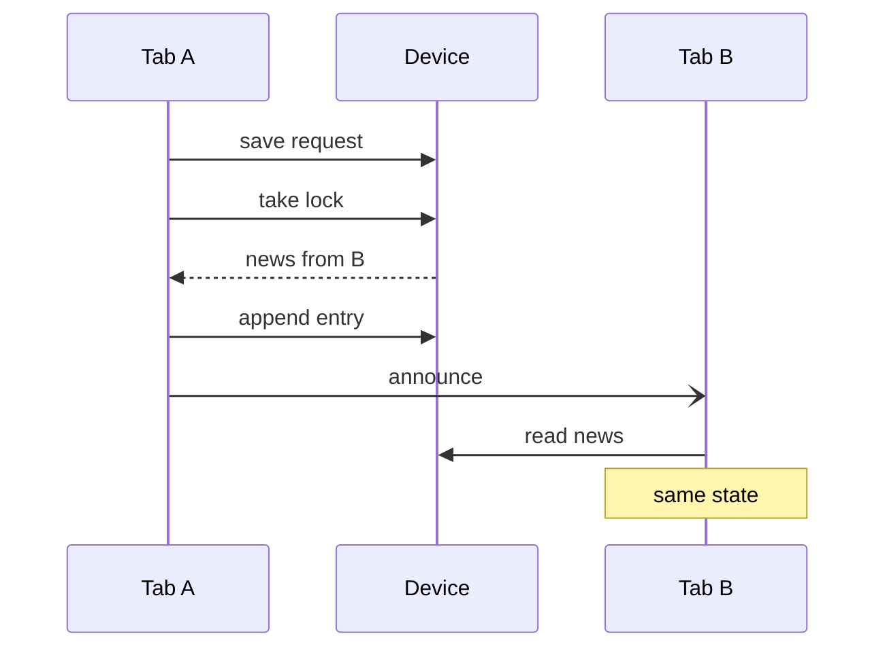
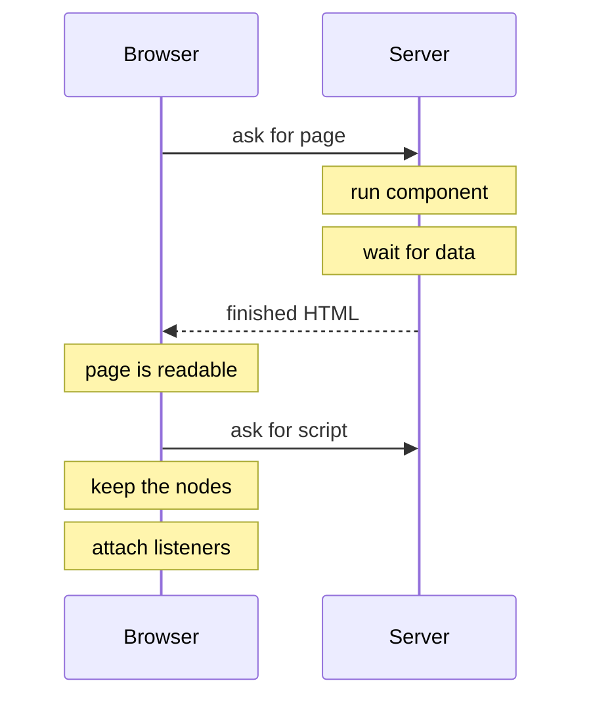

# API

Everything is imported from `spar` unless a line says otherwise. Each section names a file in this
repo where the API is used and type-checked.

## View

| Function                               | What it does                                                                                                               |
| -------------------------------------- | -------------------------------------------------------------------------------------------------------------------------- |
| `View.make(name, fields, draw)`        | Makes a view: `fields` gives a Schema for each prop, `draw` turns the props into JSX.                                      |
| `View.connect(props)(View)`            | Makes a component: `props` is `() => Effect<Props, E, R>`, run once on mount.                                              |
| `View.taking(fields, props)(View)`     | The same for a component its parent gives props to: `fields` is their Schema, `props` is `(outer) => Effect<Props, E, R>`. |
| `View.child(component, props)`         | Mounts a child from a parent's Effect and gives back its element.                                                          |
| `View.recover(ErrorSchema, ErrorView)` | Handles one tagged error with a view and removes it from the type.                                                         |
| `View.pending(PlaceholderView)`        | Shows a placeholder until the component's Effect finishes. Needs errors handled first.                                     |
| `View.split(PlaceholderView, load)`    | A component whose code is imported when it is first shown; the placeholder takes the same props.                           |
| `View.crash(FallbackView)`             | Shows a fallback if the component's Effect dies, and reports it.                                                           |
| `View.mapProps(f)`                     | Changes the props a component takes.                                                                                       |
| `View.branch(test, Other)`             | Mounts `Other` instead when `test(props)` holds.                                                                           |
| `View.portal`                          | Mounts the component in a layer above the app.                                                                             |

```ts
export const AgentPage = pipe(
  View.taking({ id: Schema.String }, agentProps)(AgentPageView),
  View.recover(AgentNotFound, AgentMissingView),
  View.pending(AgentLoadingView),
)
```

(`apps/sidebar/src/AgentPage.ts`)

## Props

A view's props are declared as a record of Schemas. Plain data uses `Schema` as it is; what is
not data has a Schema of its own kind:

| Schema                                                           | A prop that is                                       |
| ---------------------------------------------------------------- | ---------------------------------------------------- |
| `Props.Reactive(schema)`                                         | a reactive value of that type                        |
| `Props.State(schema)`                                            | UI state the view may also set                       |
| `Props.Action`                                                   | something to run from a handler                      |
| `Props.Handler("keydown")`, `Props.Handler("input", "textarea")` | a handler for that event, on that element when named |
| `Props.Callback(schema)`                                         | a function from a value to an action                 |
| `Props.Element`, `Props.Handle`                                  | an element to place, a handle to an element          |
| `Form.Field(schema)`, `Router.Link`, `Overlay.Placement`         | a form field, a link, where an overlay sits          |

`Props.kind(guard, show)` makes one for a type of your own. `Props.allShown(fields, props)` gives a
view's props as plain values, which is what the inspector and the MCP tools read.

## Reactive

A `Reactive<A>` is a value that changes: `get` reads it and `changes` is a stream that starts with
the current value.

| Function                                                                                      | What it does                                                          |
| --------------------------------------------------------------------------------------------- | --------------------------------------------------------------------- |
| `Reactive.map(reactive, f)`                                                                   | A derived value.                                                      |
| `Reactive.zip(a, b)`                                                                          | Both values as a pair (an Effect, scoped to the component).           |
| `Reactive.mapBy(key, Component, toProps)`                                                     | A keyed list. `toProps(item, key)` gets each row's own reactive item. |
| `Reactive.when(Component, props)`                                                             | Mounts a component while a boolean is true.                           |
| `Reactive.fromStream(initial, stream)`                                                        | Any stream as a reactive value, owned by the scope.                   |
| `Reactive.fromSubscriptionRef(ref)`, `Reactive.succeed(value)`, `Reactive.make(get, changes)` | Other ways to make one.                                               |

```ts
const rows =
  yield *
  pipe(
    Reactive.map(props.section, (section) => section.rows),
    Reactive.mapBy(
      (agent: Agent) => agent.id,
      AgentRow,
      (agent, id) => ({ agent, id, editing: props.editing }),
    ),
  )
```

(`apps/sidebar/src/Sidebar.ts`)

## UiState

`UiState.make(name, schema, initial)` in a component's Effect; `UiState.set(state, value)` and
`UiState.update(state, f)` as event handlers. A `UiState` is also a `Reactive`.

Every piece is kept in one tree, under its component's place: the names of the views from the root
down, with a row's key in brackets (`Board / Note[a]`), and a number when two share a place
(`Panel#2`). It is there while the component is mounted and gone when it leaves.
`UiState.snapshot` reads the whole tree as plain JSON (each value encoded by its Schema),
`UiState.changes` is the stream of what was added, set and removed, `UiState.put(path, name, value)`
sets one piece from outside (refused when the value does not fit the Schema), and
`UiState.restore(snapshot)` puts a whole snapshot back, keeping values for components that are not
on screen until they mount. Give an app its own tree with
`Layer.succeed(UiState.Tree, UiState.makeTree())`; a server render always has its own.

```tsx
<button onClick={UiState.update(open, (shown) => !shown)}>Options</button>
```

## Store

| Function                                                              | What it does                                                                                                           |
| --------------------------------------------------------------------- | ---------------------------------------------------------------------------------------------------------------------- |
| `Store.Tag<Self>()(key, { state, initialState, actions, selectors })` | Defines a store as a service class.                                                                                    |
| `Store.selector(Schema, select)`                                      | One named reading of the state, with a Schema for what it gives. A plain function is a compile error.                  |
| `Store.action(Schema, reduce)`                                        | One action: a payload Schema and a pure reducer.                                                                       |
| `Self.layer(reactions?)`                                              | The store in memory, for the whole app: provide it where the app is mounted.                                           |
| `Self.with(component, reactions?)`                                    | The store beside one component: mounting the result makes the store, and each place it is mounted has its own.         |
| `Self.layerDurable({ compactAfter? }, reactions?)`                    | The store kept on the device (needs a `KeyValueStore`). Fails with `Store.Unreadable` if saved data no longer decodes. |
| `Store.after(action, effect)`                                         | Runs an Effect after an action.                                                                                        |
| `Store.outbox(action, send)`                                          | Sends the action's payload through the outbox.                                                                         |
| `Store.replay(definition, entries)`                                   | Rebuilds state from a log.                                                                                             |

A store service has `state`, `log`, `select.<name>`, `commands.<name>(payload)`, `viewing` and
`travelTo(seq | null)`.

(`apps/sidebar/src/BoardStore.ts`)

### A store that refuses

`Store.action(Schema, reduce, refusal)` takes a third argument, a guard: it is given the state and
the payload and answers with a reason, or null when the command is accepted. A refused command
changes nothing and is not added to the store's log. It is noted in the log of everything that
happened as `refused` with the reason, its span carries `spar.refused`, and `store.refused` is the
last refusal since the store last accepted a command. This is how a store is a state machine:
a field names the state and each action's guard says in which states it applies
(`apps/sidebar/src/ResetCounter.ts`, `docs/state-and-server-data.md`).

`Store.after(action, (payload, state, send) => effect)`: `send(otherAction, payload)` commits
another action of the same store, so async work started by one command reports back as another.

### A store beside its view

```ts
export class NotesStore extends Store.Tag<NotesStore>()("sidebar/Notes", { ... }) {}

const NotesPanel = View.taking({ id: Schema.String, title: Schema.String }, ...)(NotesView)

export const Notes = NotesStore.with(NotesPanel)
```

`Notes` is one unit: mount it anywhere with `View.child(Notes, props)` and nothing is wired at the
app root. The store is made when the unit mounts and closed when it unmounts. Its key is the
store's key and the place it is mounted (`sidebar/Notes @ ShellView / NotesView`), a second one
beside it is numbered (`... NotesView#2`), and it registers with the devtools like every other
store, so its actions are in the one log and it rewinds and forks with the rest. Underneath it is
the same model, view, update as an app-wide store: one definition, pure reducers, every change an
action. (`apps/sidebar/src/Notes.ts`)

The build refuses any other way to hold state in app code (rule `state-only-through-spar`):
`Ref.make`, `SubscriptionRef.make` and their relatives, `let` and `var`. Code under a `server/`
folder is not page state and is left alone.

### Several tabs



Provide `Tabs.layerBrowser` in a browser and a durable store is one store across every open tab.
A command takes a cross-tab lock, first applies whatever other tabs have recorded since, then
records its own entry, so two tabs never write the same slot and a reducer always sees the latest
state. Idle tabs hear about new entries and follow. A tab that fell behind a fold of old entries
starts again from the saved state. Each command is written to the device before the lock is taken, so
one made just before a reload or a close is carried out by the next tab to open (and reported as
`Store.Abandoned` if that version no longer has the action). Without the layer a store behaves as if
it were the only tab.

## Outbox

`Outbox.Outbox.layer` (or `layerWith({ maxAttempts, attemptTimeout })`) needs a `KeyValueStore`.
Provide `Outbox.layerBrowser` in a browser: it follows the connection, lets one tab send, and tells
other tabs when something was added. The service has `pending`, `dead`, `retry(key)` and
`discard(key)`.

## Events

| Function                                                             | What it does                                                             |
| -------------------------------------------------------------------- | ------------------------------------------------------------------------ |
| `Events.onDocument(type, handler)`, `Events.onWindow(type, handler)` | A typed handler outside one element, in a component's scope.             |
| `Events.fromDocument(type)`, `Events.fromWindow(type)`               | The same events as streams.                                              |
| `Events.prevent(handler)`, `Events.stop(handler)`                    | A handler that prevents the default or stops propagation, synchronously. |
| `Events.online`, `Events.visible`, `Events.mediaQuery(query)`        | Reactive values for the connection, tab visibility and a media query.    |

Event props are `on` plus the DOM event name capitalised: `onClick`, `onKeydown`, `onPointerdown`.

## Handle

`Handle.make` in a component's Effect, `ref={handle}` on an element, then `Handle.focus(handle)`,
`Handle.scrollIntoView(handle)` or `Handle.measure(handle)`.

## Form

```ts
const form = yield * Form.make(Named, { name: "" })

return {
  field: form.field("name"),
  busy: form.submitting,
  onSubmit: form.submit(({ name }) => store.commands.spaceAdded({ name })),
}
```

`Form.text(field)` and `Form.checkbox(field)` are the props to spread on an input. A field's problem
shows once the field has been left or a submit was tried. Fail the submit Effect with
`new Form.Rejected({ message, fields })` to put a server's messages on their fields.
`form.submitThen(onValid, onDone)` also runs an action (closing a dialog, clearing the form) once
the submit has worked, and not when the input was invalid or the server refused it.

(`apps/sidebar/src/Sidebar.ts`, `packages/spar/test/form.test.ts`)

## Router

```ts
export const home = Router.route("/")
export const agentRoute = Router.route("/agents/:id", Schema.Struct({ id: Schema.String }))

page: yield *
  Router.outlet({
    routes: [Router.on(home, EmptyPageView), Router.on(agentRoute, AgentPage)],
    otherwise: MissingPageView,
  })
```

`Router.route(path, Schema)` decodes path and query params with a Schema. A path with `:params` cannot be declared without one, and the Schema must have every param the path names. A path ending in `/*` is a
layout that stays mounted while inner pages change. `Router.under(parent, path, Schema)` declares a route inside such a layout: the path is added to the parent's, and the Schema must carry every param of the whole path. The service has `location`, `go(route, params)`,
`replace`, `back` and `link(route, params)`. `Router.focusOnChange(handle)` moves focus after a
navigation. `Router.live(route, Page)` keeps the page mounted while only the query changes and
gives it `params` as a reactive value, where `Router.on` mounts a fresh page for every change. In
a browser, a new page starts at the top and going back or forward puts the page where it was
scrolled to, waiting for late content for up to two seconds. `Router.focusOnChange(handle)` moves
focus to the page on every navigation; after a link it lets the browser bring the page into view,
and after back or forward it leaves the scroll position alone. Layers: `Router.Router.layerBrowser` and `Router.Router.layerMemory(url)`.

(`apps/sidebar/src/Shell.ts`, `packages/spar/test/router.test.ts`)

## Overlay

Inside a component wrapped in `View.portal`: `Overlay.modal({ onDismiss, initialFocus? })` makes
everything beneath inert, locks scrolling, keeps Tab inside, dismisses on Escape and returns focus;
`Overlay.dismissable({ onDismiss, anchor? })` is for menus; `Overlay.position(anchor)` gives styles
that place the layer by its anchor: below it or above, whichever has more room, from the left edge
or the right, never past the edge of the window, and no taller than the room there is.

## On a server



`Server.render(Component, { layer })` runs the same component on a server and gives its HTML
and the state it drew from: each store's state encoded by its Schema, the UI state tree, and the
trace of the render. `Server.renderToString` gives only the HTML. `Server.renderInPieces` sends the page as first drawn and then each query's data as it lands (`docs/routing-and-data.md`). Loading parts (`View.pending`)
are waited for, so the page arrives complete; overlays are left out; `Events` values take their
resting values (online, visible, no media query matching) and window listeners are not attached.

There are no directives. The component is the same in both places, and the layers it is given
decide where its data comes from. On the server a store starts from data loaded there,
`Self.layerFrom(load)`, and a service reads the database directly. In the browser the same store
is `Self.layer()`, which starts from the state the server sent, and the same service asks over
the network.

`Server.renderToStream(Component, { layer, open, close, end })` sends the document in parts:
`open` at once, before anything is drawn, then the page, `close`, the state as a
`<script type="application/json" id="spar-state">`, and `end`. `Server.stateScript(state)` is that
script on its own.

In the browser, `App.hydrate(Component, { target, layer })` takes the page over instead of
building it again: it keeps the server's nodes, attaches listeners and bindings to them, and
repairs whatever does not match what the component would have drawn. It reads the state script,
so stores and UI state start where the server left them, and its span `App.hydrate` is a child of
the server's `Server.render`: the render and the takeover are one trace. While it takes over,
loading parts are waited for as on the server, so nothing flickers back to a placeholder.
`App.mount` and `App.hydrate` both take `shown`, an effect run once the first picture is up.

(`apps/ssr`: `server/layers.ts` and `src/client.ts` are the two sets of layers.)

## One application, front to back

Every DOM handler runs in a span named `on <event>`, the root of a trace. What it causes stays in
that trace: the store command (`<store>/<action>`), what the outbox saves and later sends, even
after a restart (`Outbox.persist`, `Outbox.deliver`), navigation (`Router.go`), each component
that mounts because of it (a span with the view's name), and each call to the backend. Calls go
through Effect RPC, which carries the trace to the server, so the backend's spans are children of
the page's.

The contract is shared: an `RpcGroup` whose payloads, results and failures are Schemas. A failure
named in the contract is in the calling component's error type, so a component that calls the
backend and does not `View.recover` it cannot be mounted.

`spar/devtools/spans` is a span buffer for either side: `Spans.layer()` wraps whatever tracer is
installed and keeps the newest spans; `SpanBuffer.ofTrace(id)` and `recent()` give them as plain
data. `spar/devtools/span-routes` has `route` (`GET /spans/:traceId`) and `recentRoute`
(`GET /spans`) for an Effect HTTP server.

(`apps/sidebar`: `src/api.ts` is the contract, `server/handlers.ts` and `scripts/backend.ts` the
backend; `bun run backend` serves the app with it, and `bun run traced` follows one trace through
both in a real browser.)

## Query

Server data lives in a store. `Query.Tag` declares one: it is a `Store.Tag` underneath, so it is
in the log, the devtools and the traces like any other.

| Function                                                                       | What it does                                                                                                                                                                         |
| ------------------------------------------------------------------------------ | ------------------------------------------------------------------------------------------------------------------------------------------------------------------------------------ |
| `Query.Tag<Self>()(key, { input, success, failure, load, staleAfter, retry })` | Declares the query: Schemas for its input, what it loads and how it fails, `load(input)`, how long an answer stays fresh, and a schedule to try again on before it counts as failed. |
| `Self.ask(input)`                                                              | Declares, in a component's Effect, that this input is needed. Returns a handle at once.                                                                                              |
| `Self.read(input)`                                                             | The loaded value for an input, or null. For another store's after-effect.                                                                                                            |
| `Self.live`                                                                    | Its layer, for the whole app.                                                                                                                                                        |
| `Self.beside(component)`                                                       | The query beside one component, as `.with` does for a store.                                                                                                                         |
| `Self.invalidate`, `Self.invalidatedBy(action)`                                | Load everything it holds again; a reaction for another store's layer that does so after that action.                                                                                 |
| `Self.patchedBy(action, input, patch)`                                         | A reaction for another store's layer: after that action, change the loaded value for `input(payload)` at once. With `Store.outbox` on the same action, an optimistic update.         |

`ask` takes a plain value, a reactive value, or a reactive `Option` (`Schema.Void` as the input
means no argument). The handle has `status` (`waiting` while the input is none, then `loading`,
`loaded` or `failed`), `value`, `error`, `loading`, `latest` (the last value loaded under any
input, for paging without a blank) and `refetch`, all reactive. It asks again
when the input changes; an input that is still fresh is a cache hit. One request runs for each
input at a time (a second is refused) and an answer to an earlier request is refused. Because
nothing awaits in a component's Effect, every query declared in a tree starts in the same pass,
and a query whose input comes from another query's value waits only for that value.
While a component is using it, a query asks again for what has gone stale when the tab is shown
again or the connection comes back. Data already there is served with a short span that links to
the trace that loaded it. An entry no component is using is released, then dropped after `dropAfter` (5 minutes unless
set); over `keepAtMost` entries (100 unless set) the longest unused are dropped at once. An entry
in use is never dropped. `Self.pages({ first, next })` reads a list a page at a time: `pages`,
`loading`, `failed`, `more` and `loadMore`. (`apps/sidebar/src/People.ts`, `docs/state-and-server-data.md`)

## Backend

Every call to a backend goes through one client, so each is a span in the trace and an entry in
the log.

| Function                    | What it does                                                                                                  |
| --------------------------- | ------------------------------------------------------------------------------------------------------------- |
| `Backend.layer`             | The `HttpClient` of the app. Each request is noted in the log as a `call` with the trace it belongs to.       |
| `Backend.layerFrom(client)` | The same over another `HttpClient` layer (a test double, a client with a base address).                       |
| `Backend.rpc(group, url)`   | A client for an Effect RPC group over that `HttpClient`. This is the blessed way to talk to your own backend. |
| `Backend.layerTelemetry`    | A client for telemetry exporters. It is deliberately not logged, or each export would log itself.             |
| `Backend.beacon(url, body)` | `navigator.sendBeacon`, for what must still be sent as the page goes away.                                    |

How the other ways fit:

- **Effect RPC** is the one to use for a backend you own: the contract, its errors and the trace
  context are shared, and an error the component does not handle is a compile error.
- **Effect HttpApi** clients and **hand-written JSON calls** take `HttpClient.HttpClient` from
  context. Provide `Backend.layer` and they are logged and traced like RPC.
- **Generated OpenAPI clients** fit when they are built on an Effect `HttpClient`. Ones that call
  `fetch` themselves are refused.
- **tRPC, axios, ky, got, superagent, graphql-request, openapi-fetch, Apollo, socket.io-client**,
  and plain `fetch`, `XMLHttpRequest`, `WebSocket`, `EventSource`, `sendBeacon` and
  `FetchHttpClient.layer` are refused by the build (rule `backend-only-through-spar`). Port a tRPC
  router to an RPC group.

(`apps/sidebar/src/server/Server.ts`, `apps/sidebar/src/main.ts`)

A WebSocket goes through `Backend.layerSocket(url)`, which gives Effect's `Socket` service: what
it sends and receives is in the log as calls, a batch of frames at a time. `Backend.heard(url,
socket)` does the same for a socket made another way. The build refuses `new WebSocket` and
`Socket.makeWebSocket` in app code.

## Timeline

`Timeline.note(kind, name, detail)` reports something that happened to whoever is recording; with
nobody recording it does nothing. Store commands, `UiState.set` and `update`, and route changes
report themselves; use it for data arriving from a server. Each note carries the trace and span it
happened in.

## Devtools

The devtools are not part of an app. In development the Vite plugin adds them:

```ts
import { sparDevtools } from "spar/devtools/vite"

export default defineConfig({
  plugins: [sparJsx, sparDevtools({ backends: ["http://127.0.0.1:4182"] })],
})
```

It only acts on the dev server. A production build carries no devtools code at all
(`apps/sidebar` checks its own build for that as part of `check`). `backends` are the servers
that expose `GET /spans/:traceId`; leave it out when there is none.

What the tools show, docked at the corner of the page:

- **Inspector.** Pick a component on the page: it is outlined as you move over it, and picking it
  shows its place in the tree, the props its view receives as plain values (reactive ones as they
  are now, and the store selector each comes from), its UI state, the services its Effect uses,
  the failures it recovers from, and a list of what changed in it after each action.
- **Everything that happened.** One log of store commands, UI state changes, route changes and
  data arriving and backend calls, in order, each with its trace id. Jump to any moment, step
  earlier and later, or go back to now; the whole app, stores and UI state together, shows that
  moment, and stepping opens the trace of the moment stepped to.
- **Fork.** "Fork from here" carries the running program on from the moment being shown, in a new
  branch, and keeps the original. The Branches list switches between them. A fork lives in the
  page: a durable store's saved log is not rewritten, so a reload returns to what was saved.
- **Trace.** Any moment opens as a waterfall of its spans: the page's and the backends' on one
  time line, nested by parent, with how long each took and the failed ones marked.
- **Stores.** Each store's actions and state, with Back, Forward, Live and Go to; export a log as
  JSON text, or paste one and load it to see where it leads without touching the live state. When
  the app has an outbox: how many items are waiting, and what could not be sent, each with Retry
  and Discard.

An app can also include the stores panel on purpose: provide `Devtools.layer` (from
`spar/devtools`) to its store layers and mount `Devtools.Panel`.

### For agents

`bun run --cwd packages/devtools-mcp start` runs a small server on 127.0.0.1:4188 (set
`SPAR_DEVTOOLS_PORT` to change it). An app that provides
`DevtoolsLink.layer({ url })` from `@spar/devtools-mcp/client` beside `Devtools.layer` reports to
it over Effect RPC; the demo does when opened with `?devtools=http://127.0.0.1:4188`. An agent
connects to `http://127.0.0.1:4188/mcp` (MCP over HTTP) and can ask what the app is doing right
now:

| Tool                                     | What it gives                                                                                  |
| ---------------------------------------- | ---------------------------------------------------------------------------------------------- |
| `list_stores`, `get_state`, `get_log`    | The stores, a store's state, its recorded actions                                              |
| `travel_to`, `run_action`, `load_log`    | Step one store through its log, carry out an action, replay another log                        |
| `get_ui_state`, `set_ui_state`           | Every piece of UI state by component path; set one (refused when it does not fit its Schema)   |
| `get_timeline`, `rewind`                 | The one log with trace ids; show the whole app as it was after a moment                        |
| `list_components`, `get_component`       | The mounted components; one component's props, UI state, services and recovered failures       |
| `get_trace`                              | The spans the page recorded for a trace                                                        |
| `get_navigation`                         | The newest route change, its trace id and its spans; `back` counts back, `lens` keeps one kind |
| `step`                                   | One moment earlier or later; gives the moment and every span of its trace                      |
| `fork`, `list_branches`, `switch_branch` | Fork the program at the moment shown, list the branches, make another one the running one      |
| `count_moments`                          | How many times each thing happened, most frequent first                                        |
| `diff_states`                            | What changed in a store between two of its actions, by path                                    |

The same tools answer from a shell: `bun run --filter @spar/devtools-mcp cli tools` lists them and
`bun run --filter @spar/devtools-mcp cli call <tool> '<json>'` asks one (add `--url` when the
server is not on 127.0.0.1:4188).

Each failure comes back as a plain sentence. With several pages linked, the tools speak for the
one that reported last.

## App

`App.mount(component, { target, layer })` never returns; interrupting it unmounts everything.
`App.CrashReporter` is the reference to replace to receive crashes.

## spar/testing

`import * as Testing from "spar/testing"`: `render(view, props)`, `mount(component)`,
`find(role, name?)`, `findText(text)`, `gone(role, name?)`, `eventually(assertion)`,
`click(role, name?)`, `fill(role, name, value)`, `press(key)`.

## @spar/ui

`Button`, `SubmitButton`, `TextField`, `Select`, `Checkbox`, `Switch`, `Tabs`, `Menu`,
`Dialog(frame, View.child(Content, props))` (mounted with `{ onClose }`) and `Toast` (`Toast.Toasts` service, `Toast.Viewport`). Import
`@spar/ui/styles.css` once. One page per component in `apps/stories`.

- `Popover` (`label`, `text`, `content`): a button that opens a panel beside it. The panel takes
  focus, closes on Escape or a press elsewhere, and gives focus back.
- `Tooltip.make(text)`: gives `trigger`, props to spread on the button it describes, and `bubble`,
  an element to put next to it. Shown on hover and on focus, put away on leave, blur or Escape.
- `Listbox` (`label`, `name`, `choices`, `value`, `onChange`): a select drawn by the kit, for when
  the native control will not do. Arrow keys, Home, End, typing a first letter, Enter or Space to
  choose, and a hidden input so it posts with a form. `Select` stays the native control.

`Events.cancel(event)` is an action that stops what the browser would do with an event, for a
handler that only sometimes takes a key over.
