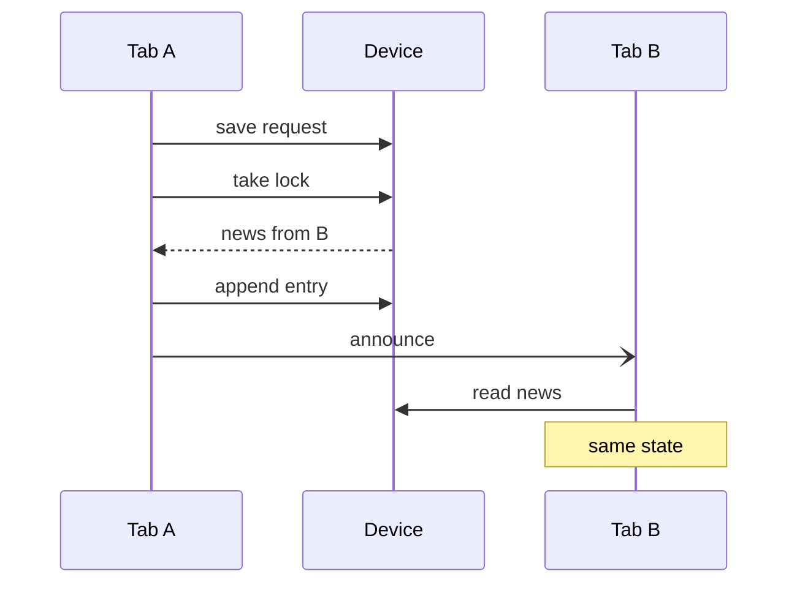
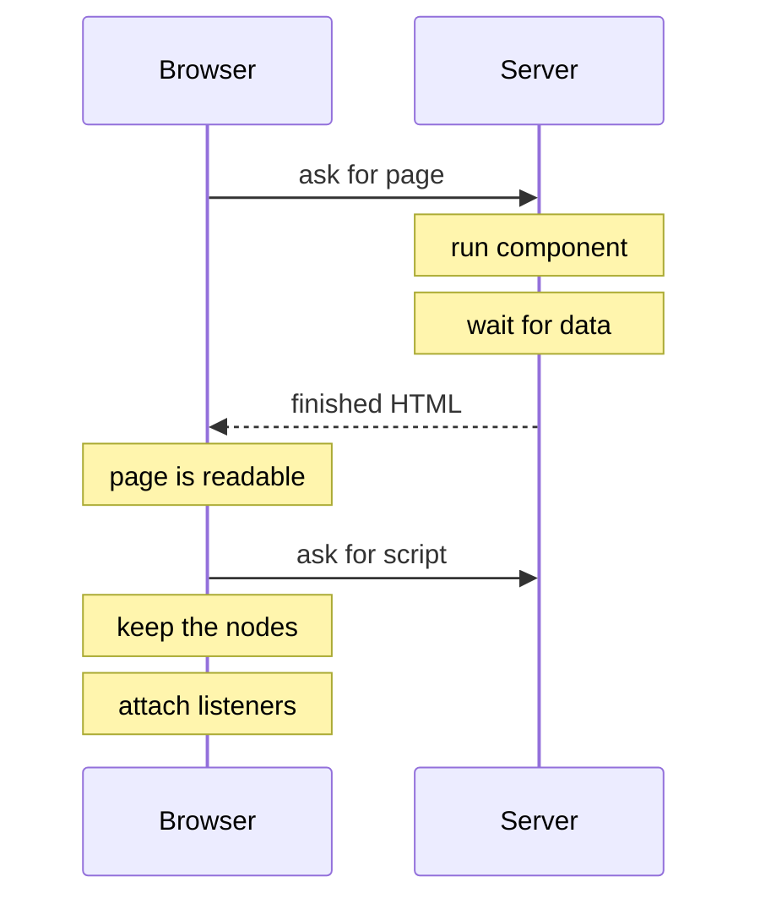

# API

Everything is imported from `spar` unless a line says otherwise. Each section names a file in this
repo where the API is used and type-checked.

## View

| Function                        | What it does                                                                           |
| ------------------------------- | -------------------------------------------------------------------------------------- |
| `View.connect(props)(View)`     | Makes a component: `props` is `(outer) => Effect<Props, E, R>`, run once on mount.     |
| `View.child(component, props)`  | Mounts a child from a parent's Effect and gives back its element.                      |
| `View.recover(tag, ErrorView)`  | Handles one tagged error with a view and removes it from the type.                     |
| `View.pending(PlaceholderView)` | Shows a placeholder until the component's Effect finishes. Needs errors handled first. |
| `View.crash(FallbackView)`      | Shows a fallback if the component's Effect dies, and reports it.                       |
| `View.mapProps(f)`              | Changes the props a component takes.                                                   |
| `View.branch(test, Other)`      | Mounts `Other` instead when `test(props)` holds.                                       |
| `View.portal`                   | Mounts the component in a layer above the app.                                         |

```ts
export const AgentPage = pipe(
  View.connect(agentProps)(AgentPageView),
  View.recover("AgentNotFound", AgentMissingView),
  View.pending(AgentLoadingView),
)
```

(`apps/sidebar/src/AgentPage.ts`)

## Reactive

A `Reactive<A>` is a value that changes: `get` reads it and `changes` is a stream that starts with
the current value.

| Function                                                                                      | What it does                                                          |
| --------------------------------------------------------------------------------------------- | --------------------------------------------------------------------- |
| `Reactive.map(reactive, f)`                                                                   | A derived value.                                                      |
| `Reactive.zip(a, b)`                                                                          | Both values as a pair (an Effect, scoped to the component).           |
| `Reactive.mapBy(key, Component, toProps)`                                                     | A keyed list. `toProps(item, key)` gets each row's own reactive item. |
| `Reactive.when(Component, props)`                                                             | Mounts a component while a boolean is true.                           |
| `Reactive.fromStream(initial, stream)`                                                        | Any stream as a reactive value, owned by the scope.                   |
| `Reactive.fromSubscriptionRef(ref)`, `Reactive.succeed(value)`, `Reactive.make(get, changes)` | Other ways to make one.                                               |

```ts
const rows =
  yield *
  pipe(
    Reactive.map(props.section, (section) => section.rows),
    Reactive.mapBy(
      (agent: Agent) => agent.id,
      AgentRow,
      (agent, id) => ({ agent, id, editing: props.editing }),
    ),
  )
```

(`apps/sidebar/src/Sidebar.ts`)

## UiState

`UiState.make(name, schema, initial)` in a component's Effect; `UiState.set(state, value)` and
`UiState.update(state, f)` as event handlers. A `UiState` is also a `Reactive`.

Every piece is kept in one tree, under its component's place: the names of the views from the root
down, with a row's key in brackets (`Board / Note[a]`), and a number when two share a place
(`Panel#2`). It is there while the component is mounted and gone when it leaves.
`UiState.snapshot` reads the whole tree as plain JSON (each value encoded by its Schema),
`UiState.changes` is the stream of what was added, set and removed, `UiState.put(path, name, value)`
sets one piece from outside (refused when the value does not fit the Schema), and
`UiState.restore(snapshot)` puts a whole snapshot back, keeping values for components that are not
on screen until they mount. Give an app its own tree with
`Layer.succeed(UiState.Tree, UiState.makeTree())`; a server render always has its own.

```tsx
<button onClick={UiState.update(open, (shown) => !shown)}>Options</button>
```

## Store

| Function                                                              | What it does                                                                                                           |
| --------------------------------------------------------------------- | ---------------------------------------------------------------------------------------------------------------------- |
| `Store.Tag<Self>()(key, { state, initialState, actions, selectors })` | Defines a store as a service class.                                                                                    |
| `Store.selector(Schema, select)`                                      | One named reading of the state, with a Schema for what it gives. A plain function is a compile error.                  |
| `Store.action(Schema, reduce)`                                        | One action: a payload Schema and a pure reducer.                                                                       |
| `Self.layer(reactions?)`                                              | The store in memory.                                                                                                   |
| `Self.layerDurable({ compactAfter? }, reactions?)`                    | The store kept on the device (needs a `KeyValueStore`). Fails with `Store.Unreadable` if saved data no longer decodes. |
| `Store.after(action, effect)`                                         | Runs an Effect after an action.                                                                                        |
| `Store.outbox(action, send)`                                          | Sends the action's payload through the outbox.                                                                         |
| `Store.replay(definition, entries)`                                   | Rebuilds state from a log.                                                                                             |

A store service has `state`, `log`, `select.<name>`, `commands.<name>(payload)`, `viewing` and
`travelTo(seq | null)`.

(`apps/sidebar/src/BoardStore.ts`)

### Several tabs



Provide `Tabs.layerBrowser` in a browser and a durable store is one store across every open tab.
A command takes a cross-tab lock, first applies whatever other tabs have recorded since, then
records its own entry, so two tabs never write the same slot and a reducer always sees the latest
state. Idle tabs hear about new entries and follow. A tab that fell behind a fold of old entries
starts again from the saved state. Each command is written to the device before the lock is taken, so
one made just before a reload or a close is carried out by the next tab to open (and reported as
`Store.Abandoned` if that version no longer has the action). Without the layer a store behaves as if
it were the only tab.

## Outbox

`Outbox.Outbox.layer` (or `layerWith({ maxAttempts, attemptTimeout })`) needs a `KeyValueStore`.
Provide `Outbox.layerBrowser` in a browser: it follows the connection, lets one tab send, and tells
other tabs when something was added. The service has `pending`, `dead`, `retry(key)` and
`discard(key)`.

## Events

| Function                                                             | What it does                                                             |
| -------------------------------------------------------------------- | ------------------------------------------------------------------------ |
| `Events.onDocument(type, handler)`, `Events.onWindow(type, handler)` | A typed handler outside one element, in a component's scope.             |
| `Events.fromDocument(type)`, `Events.fromWindow(type)`               | The same events as streams.                                              |
| `Events.prevent(handler)`, `Events.stop(handler)`                    | A handler that prevents the default or stops propagation, synchronously. |
| `Events.online`, `Events.visible`, `Events.mediaQuery(query)`        | Reactive values for the connection, tab visibility and a media query.    |

Event props are `on` plus the DOM event name capitalised: `onClick`, `onKeydown`, `onPointerdown`.

## Handle

`Handle.make` in a component's Effect, `ref={handle}` on an element, then `Handle.focus(handle)`,
`Handle.scrollIntoView(handle)` or `Handle.measure(handle)`.

## Form

```ts
const form = yield * Form.make(Named, { name: "" })

return {
  field: form.field("name"),
  busy: form.submitting,
  onSubmit: form.submit(({ name }) => store.commands.spaceAdded({ name })),
}
```

`Form.text(field)` and `Form.checkbox(field)` are the props to spread on an input. A field's problem
shows once the field has been left or a submit was tried. Fail the submit Effect with
`new Form.Rejected({ message, fields })` to put a server's messages on their fields.
`form.submitThen(onValid, onDone)` also runs an action (closing a dialog, clearing the form) once
the submit has worked, and not when the input was invalid or the server refused it.

(`apps/sidebar/src/Sidebar.ts`, `packages/spar/test/form.test.ts`)

## Router

```ts
export const home = Router.route("/")
export const agentRoute = Router.route("/agents/:id")

page: yield *
  Router.outlet({
    routes: [Router.on(home, EmptyPageView), Router.on(agentRoute, AgentPage)],
    otherwise: MissingPageView,
  })
```

`Router.route(path, Schema)` decodes path and query params with a Schema. A path ending in `/*` is a
layout that stays mounted while inner pages change. The service has `location`, `go(route, params)`,
`replace`, `back` and `link(route, params)`. `Router.focusOnChange(handle)` moves focus after a
navigation. `Router.live(route, Page)` keeps the page mounted while only the query changes and
gives it `params` as a reactive value, where `Router.on` mounts a fresh page for every change. In
a browser, a new page starts at the top and going back or forward puts the page where it was
scrolled to, waiting for late content for up to two seconds. `Router.focusOnChange(handle)` moves
focus to the page on every navigation; after a link it lets the browser bring the page into view,
and after back or forward it leaves the scroll position alone. Layers: `Router.Router.layerBrowser` and `Router.Router.layerMemory(url)`.

(`apps/sidebar/src/Shell.ts`, `packages/spar/test/router.test.ts`)

## Overlay

Inside a component wrapped in `View.portal`: `Overlay.modal({ onDismiss, initialFocus? })` makes
everything beneath inert, locks scrolling, keeps Tab inside, dismisses on Escape and returns focus;
`Overlay.dismissable({ onDismiss, anchor? })` is for menus; `Overlay.position(anchor)` gives styles
that place the layer by its anchor: below it or above, whichever has more room, from the left edge
or the right, never past the edge of the window, and no taller than the room there is.

## On a server



`Server.renderToString(Component, { layer })` runs the same component on a server and gives its
HTML. Loading parts (`View.pending`) are waited for, so the page arrives complete; overlays are
left out; `Events` values take their resting values (online, visible, no media query matching)
and window listeners are not attached. Give it server layers: `Router.Router.layerMemory(url)`,
stores in memory or over a `KeyValueStore` you provide.

In the browser, `App.hydrate(Component, { target, layer })` takes the page over instead of
building it again: it keeps the server's nodes, attaches listeners and bindings to them, and
repairs whatever does not match what the component would have drawn. While it takes over,
loading parts are waited for as on the server, so nothing flickers back to a placeholder.
`App.mount` and `App.hydrate` both take `shown`, an effect run once the first picture is up.

(`apps/ssr`)

## Devtools

Provide `Devtools.layer` to the store layers and mount `Devtools.Panel`: each store's actions and
state, with Back, Forward, Live and Go to. Actions restored from the device can be stepped to as
well. Export log gives a store's actions as JSON text; pasting a log and pressing Load log replays
it from the store's first state and shows the result without touching the live state (Live goes
back). When the app has an outbox, the panel also shows how many items are waiting and lists what
could not be sent, each with Retry and Discard.

### For agents

`bun run --cwd packages/devtools-mcp start` runs a small server on 127.0.0.1:4188 (set
`SPAR_DEVTOOLS_PORT` to change it). An app that provides
`DevtoolsLink.layer({ url })` from `@spar/devtools-mcp/client` beside `Devtools.layer` reports its
stores to it over Effect RPC; the demo does when opened with `?devtools=http://127.0.0.1:4188`. An
agent connects to `http://127.0.0.1:4188/mcp` (MCP over HTTP) and gets six tools: `list_stores`,
`get_state`, `get_log`, `travel_to`, `run_action` and `load_log`. Each failure comes back as a
plain sentence. With several pages linked, the tools speak for the one that reported last.

## App

`App.mount(component, { target, layer })` never returns; interrupting it unmounts everything.
`App.CrashReporter` is the reference to replace to receive crashes.

## spar/testing

`import * as Testing from "spar/testing"`: `render(view, props)`, `mount(component)`,
`find(role, name?)`, `findText(text)`, `gone(role, name?)`, `eventually(assertion)`,
`click(role, name?)`, `fill(role, name, value)`, `press(key)`.

## @spar/ui

`Button`, `SubmitButton`, `TextField`, `Select`, `Checkbox`, `Switch`, `Tabs`, `Menu`,
`Dialog(frame, Content)` and `Toast` (`Toast.Toasts` service, `Toast.Viewport`). Import
`@spar/ui/styles.css` once. One page per component in `apps/stories`.

- `Popover` (`label`, `text`, `content`): a button that opens a panel beside it. The panel takes
  focus, closes on Escape or a press elsewhere, and gives focus back.
- `Tooltip.make(text)`: gives `trigger`, props to spread on the button it describes, and `bubble`,
  an element to put next to it. Shown on hover and on focus, put away on leave, blur or Escape.
- `Listbox` (`label`, `name`, `choices`, `value`, `onChange`): a select drawn by the kit, for when
  the native control will not do. Arrow keys, Home, End, typing a first letter, Enter or Space to
  choose, and a hidden input so it posts with a form. `Select` stays the native control.

`Events.cancel(event)` is an action that stops what the browser would do with an event, for a
handler that only sometimes takes a key over.
