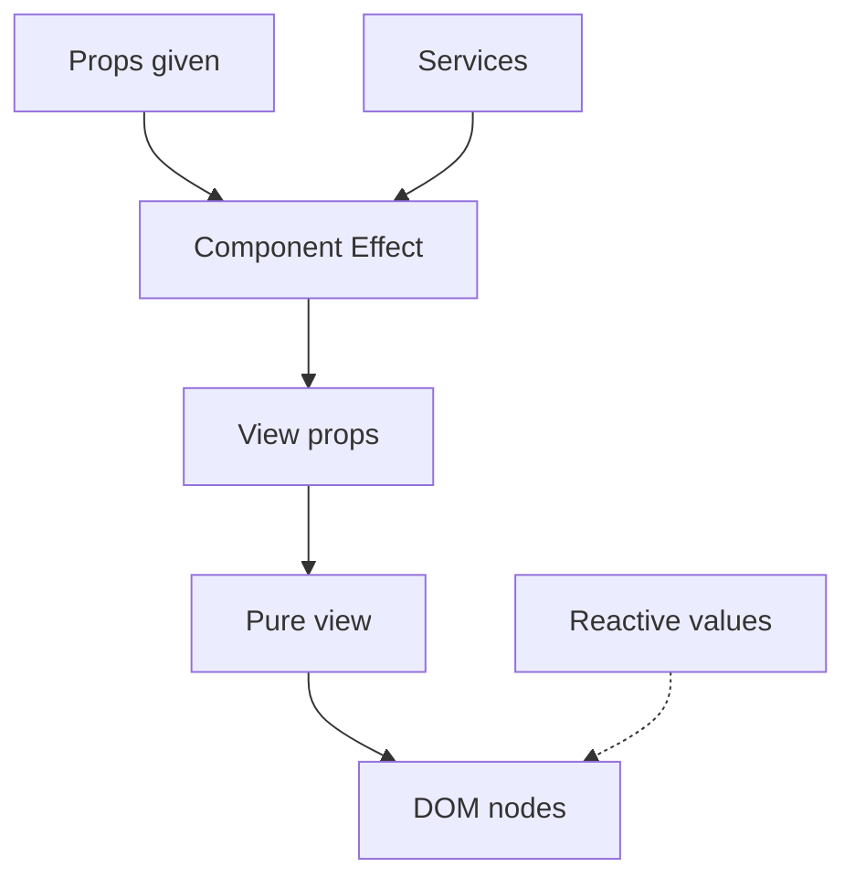

# Principles

Each principle says what it is and what it rules out. Rules are enforced by types or by Spar's own
JSX build step, never by a lint rule, and each has a file under `apps/demo/forbidden` that must fail
to compile.

How one component is put together: its Effect runs once with the props it was given and the
services it asks for, and hands plain props to a pure view. After that, only reactive values
touch the page.

## 1. Set up once, bind at the leaf

A view function runs one time and builds real DOM nodes. A reactive value placed in the markup is
bound to exactly one text node or attribute, and only that node is written when the value changes.
There is no virtual DOM and nothing re-renders. A store command updates the screen before it
returns.

Rules out: stale closures, dependency arrays, memoization, and every bug that comes from a
component function running again.

## 2. A component is enhancers that make its props, then a pure view

`compose(...enhancers)((props) => <jsx />)`. Each enhancer is a plain function from the props so
far to an Effect of the props it adds; `withProps(fields)` declares the props a parent gives, with
a Schema for each, and a first enhancer that asks for props any other way does not compile. The
enhancers are ordinary Effect code. They run once when the component mounts, in the component's
own scope, and everything they started is cancelled when the component unmounts. The view comes
last, inline, and only draws: it cannot reach a service, and outside `compose` the build rejects a
view written as a plain function (use `View.make(name, fields, draw)` there). Every component keeps
its view as `.view`, so a test or a story can render it with sample props.

Rules out: hook ordering rules, effects that run again, leaked subscriptions and timers, views that
fetch, and services smuggled into a view.

## 3. Errors and layers are part of a component's type and are settled at mount

`Component<Props, E, R>` carries what can fail and what it needs, the same way an Effect does.
`App.mount` only accepts a component with no errors left and a layer that provides everything it
needs.

Rules out: a load failure nobody handles and a missing provider. Both are compile errors.

## 4. Children with needs are placed by the Effect, not by JSX

TypeScript gives every JSX expression the same type, so a connected component used as a tag would
silently lose its errors and layers. A connected component is therefore not a function and cannot be
a tag. The parent's Effect mounts it with `View.child`, `Reactive.mapBy`, `Reactive.when` or
`Router.outlet` and hands the view a finished element. Only pure views are JSX tags.

Rules out: requirements and errors that disappear somewhere in the middle of the tree.

## 5. Composition is plain functions

`recover`, `pending`, `crash`, `mapProps`, `branch` and `portal` each take a component and return a
component, combined with `pipe` or `flow`. `recover` removes the error it handles from the type.
`pending` only accepts a component with no errors left, because a placeholder would hide a failure
that arrives later. `portal` supplies the overlay layer that `Overlay.modal` needs, so modal
behaviour outside a portal does not compile.

Rules out: class components, a context API, lifecycle hooks and wrapper hierarchies.

## 6. UI state and app state are different types

`UiState.make(name, schema, initial)` only works inside a component's Effect. It can be read anywhere it is
passed, but it can only be changed by a `UiState.set` or `UiState.update` value, and the only thing
that runs those is a DOM event handler (including `Events.onDocument` and `Events.onWindow`, which
also only work inside a component). Its Schema describes the value for the devtools and for
restoring it; the state itself is a live handle, not data, so it cannot be a command payload. Form input
is UI state inside `Form`. App state lives in stores and nowhere else.

Rules out: local state kept in sync with a store, UI state created in a service, UI state sent to
the server or saved.

## 7. App state changes only through named commands, and every one is logged

A store is a Schema for its state, an initial state, pure actions `(state, payload) => state` with a
Schema for each payload, and named selectors with a Schema for what each gives. None of the three
can be declared without its Schema. Commands return an Effect. The state is always computed from the
encoded payload that went into the log, so replaying the log gives the same state. Every store can
show any earlier state (`travelTo`), which is what the devtools use.

Rules out: state changed from anywhere, actions that cannot be saved or replayed, and a log that
drifts from the state.

## 8. Nothing the user did is lost

A durable store writes each action to the device before the state changes and comes back after a
reload. Anything leaving the device goes through the outbox: saved first, sent in order with one
idempotency key, retried, held while offline, sent by one tab at a time, and set aside with its
reason if it can never be sent.

Rules out: effects inside reducers, a sent item that is lost on reload, a retry the server sees as a
second send, and two tabs sending the same thing.

## 9. Lists, conditionals and pages are functions over reactive values

`Reactive.mapBy(key, Component, toProps)` keeps one mounted row per key and moves, adds and removes
rows as the list changes. `Reactive.when(Component, props)` mounts a component while a condition
holds. `Router.outlet` mounts the page for the current URL. None takes a function that returns JSX,
and JSX cannot appear inside an expression in other JSX.

Rules out: unkeyed lists, rows rebuilt on every change, inline ternaries and maps in markup, render
props, and a route whose page does not take that route's params.

## 10. A part that breaks does not take the page with it

`View.crash(Fallback)` shows a fallback for a part whose Effect dies. An event handler, a reactive
binding or a background load that dies is reported to `App.CrashReporter` and the rest keeps
working.

Rules out: a blank page, and failures nobody hears about.

## 11. The compiler and the build enforce the rules

Every rule above is a type error, or a failure of the JSX build step for the two things types cannot
see (JSX inside an expression, and `Effect.run` in a view file). A rule that neither can check is
left out instead of being written down as a convention.

Rules out: rules that hold only while everyone remembers them.

## 12. One way to do each thing

The surface is these modules: View, Reactive, UiState, Store, Outbox, Events, Handle, Form, Router,
Overlay, Devtools, App, and `spar/testing`. Timers are Effect's schedules and websockets are
`effect/socket`; Spar adds no wrapper for what Effect already ships.

Rules out: two styles of the same app in one codebase.

## 13. Everything declared has a Schema

Nothing that is data can be declared with a TypeScript type alone. Each of these takes a Schema, and
the plain form does not compile or does not build:

- a view's props (`View.make(name, fields, draw)`; a function that just returns JSX is rejected by
  the build outside `compose`), and a component's outer props (`withProps(fields)`);
- UI state (`UiState.make(name, schema, initial)`);
- a store's state, each command's payload and each selector's output;
- a route's params, whenever its path has any, and the Schema must name every one of them;
- an error a component recovers from (`View.recover(ErrorSchema, ErrorView)`).

What is not data has a Schema of its own kind, checked by what it is: reactive values and UI state
carry the Schema of their value, and actions, handlers, callbacks, elements, handles, links, form
fields and placements each have one. Reactive values themselves are plumbing between these points
and take no Schema of their own: wherever one is shown, kept or passed it crosses one of the
declarations above. DOM events are not data either; a handler prop names the event it takes.

The Schemas are what the devtools read: a component's props and UI state can be shown as plain
values, restored, and sent to an agent, without any of it being written twice.

Rules out: props, state and params that exist only as types, which nothing at run time can read,
check, show or restore.

## 14. One application, front to back

A click and everything it causes are one trace: the event, the command, what the outbox sends
(now or after a restart), the components that mount because of it, the call to the backend and the
backend's own work. The backend is reached through a shared Effect RPC contract, so its failures
are part of the calling component's type and an unhandled one is a compile error. The same
component runs on a server and in the browser; the layers it is given decide where its data comes
from, and the render and the takeover are one trace too.

Rules out: a front end and a back end that only meet in a network tab, failures that surface as
an unknown error, and directives that say where code runs.

## 15. What the app is doing can always be read

In development the tools are there without being asked for, and a production build has none of
their code. A person picks a component on the page and reads its data where it lives; an agent
asks the same over MCP. Both see one log of everything that happened, can show the app as it was
at any moment, and can open any moment as one trace across the page and the backend.

Rules out: debugging by guessing what state a component is in, and devtools that only work with a
browser extension or only for people.

## 16. State is declared where it is used and registered in one place

UI state and stores are made only through Spar: `UiState.make` in a component's Effect, and a
`Store.Tag` placed app-wide with `.layer` or beside a view with `.with`. Wherever one is declared,
making it registers it in the one registry the devtools read, and every change to it is an entry
in the one log. So a component can own app state, be reused, and compose with others without the
app root knowing about it, and it is still model, view, update underneath. The build refuses
state held any other way.

## 17. One way to the backend

Every backend call goes through `Backend`. Effect RPC is the way to talk to a backend you own;
HttpApi and JSON clients plug into the same client; everything that would go around it is refused
by the build. A call the framework cannot see is a call missing from the trace.

## 18a. A store says which commands it accepts, and server data is a store

Events interleave: anything can arrive while a multi-step flow is waiting. Spar has no holding or
queueing primitive. A flow is states in a store, and each action's guard says in which states it
applies; a command that does not apply is refused with a reason that the log, the trace and the
view can all show. The rule is in the model, so a button, a key and an agent get the same answer.
Server data is no exception: a query is a store with typed loading, loaded and failed states, and
any other store's action reads it directly, so no prop carries server data.

## 18. The past can be walked and branched

Any moment in the log can be shown again, stepped through with the trace each step caused, and
forked: the program carries on from there while the original is kept. People do it in the tools
and agents do it over MCP or from a shell.

## Where this differs from the first brief

- `recover` takes one tag at a time. Looking up a handler by tag in a record cannot be typed without
  a cast.
- There is no `selectKeys`. Key selectors are ordinary selectors.
- A reducer names its state type: `Store.action(Schema, (state: State, payload) => ...)`.
- Two things types cannot catch were dropped: seeding UI state from a one-off read of a store, and
  an aliased `Effect.run` in a view file.
- Refs are `Handle` values, not an enhancer, because the component's Effect has to hold the handle
  to act on it.
- A span per component is automatic (named after the view), so there is no `withSpan`.
- Two internal modules are allowed to mutate, each behind a pure-looking interface: `internal/dom.ts`
  (all DOM writes) and `internal/cell.ts` (the value cell under reactive values, added after the
  benchmark showed a stream and a fiber per binding cost 10 seconds for 10,000 rows). The reactive
  values in `internal/reactive.ts` are small classes for the same reason: one object per value
  instead of an object, two effects and three closures, which with one list of things to stop per
  row took 10,000 rows from 61 MB to 19 MB. The lint rule lets a constructor set its own fields
  and nothing else.
